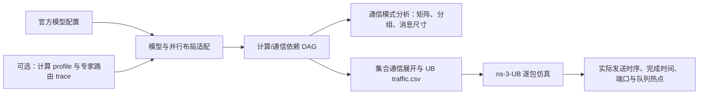

# Kimi K3 / GLM-5.2 训练与推理通信仿真方案

日期：2026-09-10。状态：已执行首轮六个 64-rank 合成 EP 通信窗口；后续规模扩展、MTP 对比及完整模型部署实验未执行。

执行结果见 [仿真结果入口](仿真结果.md) 和 [完整报告](ns-3-ub/scratch/20260910-kimi-k3-glm52-ep64/report.md)。以下保留原始设计提案；最终实现假设、冻结配置、执行矩阵和限制以实验包中的 `experiment-plan.md`、`matrix.yaml` 和结果报告为准。执行前版本另存于实验包 `inputs/original-proposal.md`。

目标是看清两种模型在指定并行部署下的通信矩阵、时间分布和网络热点，并逐步评估集群扩展性。以下规模和负载是建议的实验设计值，不代表厂商实际部署，也不是已验证的仿真性能。

## 1. 仿真规模：已知证据与建议范围

本地版本为 ns-3-ub `581bf28a`，工具子模块为 `2afc7202f88c132b63c38e8c7dcfc08505b13bb2`。本机只完成过官方双节点 smoke run；当前构建没有启用 MTP 或 MPI。

仓库 [Release 1.3.0 验证表](ns-3-ub/RELEASE_NOTES_UB.md) 给出过 1,024-host、32-leaf、32-spine Clos 的压缩路由测试。在该特定负载、关闭 trace 和 parse 的条件下，压缩版本 RSS 为 563.4 MB，run 阶段为 344.1 ms。这证明项目做过千端点规模测试，不能用来承诺千卡大模型训练也只需这些资源。没有找到对任意 workload 适用的最大集群规模保证。

| 层次 | 建议规模 | 处理方式 | 能得出的结论 |
|---|---:|---|---|
| 通信模式生成与分析 | 64～4,096 ranks 起步，可继续扩展 | 生成稀疏通信 DAG，按通信组聚合 | 谁与谁通信、逻辑字节数、并行组与依赖 |
| 首轮逐包仿真 | 64，随后 128/256 个端点 | 代表层、短窗口、有限 trace | UB 网络上的时延、拥塞和热点 |
| 千端点逐包验证 | 512、1,024 个端点 | 压缩路由、按需 TP、MTP | 对选定 workload 测出时间/内存/日志曲线 |
| 更大规模探索 | 2,048/4,096 个端点 | 先做成本预测，再考虑 MPI/hybrid 或缩短窗口 | 条件化可行性；不预先保证整 step 可跑完 |

本方案默认每个模拟 host 对应一个加速器通信 rank；一台服务器可以包含多个这样的端点。交换机节点另外计数。网络生成器的 host 数量不能直接当成物理服务器数量。

成本主要取决于通信任务数、有效载荷总量、MTU、路径跳数、拥塞/重传、DAG 和 trace。完整有向 All-to-All 在 1,024 ranks 上有 1,047,552 对端点，在 4,096 ranks 上有 16,773,120 对；实际 MoE 流量应按 EP 组及非零通信对生成，不必展开整个集群的全连接矩阵。

成本预估同时记录 `Σ ceil(flow_bytes / payload_per_packet)` 和按路径跳数累计的数据包处理量；它们只用于筛选规模，不能直接等同于引擎事件数或实际运行时间。

本机可见 120 个逻辑 CPU、约 1 TiB 总内存，检查时约 694 GiB available、工作盘约 55 GiB 剩余。这是共享机器的瞬时资源，不能全部视为专用额度。建议首轮单次使用最多 24 个 CPU 线程、128 GiB RSS、5 GiB 输出、30 分钟墙钟预算；这些是拟定的运行预算，不是耗时预测。超预算保留记录并缩小窗口，不自动展开更大任务。

## 2. 模型输入与真实性边界

| 模型结构 | Kimi K3 | GLM-5.2 |
|---|---|---|
| 主干层数 | 93 | 78 |
| 路由专家数 | 896 | 256 |
| 每 token 选择专家数 | 16 | 8 |
| 共享专家数 | 2 | 1 |
| 注意力特征 | 69 KDA + 24 Gated MLA；AttnRes；LatentMoE | 稀疏注意力；IndexShare；含 MTP 预测层 |
| 与载荷相关的维度 | attention hidden 7168；latent MoE 3584 | hidden 6144 |

架构数据来自 [Kimi K3 官方仓库](https://github.com/MoonshotAI/Kimi-K3)、[Kimi K3 官方配置](https://huggingface.co/moonshotai/Kimi-K3/blob/main/config.json)、[GLM-5.2 官方配置](https://huggingface.co/zai-org/GLM-5.2/blob/main/config.json) 和 [GLM-5.2 模型卡](https://huggingface.co/zai-org/GLM-5.2)。实施时保存所用配置的 revision 和摘要，避免 main 分支后续变化影响复现。

这些配置给出结构，没有唯一确定实际训练或在线服务的通信行为。还需要选择推理/训练框架、TP/EP/PP/DP/CP 的具体 rank 分组、专家放置、请求序列、token 路由、计算耗时和通信实现。

建立三种证据标签：

- `config-derived`：由公开架构、张量形状、明确的并行布局推导。
- `synthetic`：均匀、热点、时间相关的专家路由，以及假设的调度或计算时长。
- `trace-calibrated`：用目标部署的通信/路由 trace 和计算 profile 校准。

第一版是前两类；只有接入目标部署实测数据后才称为该部署的校准结果。官方 API 调用不会暴露服务端 GPU 间通信，不能作为内部网络 trace。

不需要下载完整模型权重即可开展结构推导和 UB 仿真；模拟端点也不要求同等数量的实际 GPU。要报告真实吞吐量、TTFT、TPOT 或训练 step 时间，则需要额外校准计算、调度和显存约束。

## 3. 技术路线

先在逻辑层看通信需求，再在网络层看这些需求经过排队、流控和路径选择后的表现。逻辑矩阵可从输入 DAG 得到；网络热点必须由仿真 trace 或计数器给出。

项目已经提供 [SimAI Flow 转换流程](ns-3-ub/scratch/ns-3-ub-tools/traffic_maker/SIMAI_FLOW_WORKFLOW.md)。可选路径为 AICB/自定义 workload → SimAI MockNCCL FlowModels → JSONL → `simai_flow_to_traffic.py` → UB。

该路径有几个需要显式处理的条件：

1. SimAI 必须具有 `AS_FLOW_EXPORT` 支持；本次尚未安装或验证 SimAI。
2. 转换器接收逐 flow 的 JSONL，不能把 AICB 高层 workload 文本直接当作输入。
3. 默认按 DAG 层聚合 phase，且串行化 successive collectives；这会影响并发和流水线。需要精确依赖时使用逐 flow phase，并补齐跨 collective、跨层、计算节点的依赖。仅打开允许 overlap 的开关也不能自动恢复真实调度。
4. NVLS/NVSwitch 伪端点不能直接映射为普通主机。使用 UB 替代互联时明确重新选择集合通信实现；需要复现真实 NVLink/NVSwitch 时，应另建对应后端或经验证的抽象模型。
5. AICB 可作为 workload 生成参考，但其[官方说明](https://github.com/aliyun/aicb)列出了模型与后端兼容范围，也注明部分线性注意力训练生成限制。不能假设已原生支持 K3 和 GLM-5.2 的完整行为。优先实现两个明确的模型适配器；复杂 MoE 动态 All-to-All-v 可直接展开成 UB tasks。

阶段依赖表示通信完成后才能发起后续操作，保留计算节点及其经过校准或标注的延迟。不能把所有任务的 delay 设为零，也不能给每层添加无依据的全局 barrier。最早、最晚时间的窗口图若尚未校准计算，标记为合成调度示意。

## 4. 推理 workload

将 prefill、decode、可选 prefill/decode 分离部署分别建模。

| 场景 | 建议扫描 | 必须保留的通信 |
|---|---|---|
| Prefill | 输入 4K、32K、128K tokens；首轮用较小 chunk | 层内 TP/SP 集合通信、MoE dispatch/combine；启用 CP 才加入对应上下文通信 |
| Decode | 服务实例活跃请求 1、8、32、128；采样连续 32 个输出步 | 每步逐层通信、实际 rank token 分布、专家路由的时间相关性 |
| P/D 分离 | 第二轮再加，固定 prefill/decode 两侧放置 | 请求交接与 KV/状态传输，按模型和引擎实际格式计算 |

输出先报告每个阶段的通信字节、message size、peer 数、通信时间和热点。没有计算/服务调度校准时，不把这些直接命名为真实 TTFT/TPOT。

K3 的 KDA 状态与 Gated MLA cache 要分开计算，不能给所有层套普通 MHA 的 KV-cache 公式。GLM-5.2 的 IndexShare 和 MTP 需要与实现一致；第一轮明确关闭 speculative decoding，第二轮才比较带接受率记录的开启情况。K3 的 latent 投影发生在 dispatch 前还是后，将决定实际传输宽度，应在模型适配中核实。

## 5. 训练 workload

第一轮定义为文本预训练式 forward/backward/optimizer workload；SFT、RL rollout 和多模态训练是后续独立场景。

按顺序扩展：一个代表 MoE 层的前后向 → 连续数层和多个 microbatches → 一个完整训练 step → 少量稳态 step。

必须包含：

- EP：前向 dispatch/combine 与反向对应传输，依据数据类型和路由分别计算。
- TP/SP：由具体算子分片产生的 AllReduce、AllGather、ReduceScatter 等；不能假定每层固定次数适用于两个模型。
- PP：stage 间 activation 和 gradient P2P、microbatch 调度、warmup/steady/cooldown。
- DP/分片优化器：区分 dense/shared/expert 参数的同步组，按 bucket 建模梯度归约、参数收集和重叠；不能用“激活参数量”替代全部参数的存储/优化器成本。
- CP：仅在启用时加入对应算法。KDA、MLA、稀疏注意力不能共用未经验证的通信模板。
- 重计算和 offload：默认关闭；需要时作为独立实验变量加入。

并行布局输出明确的 rank→GPU→服务器→超节点映射和每个 communicator 成员表。EP 与其他维度的关系按框架实际 process groups 处理，不盲目将所有并行度相乘。

模拟完整部署前，另做显存可行性检查：权重、梯度、优化器状态、激活、KV/递归状态、通信 buffer、复制与分片。64-rank 的代表层实验不意味着完整 K3 能在任意 64 张卡上训练。

## 6. MoE 路由与通信量

对每层、每个 microbatch/decode step 生成实际源 rank 到目标 rank 的 token 发送计数，固定随机种子。比较：均匀路由、轻度热点、重度热点；有真实路由 trace 时替换合成分布，并保留跨步相关性。

每个 rank 对的实际载荷以 `发送记录数 × 实际发送维度 × 通信元素字节数 + 元数据` 计算。发送记录数按所选实现统计，明确同一 token 命中同一目标 GPU/服务器多个专家时是否去重；dispatch/combine 分别计算，排除本地专家产生的非网络传输。

K3 的 top-16 与 GLM 的 top-8 不直接意味着前者网络流量为两倍。latent 投影、目标设备合并、专家布局、跨超节点占比、shared experts 放置和精度都会改变结果。模型权重量化精度也不等于网络激活精度。[DeepEP 官方说明](https://github.com/deepseek-ai/DeepEP)给出了 dispatch/combine 使用不同精度的实例，可作为适配通信实现的参考，不能当成两款模型真实部署的默认值。

## 7. 首轮实验与后续对比

尚未收到目标硬件信息，暂以单个 64-rank UB 超节点为首轮模式实验，随后扩到 128/256。此处所有配置均为提案。

首轮核心 case：两个模型 × 三个窗口（prefill 代表层、decode 代表层连续 32 步、训练代表层前后向）。EP=64、每 rank 为一个 UB host：K3 每 rank 放 14 个路由专家，GLM 每 rank 放 4 个。先隔离 EP pattern，TP/PP/CP 设为 1，不宣称这是完整模型的推荐部署。

用于验证生成器的受控局部负载：prefill/训练代表层每源 rank 256 tokens；decode 每源 rank 1 token。均匀路由、种子 1、不丢 token，BF16 作为明确的通信假设。该局部负载只用于等 token 条件下的模式对比；服务请求 batch 必须在后续完整布局中按实际分片/复制关系映射，不能直接等同于每 rank token 数。

建议网络 baseline：64 host、8 leaf、8 spine 的两层 Clos；每条链路 400 Gbit/s、传播时延 20 ns；最短路径 ECMP，默认 UB 协议参数从运行时 catalog 完整解析并记录。这是合成对照网络，不代表某款硬件参数。128/256 规模扩展时显式重算交换机端口数和上行容量。

| 实验块 | 唯一主要变化 | 固定控制 | 预期与可否定信号 |
|---|---|---|---|
| 路由偏斜 | 均匀→热点 | 模型、tokens、布局、网络、精度 | 预期热点端点负载增加；若无增加，核查路由映射与合并，时延是否增加交由仿真判断 |
| 专家放置 | 同一组路由的不同物理放置 | 专家选择、token 数、拓扑资源 | 预期局部性更高时跨组字节减少；若热点抵消收益，结论可为无加速 |
| EP 范围 | 小通信组→跨更多端点 | 总 tokens、模型、目标显存条件 | 比较远端比例和完成时间，不预设 EP 越大越好 |
| 网络容量 | baseline→更高/更低链路容量 | 同一 DAG、布局、路由、队列配置 | 带宽受限阶段应受益；小消息或计算受限阶段收益可很小 |
| 拓扑 | Clos→二维 FullMesh | 同一 DAG、端点注入上限、明确的端口/总带宽预算 | 判断改变连接方式是否改善热点；资源不等价时标为系统配置对比 |

K3 与 GLM 的模型间比较同时改变多个架构因素，属于系统级对比；不能据此把差异归因于 top-k 单个参数。先提供同 token/同网络资源的受控比较，再提供各自可部署配置比较，分别说明问题和边界。

第一轮避免模型、规模、长度、batch、拓扑、并行度全笛卡尔积。先完成六个核心窗口；只对观察到的问题展开一个变量。随机工作负载的正式结论至少使用 3 个固定种子；单种子只作调试证据。

## 8. 可视化交付

1. **源 rank × 目标 rank 字节热力图**：按 EP/TP/PP/DP/CP 和层分开，可聚合到服务器、超节点；同时标出逻辑需求与仿真完成量。
2. **时间 × rank 活动图**：展示 prefill/decode 或 forward/backward/同步的突发、重叠与等待。使用统一时间窗口，不能拿全程平均掩盖瞬时峰值。
3. **专家负载与 fan-out 分布**：展示哪些专家/设备吸收了大部分 token，区分逻辑专家负载和跨网络载荷。
4. **消息尺寸分布与通信组成**：按操作和阶段统计，观察小消息频率、总字节、跨超节点比例。
5. **拓扑热点图**：按仿真端口 Tx/Rx 时间序列与队列采样着色，展示真正拥塞的位置。
6. **规模成本图**：端点数/任务数/包量与墙钟时间、RSS、trace 字节的关系，给出当前机器的实测可运行范围。

项目现有 `task_statistics.csv` 是逐任务统计，`throughput.csv` 是逐端口方向统计；后者不能直接当成训练或推理吞吐量。时间图和窗口利用率需新增分析脚本或计数器，利用率要与相同口径的配置端口速率比较。CSV 未保留的模型层、microbatch、collective、通信组等元数据写入以 taskId 关联的 sidecar 文件。

最终输出可交互 HTML 报告及可导出的 CSV/SVG/PNG；每图链接到数据和 case 配置。尚未执行前不生成冒充测量结果的示例图。

## 9. 验证、资源与实施顺序

**步骤 A：确定与冻结输入。** 保存模型配置来源；确定目标是 UB 超节点方案评估还是复现已有 GPU 网络；绑定 rank 分组、专家布局和负载。对未知计算时间和路由用明确假设。

**步骤 B：验证 workload 生成。** 检查每个 collective 的参与者、字节守恒、DAG 无环、非零任务、实际 rank 映射与本地传输消除。用单层可手算结果校验；不对全模型按层数简单乘时延。

**步骤 C：64-rank 窗口仿真。** 使用压缩路由和按需 TP，先单线程基准，再启用 MTP 比较同一 workload 的结果与加速。依赖可见延迟保持可比，默认不加改变突发性的 timing offset。记录完整执行命令、退出码、配置、线程数和种子。

**步骤 D：128/256→512/1,024 成本爬坡。** 同时做固定总 tokens 与固定每 rank tokens 两种独立扩展实验。大 case 以任务统计为主，端口/队列 trace 限定代表窗口；如果现有开关只有全局粒度，则明确需要补充采样能力，而不是声称已有。缺少端口证据的 case 不报告端口热点。

**步骤 E：训练 step 与服务实例扩展。** 接入可靠的计算 profile 和并行调度，必要时用 MPI/hybrid。网络完成时间可以反馈后续任务，计算资源排队、动态 batching 等若超出现有 CSV 表达能力，需要扩展调度层或协同仿真，不能把离线时间回放称为完整闭环服务仿真。

建议正式实验使用 `continue_full_matrix`：预期不匹配仍保留并继续已定义且有效的同规模对比；无效 workload、结果缺失或资源超预算停止对应块。每一级成本验证合格才进入下一规模；不因某个结果与预测不同而删掉该结果。

执行前再将已确认方案落实为仓库规定的 `experiment-plan.md`、`matrix.yaml`、`command-manifest.yaml`、`run-ledger.md` 和每个 case 的 spec。当前文件是可审阅的方案，不是已批准的执行矩阵。

## 10. 第一项待定信息

优先明确：先做单个 64～256 卡超节点，还是直接面向 1,024～4,096 卡跨超节点集群？如有真实目标硬件，给出每服务器/超节点卡数、卡间及跨节点互联即可；后续据此细化带宽、端口、并行映射和显存检查。
