# 8. 完整案例：DeepSeek V4.1 Flash 1017，16卡与MPU部署

## 8.1 部署方式介绍

本案例选择 TP4 × DP16、全局EP64、专家内部TP=1、PP=1，配2个MPU。每卡4个Die构成一个TP组，公共层的集合通信留在卡内；热专家权重与KV留在本地HBM，约202.76GB的Engram表分片放到MPU。Batch=64，每个公共层DP组承接4个token，上下文长度32768。

这是“探索共享内存池”的合理起点，不是本次最低时延方案，也不是宣称全局最优。18个对照/敏感性实验表明：TP4优于本次测试的TP1和TP8，但16卡完全有容量把Engram放在本地。本地方案更快；选择MPU是用额外访问延迟换取HBM容量释放和共享池能力。若单模型低时延是唯一目标，本例应优先保留本地Engram。

本节实测窗口包含：一个代表MoE块、均摊到该块的公共计算与KV访存、每token的完整Engram查表，两次连续decode步骤。它不是40层完整推理，不是TPOT或TTFT，不能把窗口除以2或乘以40解释成真实模型测速。 完整模型参数仅用于容量与解析预算。

本章统一采用事件唤醒、1 ps全局精度、1 ns请求产生/重试及DAG通知；XPU/MPU端口单向接入各400 ns；IO Die尽力拼包（不拼包对照除外）；MPU按256 B AXI事务流水，128个在途槽位、200 ns可重叠访问延迟、内部带宽FIFO，单向有效带宽190 GB/s（效率1.0）；HBM采用公平共享。MPU带宽×2实验已取消，其他敏感性对照保留。


MPU的128槽位对应128条256 B事务；仅按200 ns延迟计算的覆盖上界为163.84 GB/s，仍低于190 GB/s有效服务带宽；实际还受数据服务、请求到达及网络依赖限制。


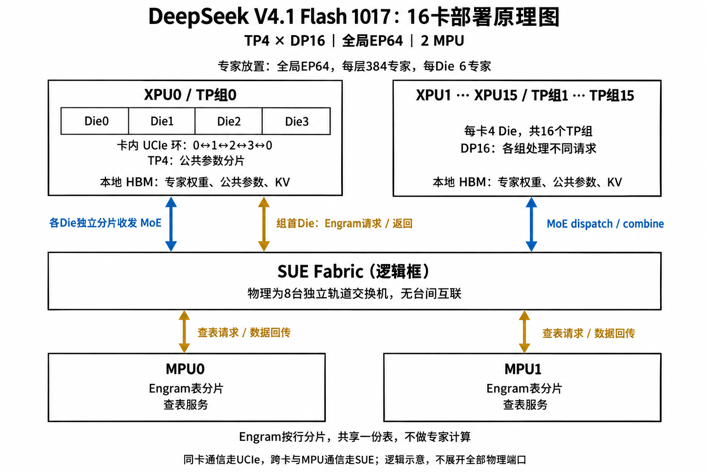

- **上方计算卡框**：左侧展开XPU0，右侧用XPU1…15表示其余15张卡；全系统一共64个Die/rank，不是16张卡合成一个TP组。
- **左侧展开的一张卡**：Die0↔Die1↔Die2↔Die3↔Die0形成双向UCIe环。每张卡是一个TP4组；公共参数分成4份，16个组各有完整的一套公共参数。
- **蓝色路径**：MoE激活由活跃TP组的4个Die分片发出，跨卡走SUE，同卡走UCIe；目标专家计算完成后，把结果分片返回各源Die。本例64个Die均实际发送了跨卡dispatch/combine流量，但不代表每个端口持续跑满。
- **中间SUE Fabric逻辑框**：抽象表示8台独立轨道交换机，并非单台交换机或互联总线；各轨之间没有交换机级联，图中不展开物理端口。
- **金色路径**：Engram查询由每个TP组的首Die聚合，经SUE请求MPU；MPU服务完成后，经SUE把查表结果送回首Die的HBM。这是当前Engram简化布局，与MoE的全Die分片收发不同。
- **底部2个MPU**：按行均衡放置两张Engram表的数据，各承担约101.38GB。不是一台一张表，也不是双副本、主备或容错镜像。每个MPU的190GB/s规格是单向带宽，不应再因方向折半。本轮`mpu_efficiency=1.0`，模型中的单向有效服务带宽为190GB/s，不再施加0.5折扣。

## 8.2 完整并行策略与具体映射

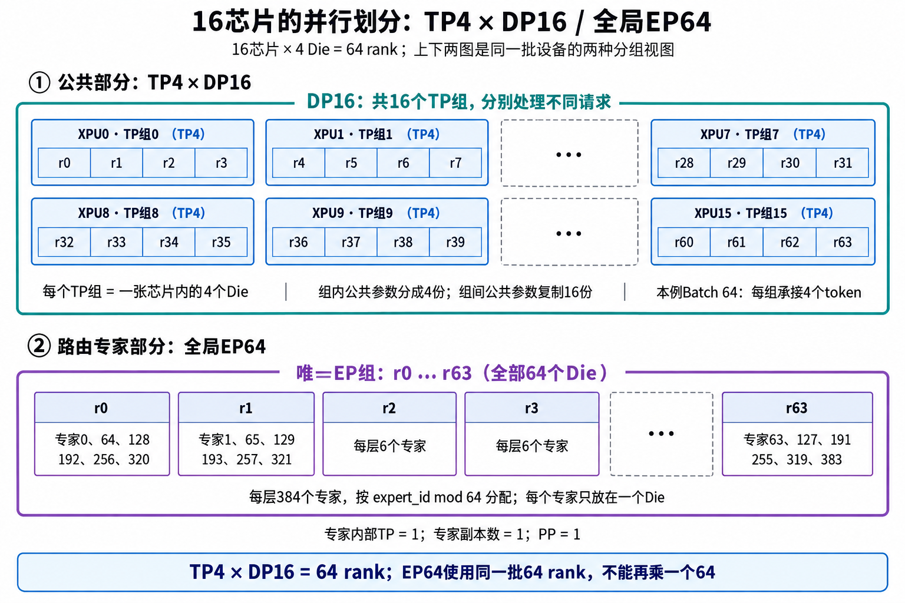

部署示意图与本节并行分组图展示的是同一批64个Die。蓝框是卡内TP组，绿色范围表示公共部分的16个DP副本，紫框是覆盖所有Die的唯一全局EP组。省略框代表未展开的组或rank，不是额外设备。图由内置GPT Image生成，[提示词](images/deepseek-16chip-parallel-prompt.txt)随文档保存。

| 项目 | 本例配置 | 含义 |
|---|---|---|
| 芯片 / Die | 16 / 64 | 每Die一个rank，`r=4×chip+die` |
| 公共部分TP | 4 | TP组g为rank `4g…4g+3`，恰好一张卡 |
| 公共部分DP | 16 | 16套公共参数副本；不同组接收不同token |
| 专家EP | 64 | 所有64个Die组成一个全局专家组 |
| 专家副本数 | 1 | 每层384个路由专家各只有一个owner |
| 每Die专家数 | 每层6个 | `owner(expert)=expert_id mod 64` |
| 专家内部TP | 1 | 一个专家的GEMM在一个Die上执行 |
| PP | 1 | 没有流水线stage切分 |
| Top-K | 6 | 每token选择6个专家；合成均匀采样 |
| MoE收发 | tp-striped | 全部TP rank按特征维度分片收发 |
| token分配 | round_robin | token t交给公共组 `t mod 16` |
| 跨步专家复用 | 0.75 | 以0.75概率沿用该token上一步的专家集合 |

例如公共组3就是XPU3，使用rank12、13、14、15，承接token3、19、35、51。rank12的专家ID为12、76、140、204、268、332；每一层都按这个规则放置。专家可以接收来自任意一个公共DP组的token，不被限制在本卡。

## 8.3 数据放在哪里：完整容量账本

本例使用已冻结的[官方HF配置](https://huggingface.co/deepseek-ai/DeepSeek-V4.1-Flash-1017/blob/1bae0e1088993b9b82de08f59de5be5a34e42170/config.json)与独立`simulation.json`假设，文本部分40层、384专家、Top-K6、hidden=5120、专家中间维度2304；视觉、DSpark/MTP不执行。

以下为十进制GB。每Die物理36GB，预留20%之后可分配预算28.8GB。

| 数据 | 放置规则 | 每Die占用 | 全部16卡 / 远端占用 |
|---|---|---:|---:|
| 路由专家权重 | 全局EP64，每Die每层6专家，FP4平均0.53125B/参数 | 4.512GB | 本地288.778GB |
| 公共矩阵与embedding/head | 每卡一套、TP4切分；公共FP8，embedding/head按2B预留 | 2.540GB | 本地162.584GB |
| 64条32K上下文KV | 容量按64个Die均衡分片 | 0.110GB | 本地7.046GB |
| Engram两张表 | 跨2个MPU按行分片，一份全局表 | 0 | 远端202.758GB，约101.379GB/MPU |
| 本地合计 | 上述本地三项 | **7.163GB** | **458.409GB** |
| 无MPU、Engram也在本地 | Engram额外按Die均衡分片 | **10.331GB** | **661.167GB** |

因此远置Engram释放本地202.758GB，即每卡约12.672GB、每Die约3.168GB。16卡总物理容量2304GB、扣预留后1843.2GB，两种方案都能放下；MPU不是本例“能跑起来”的必要条件。2个MPU总容量1024GB，平均只用约19.8%；选择2个是当前入口支持的最小非零MPU数，并能分摊服务队列。单个512GB节点在纯容量上也能装下，但普通硬件CLI不支持1个MPU，本章部署实验未做单节点对照；第9章卸载专用入口支持1个MPU且有独立结果。

KV容量均衡放置与运行时TP组KV读取仍是抽象模型：没有逐KV页映射和跨组取页事务。本地Engram也按容量均衡，但访问直接记到组首Die的HBM，未逐行模拟从其他Die取数据。因此无MPU对照有乐观成分；表中差值不能当作真实系统确定的延迟罚时。公共参数量来自显式估算，不是逐tensor权重清单。

### 为什么远置Engram，而不远置热专家

Engram容量大，但每token只返回`2张表×3种n-gram×8个头=48`行，每行`256+8=264B`，合计12,672B。这里没有把整张202.76GB表拉回XPU。

一个专家的一层权重为`3×5120×2304×0.53125=18,800,640B`，约18.8MB，适合留在高带宽HBM；若每次使用都从MPU流式拉取，会把小规模激活通信变成大规模权重搬运。本例专家远置比例为0，MPU不执行专家GEMM，也不充当专家流量中转。

## 8.4 实际运行结果：TP4是本次对照中的合适起点

所有条件都使用同样的模型、16卡、batch64、32K上下文、2步、全局EP64以及逻辑专家采样规则。表中窗口为完整两步代表块窗口，取seed1/2/3均值；范围是这3次的min–max，不是置信区间。

| 部署 | 两步窗口均值（μs） | 三种子范围（μs） | 本地全模型容量（GB） | 远端容量（GB） |
|---|---:|---:|---:|---:|
| TP4 × DP16，Engram本地 | **189.402** | 188.147–190.465 | 661.17 | 0.00 |
| TP4 × DP16，2MPU | **203.638** | 202.602–205.095 | 458.41 | 202.76 |
| TP4 × DP16，4MPU | **198.802** | 198.122–199.181 | 458.41 | 202.76 |
| TP1 × DP64，2MPU | **352.029** | 351.141–353.260 | 946.16 | 202.76 |
| TP8 × DP8，2MPU | **295.671** | 294.070–297.743 | 377.12 | 202.76 |

当前结果支持：TP4比TP8的两步窗口短31.13%；2MPU相对本地Engram增加7.52%时延，但释放202.76GB HBM；4MPU相对2MPU缩短2.37%。增加MPU的收益与容量投入需要分别比较，不能将有限对照称为全局最优。

实际验收目录：`results/sue/full-rerun-20261030-unified/deepseek/`，18例全部完成。本节图表由本轮重新执行的输入和统计生成。本轮统一了事件唤醒、精度、MPU并发与有效带宽，不把与旧结果的差异单独归因于某一个参数。

## 8.5 一步到底传了什么

### 公共计算与TP通信

每个组有4个token。4个Die分别执行公共计算和读取其分片参数/KV，计算队列与HBM队列允许重叠，两者完成后做卡内AllReduce。随后公共激活在TP组中复制，每个Die负责其中一段特征去发MoE。

### MoE dispatch、专家计算、combine

每个token选择6个专家；5120维FP16激活拆成4片，每片1280维，消息记录为`1280×2+8=2568B`。同一source/owner组合会聚合多条记录。专家owner等待需要的分片到达，再执行一次该专家计算与权重读取，结果分片返回源TP组各Die；各Die做Top-K结果求和，最后执行卡内AllGather。

一个token每个方向的逻辑分片字节合计为`6×4×2568=61,632B`。但这不是SUE线速计费字节：同Die无需传输，同卡走UCIe，跨卡才进入SUE；报头、确认与控制流另计。本例seed1的dispatch和combine均有64个活跃跨卡发送Die，证据见`moe_die_traffic.csv`。

### Engram请求与返回

每组首Die处理4个token，即192行；2MPU均分为每节点96行。

- DAG记账的请求有效载荷：`64+96×8=832B`；不是当前AXI线上报文大小。
- 每个MPU的返回：`96×264=25,344B`。
- 每组向每个MPU读取25,344B，拆为99条256B AXI读请求；16组并发，每个MPU每步服务1,584条AXI请求。AR记录22B、R记录302B（含各自字段与记录头），尽力拼包后再加包头和SUE开销，实际线上字节见io_packets.csv和io_wire.csv。
- 全网每步返回`64×12,672=811,008B`，约0.811MB；两步为1,622,016B。

路径为“组首Die → SUE请求事务 → MPU队列/服务 → SUE数据回传事务 → 本地HBM写入”。每条AR到达MPU即进入内存流水，完成后即可返回对应R，不等待整批AR到达；整组R收齐后写HBM，消费者再继续。没有把约202.76GB总容量当成每步传输量。

当前实现没有模拟Engram回传数据随后在TP组内的完整算子分发，也没有跨步热点缓存或预取；查表由组首Die集中发起。这限制了结论的外推范围，不能将该实现直接当作真实推理框架的最佳Engram布局。

### IO Die如何把AXI事务拼成SUE报文

当前实现采用**端口发送机会驱动的尽力拼包**：发送机会到来时，只合并队列里已经就绪且满足匹配条件的事务，不设置等待凑满包的定时器。拼包位于XPU／MPU的IO Die适配器，发生在进入SUE设备发送队列之前；AFH、LLR和CBFC仍由底层SUE实现。这套规则也是理解§8.7–8.8报文数量、包长与包率的基础。

**事务单元与字节预算。** 数据按256 B拆分；不足256 B的尾事务仍按完整事务计费，有效业务字节单独统计。AW和W假设同时就绪，直接形成不可拆开的AW＋W单元，没有独立模拟两个通道的到达差。

| 可拼单元 | 内容 | 默认单元大小（含8 B记录头） | 8192 B载荷上限内最多单元数 | 此时包载荷 |
|---|---|---:|---:|---:|
| AW＋W | 写地址、256 B数据及W字段 | 312 B | 26 | 8116 B |
| AR | 读地址及请求字段 | 22 B | 372 | 8188 B |
| B | 写响应字段 | 11 B | 744 | 8188 B |
| R | 256 B读数据及响应字段 | 302 B | 27 | 8158 B |

每包另加4 B封装头，即`载荷 = 4 + 单元数 × 单元大小`，上限默认8192 B；SUE头及底层链路开销另计。短包补齐到至少64 B的MAC帧预算。表中是积攒足够多匹配单元时的理论上限，不是实际平均包长。这些是本模型的序列化预算，AXI标准本身不规定这样的网络封装格式，字段明细见[IO Die模型文档](io-die-model.md)。

**队列与匹配条件。** 每个`(源芯片, 源Die, 源端口)`有一条共享的待封装队列，默认容量4096个单元；不同目的地、VC和类别可以混排。不是每目的地或每VC各有4096个位置。只有以下各项全部相同才允许合包：源芯片、源Die、源端口、目的芯片、最终目的Die、目的侧代理Die、VC、单元类别。

AW＋W只与完整AW＋W合并；AR只拼AR，B只拼B，R只拼R。可以跨任务拼包，不要求事务编号相同；“同目的ID”指目的节点SA，不是AXI事务ID。当前不检查地址是否连续，也不会把多个AXI请求融合成一个内存请求。

**选择算法：队首决定类型，向后扫描匹配项。** 实现可表示为：

```text
first = 端口队首单元
selected = []
bytes = 4 B封装头
逐个扫描当前端口队列：
    如果与first的目的地、代理Die、VC或类别不匹配：跳过
    如果加入后超过载荷上限：停止扫描
    否则：选入本包，累加字节
    如果mode=none：选入一个后立即停止
检查SUE设备队列能否接收本包
    可以：提交，并从IO队列删除所选单元
    不可以：保留单元，等待后续机会重新选择
```

例如，队列依次是`①AR→MPU0、②AR→MPU1、③AR→MPU0、④R→MPU0、⑤AR→MPU0`，其他匹配条件相同，则第一次可把①③⑤合包，留下②④；下一次由②决定本包类型。算法允许越过不匹配项，但不统计“哪个目的地积攒最多”，也没有按业务类别加权仲裁。不同类别的等待时间受入队顺序和匹配项数量影响。

`mode=none`每个单元单独封包，AW＋W仍在同一个包中；它与完全不启用IO Die层不同。开启或关闭拼包只改变网络封装粒度，不改变256 B事务服务单位。

**封包时机与端口节流。** 空闲端口收到第一个单元后，在当前仿真时刻安排封包事件，不主动等未来请求。每次成功提交一包后，保留下一个封包机会，即使此时队列已经空了，后到请求也不能绕过该间隔：

```text
下一次封包机会间隔(ns)
  = max(1, ceil((MAC帧字节数 + 8 B) × 8 × 10^9 / 端口bit/s))
```

在200 Gbit/s端口上，64 B MAC帧加8 B的时间为2.88 ns，该处取整到3 ns；约8 KiB帧的间隔约328 ns。此处当前仍向上取整到整数ns，即使全局采用ps精度也一样。它约束适配器封包提交机会；实际上线时间还取决于SUE设备排队、信用、仲裁和控制报文，不能把该公式当作完整网络时延。

请求产生速率默认是**每个任务每1 ns一个单元**，不是整个Die每1 ns一个。多个任务可同时入队。稀疏流量往往一到就发，拼不起来；持续流量在相邻发送机会之间自然积攒，能够合包；拥塞也可能使积攒更多、包更大。因此拼包率提高不一定意味着性能提高，也可能表示排队加重。

**两层背压与事件唤醒。** IO待封装队列满时，生产者不能继续入队；当前实现将其挂起，队列释放空间后按原重试时间间隔约束唤醒，不再每1 ns执行无效重试。SUE设备出口队列无空间时，候选单元留在IO队列，等待设备空间释放通知。失败的候选包不会被冻结：下一次会重新扫描，新到的匹配单元也可能加入。成功进入设备队列的包则不再拆开重新合并。

事件唤醒保持1 ns请求和重试间隔约束，但同时间戳事件顺序可能变化，进而影响拼包与排队，不是逐事件等价。历史冻结案例仍按各自二进制运行；此处说明当前实现，不据此改写已有实验结果。新旧配对证据见[IO调度优化验证](io-wakeup.html)。

**MPU返回使用同一算法。** AR包到达MPU后解包为独立事务，每条分别进入内存流水线；哪条完成，就产生对应R并进入MPU发送端口队列，随后按相同规则尽力拼包。不等待同批全部完成，一个AR包和一个R包也不要求一一对应。写向MPU的AW＋W在对应内存服务完成后产生B，B再独立拼包；B是事务级写响应，不是LLR链路确认。返回使用原请求对应端口，不为了凑包更换端口。

```text
XPU：业务 → 256 B事务 → 端口队列 → 尽力拼包 → SUE网络
MPU：接收解包 → 独立内存事务流水 → R/B就绪 → 端口队列
      → 尽力拼包 → SUE网络 → XPU接收与事务匹配
```

**实现边界与结果读取。** 扫描队列、比较目的ID、封装记录在一次仿真回调中完成，尚未为比较器数量、扫描深度或封装数据搬运增加硬件处理周期。当前也不完整模拟AXI地址、ID复用和乱序约束；待返回的结果不能入IO队列时，会等待入队，尚未因此继续占住MPU内存槽位。模型适合研究拼包对包数、字节效率、排队和网络负载的影响，不能直接证明真实IO Die能达到某个封包频率。

可用`io_records.csv`查看每个单元的类型、任务和时间，用`io_packets.csv`查看实际包长和所含单元编号，用`io_wire.csv`核对链路发送事件；平均拼包率是单元数除以封装包数，不包含把LLR重传误算成新增事务。配置入口为`configs/hardware/io-die/best-effort.json`与`configs/hardware/io-die/no-packing.json`，生成案例保存自己的`io-die.json`快照。核心选择逻辑位于`sue-io-die-model.h`的`IoMatch`和`IoFlush`，队列准入由`IoEnqueue`处理。

## 8.6 通信热力图、链路负载与拥塞观测

本节重新运行16卡、TP4×DP16、EP64、2MPU、B64、32K上下文、两步代表块，保留种子1/2/3及seed1关闭采样控制组。采用本轮§8.4相同配置；三种子时序与对应部署案例一致，seed1开关采样的任务、端口、环与资源统计逐字节一致。

**[打开交互通信看板](communication/report.html)** · [下载原始通信证据](communication/communication-evidence.zip) · [指标CSV](communication/metrics.csv) · [图表校验记录](communication/verification.json)

### 本例首先能看出什么

| 指标 | seed1 | seed2 | seed3 |
|---|---:|---:|---:|
| 两步代表块窗口（μs） | 203.218 | 205.095 | 202.602 |
| 完成的网络任务数 | 4752 | 4744 | 4984 |
| 交换机出口最大队列快照（KiB） | 15.642 | 12.533 | 17.837 |
| 交换机发送侧最大信用占用（%） | 23.047 | 21.289 | 24.219 |
| 最忙端点全窗口忙碌率（%） | 5.383 | 5.340 | 4.219 |
| 信用不足检查次数 | 0 | 0 | 0 |
| 重传帧 | 0 | 0 | 0 |
| 丢弃 | 0 | 0 | 0 |
| MPU等待事务数峰值（采样） | 1456.000 | 1456.000 | 1456.000 |
| 最忙Die的HBM忙碌率（%） | 84.911 | 84.138 | 84.930 |
| 最忙Die的计算忙碌率（%） | 5.934 | 6.007 | 5.952 |

这些数字支持一个更具体的判断：**该case存在短暂网络排队和流量热点，但没有证据表明CBFC信用耗尽或链路饱和是主瓶颈；MPU服务队列和HBM服务更值得关注。** 不能为了让拥塞图“更热”而改变输入制造拥塞。各图颜色范围会随种子自动变化，比较种子时应看色条和数值，不只比较深浅。

交换机出口快照并非设备全部缓存：它不含正在上线的帧、独立控制/重传队列，以及可能尚未获准进入出口队列的上游pending帧。500ns采样会漏过更短峰值，因此“最大队列/信用快照”是采样值；只有累计失败计数等事件统计不受这一采样间隔漏峰的影响。本例无PFC，不能拿CBFC信用图称作PFC暂停时长图。

### 图8.6-1：卡间通信矩阵

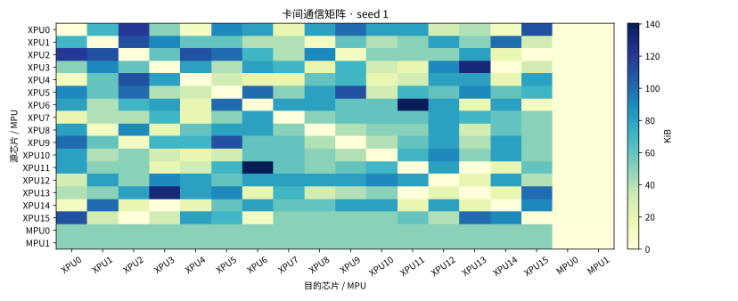

**怎么测：**逐任务网络有效载荷按源/目的芯片汇总；包含MoE及Engram请求/返回，不含本地UCIe及协议控制帧。颜色是字节数，不是带宽。

**怎么看：**检查MoE是否分布到多张卡，以及MPU的集中读服务方向。矩阵不包含等待时间，不能单凭颜色判断拥塞。

**本次观察：**seed1累计交付16,199,872B任务有效载荷。此矩阵保留DAG逻辑字节口径；AXI记录、尾部填充、协议和控制开销不在其中，不能当作线速字节。

### 图8.6-2：Die间MoE dispatch矩阵

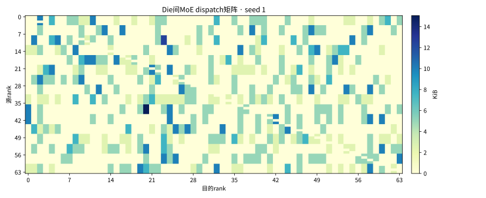

**怎么测：**只选dispatch任务；跨卡任务取bytes，同卡UCIe取resource.units与peer_die；同Die直接使用不计搬运字节。

**怎么看：**64个发送Die分散工作，矩阵每4行/列对应一张卡。专家热点和TP特征分片共同决定矩阵；不能把一格当一条物理链路。

**本次观察：**同一TP4组的4个Die发送相同token-expert集合的不同特征片，形成4行一组的结构；这不是四份完整激活。

### 图8.6-3：端点发送端口忙碌率

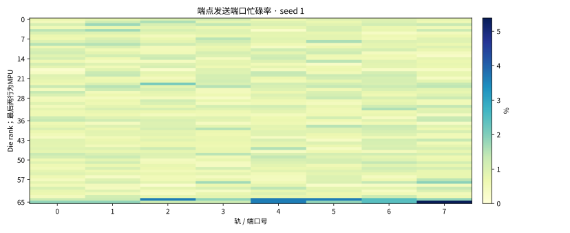

**怎么测：**host侧tx_busy_ps / 仿真结束时间，统计从0开始，含首次注入前1μs及控制帧；不含IFG等空闲时间。

**怎么看：**看同一Die的8轨是否均匀。平均忙碌率低不代表没有短突发，也不是有效应用吞吐率。

**本次观察：**seed1最忙端点全窗口忙碌率为5.38%。此值包含控制帧，不代表MoE突发阶段的峰值。

### 图8.6-4：交换机出口随时间的平均忙碌率

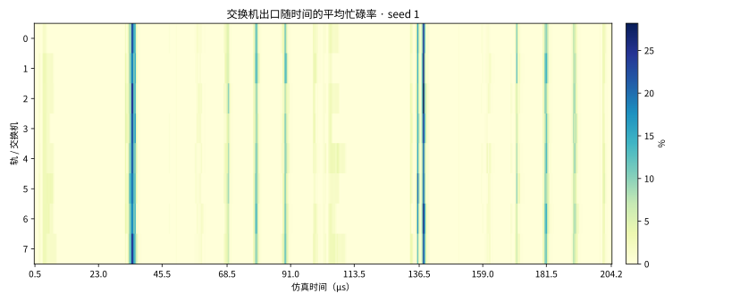

**怎么测：**相邻500ns快照累计tx_busy_ps之差除以真实区间长度，再平均同轨66个交换机出口；最后区间可能短于500ns。

**怎么看：**时间轴能看出Engram、公共处理和MoE产生的通信波段。66口平均会稀释单端口热点，须结合队列图。

**本次观察：**seed1最热采样区间的单轨66个出口平均忙碌率为28.16%；端口平均会稀释单口热点。

### 图8.6-5：交换机出口队列热点

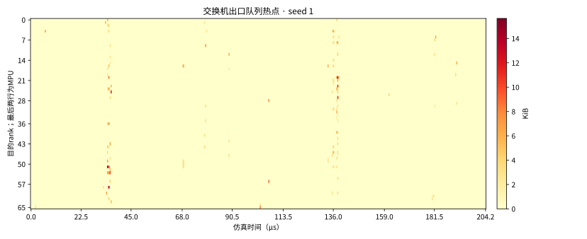

**怎么测：**500ns快照读取设备发送队列8个VC的字节总和；每目的Die在8个轨中取最大队列。不是交换机全部缓存，不含正在发送帧/重传控制队列或上游pending帧。

**怎么看：**可以定位微突发排队出现在哪个目的Die与时间。采样峰值是实际峰值下界，可能漏过短于500ns的尖峰。

**本次观察：**seed1出口队列采样峰值15.64KiB，seed3为17.84KiB。短队列峰值不能独自解释整个任务图的完成时长。

### 图8.6-6：CBFC信用占用快照

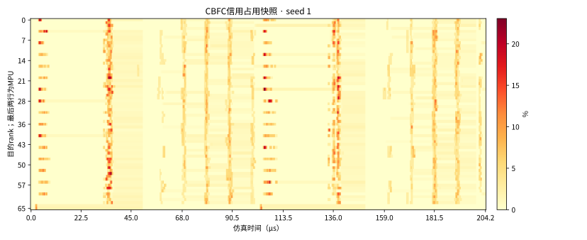

**怎么测：**交换机发送侧CU/CL；对每设备8个VC取最大，再对目的Die的8轨取最大。读取getter，不调用会更新计数的CanSend。

**怎么看：**占用高表示在途信用多，并不自动等于阻塞。只有结合credit_exhausted等证据才判断信用门控；本例该失败检查计数为0。

**本次观察：**seed1交换机侧最大采样信用占用为23.05%；三个种子的信用不足检查、重传及丢弃均为0。当前证据不支持将窗口延迟归因于信用耗尽。

### 图8.6-7：网络任务完成时延分布

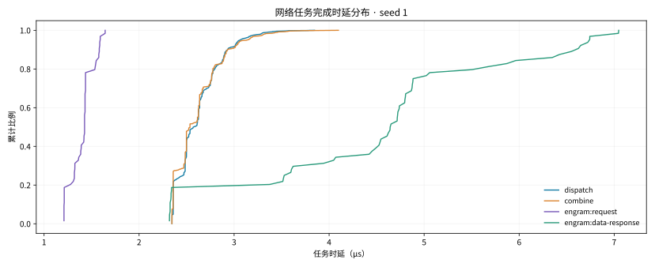

**怎么测：**各网络任务(end_ps-start_ps)/1e6，分dispatch、combine、Engram请求和回传；包含适配器事务确认，不是单包传播时延。

**怎么看：**比较方向与阶段的尾部；不同阶段消息大小不同，不能单凭CDF给协议排名。零字节计算/资源任务不纳入。

**本次观察：**seed1的P50/P99：dispatch 2.572/3.352 μs；combine 2.535/3.458 μs；engram:request 1.426/1.643 μs；engram:data-response 4.643/7.048 μs。纵轴是聚合任务完成分布。AXI模式中AR/R与内存服务流水重叠，R聚合任务从首条R就绪计时，等待后续R的时间也包含在内；不能把它当作一次纯网络trip。

### 图8.6-8：消息大小与完成时延

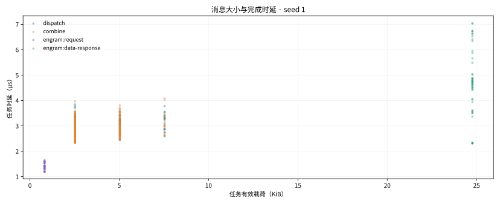

**怎么测：**每点一个网络任务，横轴逻辑有效载荷，纵轴事务完成时延；颜色按四个阶段区分。

**怎么看：**相近大小但时延不同，提示排队、路径与同步背景不同；同一任务可能分片，不能把散点数当包数。

**本次观察：**一个点代表一个逻辑消息任务，可能对应多条256B AXI和多个SUE包；点数不等于报文数。

### 图8.6-9：专家owner负载分布

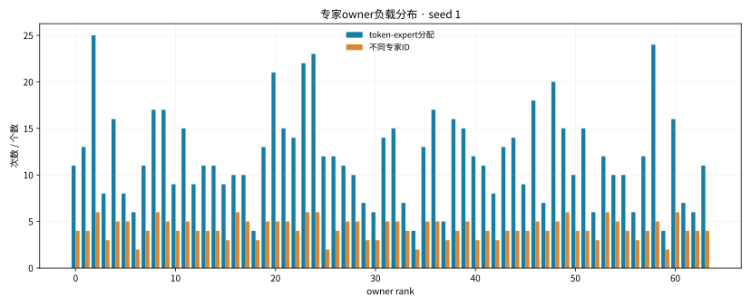

**怎么测：**token_routes.csv逐条(token,expert)分配计数，合并两步；同时展示两步内不同专家ID数量。专家复用概率0.75，不是独立同分布两步。

**怎么看：**检查合成路由负载是否均匀；不是所有Die计算量必然一样，Expert数相同也不保证token命中均匀。

**本次观察：**seed1各owner的token-expert分配数为4～25，平均12；跨步复用概率0.75使热点可能延续。

### 图8.6-10：UCIe有向边流量

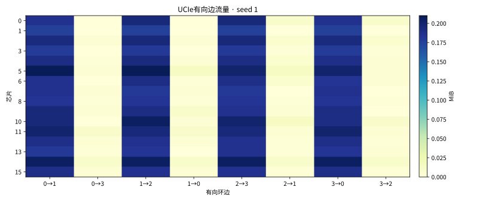

**怎么测：**ring_statistics.csv的bytes；每次经过一条边计一次，含TP集合通信及卡内MoE搬运。两跳会被计两次。

**怎么看：**方向不对称来自ring算法及任务路径，不等同于链路缺失。不能与应用端到端字节直接求和。

**本次观察：**逐跳累计包含卡内TP集合通信及MoE搬运；两个UCIe跳会计两次，不能与端到端有效载荷直接相加。

### 图8.6-11：计算与HBM资源忙碌率

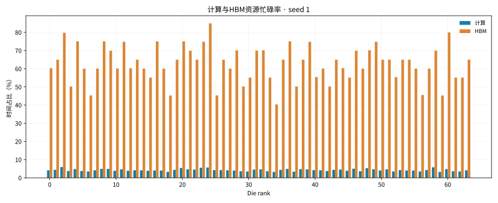

**怎么测：**计算服务时间之和及HBM非空服务区间并集分别除以仿真结束时间；HBM取hbm_dies.csv的busy_ps，多个源并发不重复累加。

**怎么看：**用于把算力空闲、HBM服务与网络活动区分。当前这是行为模型的资源占用，不是硬件GPU profiler实测。

**本次观察：**seed1最忙Die的HBM占用84.91%，计算占用5.93%。HBM按非空服务区间并集计时，多源并发不重复累加；忙碌不代表全部带宽均已用满；两项最大值未必来自同一Die。

### 图8.6-12：MPU内存事务的等待数量

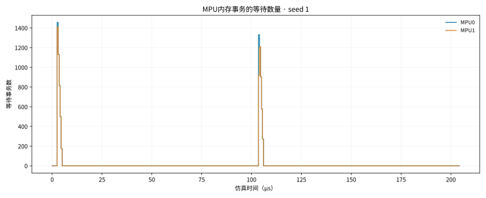

**怎么测：**逐AXI请求按[submitted_ps,bandwidth_start_ps)统计，包含等待准入、200ns访问延迟及等待带宽；500ns采样，不含已经开始带宽服务的事务。

**怎么看：**这是MPU内存服务队列，不是SUE交换机队列。两者对照可解释网络并不拥塞但远程读取仍慢。

**本次观察：**seed1最多1456条AXI等待进入带宽服务，包含等待内存槽位及200ns访问延迟，不只是带宽FIFO排队。128是已准入的在途上限；节点外等待准入的请求可超过128。此图不能再按旧的聚合任务数量解释。

### 如何复现与扩展

以下单次命令使用本章相同的1 ps精度、128槽位与190 GB/s配置并开启观测。逐字节复现还须使用记录的代码和二进制版本；后面的脚本可重放冻结案例：

```bash
bin/sue run \
  --hardware docs/manual/examples/deepseek16-hardware.json \
  --io-die-profile configs/hardware/io-die/best-effort.json \
  --hbm-profile configs/hardware/hbm/fair-share.json \
  --model-config configs/models/deepseek-v4.1-flash-1017/config.json \
  --parallel configs/parallel/deepseek-16chip-tp4-ep64.json \
  --chips 16 --mpus 2 --engram-remote \
  --batch 64 --context 32768 --steps 2 --seed 1 \
  --port-sample-ns 500 \
  --output results/sue/deepseek16-observed-repeat
```

默认`--port-sample-ns 0`关闭观测；开启时必须为不小于100ns的整数。更细采样增加输出量，且当前按所有端口采样，不宜直接在大规模长时间场景中使用极细间隔。发生代码更新时先运行`bin/sue build`。

完整复现本节的三个种子与关闭采样控制组：

```bash
SUE_HARDWARE_JSON="$PWD/docs/manual/examples/deepseek16-hardware.json" \
SUE_IO_DIE_PROFILE="$PWD/configs/hardware/io-die/best-effort.json" \
python3 simulators/sue/harness/v2/run_communication_case.py \
  results/sue/full-rerun-20261030-unified/deepseek \
  results/sue/deepseek16-communication-repeat

# 可视化依赖 matplotlib、numpy、plotly；它们只用于分析，不参与仿真。
python3 simulators/sue/harness/v2/communication_report.py \
  results/sue/deepseek16-communication-repeat
```

输出包含`report/report.html`、`report/metrics.csv`、12组SVG/PNG、图表数据及证据压缩包。当前完整记录在`results/sue/full-rerun-20261030-unified/communication/`。证据包包含三个种子的原始`port_timeseries.csv`、逐任务/端口/资源/UCIe统计、输入和运行manifest；没有把旧结果覆盖成新结果。

若后续要研究“更拥塞”的条件，应另建有明确变量的实验，例如提高batch、缩小信用窗口、热点专家路由或共享MPU的更多并发请求，并固定其他条件。当前图表已经能揭示这些变量带来的变化，但本节没有把压力实验与原始case混在一起。

<!-- BEGIN VC PACKING EXPERIMENTS -->
## 8.7 实验一：部分KV卸载与三个VC的信用需求

**本节与第8、9章其余主实验使用同一基准重新运行**：事件唤醒、1 ps全局精度、1 ns请求/依赖通知、每MPU 128条在途、单向有效带宽190 GB/s。拼包开关及VC分流是本节的对照变量。

本实验沿用§8.6的16卡、TP4×DP16、EP64、2MPU、B64、32K上下文和两步代表块；新增**25% KV静态驻留MPU、75%留在本地HBM**，按均匀访问假设取同样的读取比例。每个Die的远程读取量向下对齐256B，按256KiB块轮转分布到两个MPU。该配置释放约1.762 GB完整KV驻留容量；容量与两步实际传输量分别计量。

远程KV走AR→MPU流水服务→R→本地HBM写入→HBM消费，消费者等待完成。本地75%仍计入公共HBM读取。没有PCIe KV路径；本例不包含KV新token写回、动态换入换出和预取，也不是完整模型TPOT。Engram采用本章原有集中读取/写入DAG。TP4的Attention AllReduce与Output AllGather仍走卡内UCIe，不进入下表的SUE流量。

| 业务 | VC | 承载的AXI通道 |
|---|---|---|
| MoE dispatch与combine | VC0 | AW＋W、B；combine是另一笔写事务 |
| KV读取 | VC1 | AR、R |
| Engram查表 | VC2 | AR、R |

请求和响应使用同一业务VC，IO Die不会跨VC、AXI通道或目的端拼包。VC3–7没有业务数据。各VC仍配置512个信用单位，每单位256B；本实验测量需求，没有将信用预先按流量占比重新分配。LLR/CBFC控制消息走独立控制队列，不归到某一业务VC。

### 业务占比与报文数量

以下为seed1开启拼包结果。有效数据仅累加AW＋W中的有效业务数据与R返回数据；不将AR的逻辑请求描述大小当成KV数据。线上字节包含MAC帧和8B preamble，排除IFG与独立控制消息。所有数据帧在**交换机出口只计一次**，避免两个链路重复累计。

| 业务 / VC | 有效数据 B（占比） | 线上数据帧字节 B（占比） | 帧数（占比） | 累计信用单位（占比） |
|---|---|---|---|---|
| MoE / VC0 | 14,524,608（17.99%） | 20,216,941（19.24%） | 13,681（27.33%） | 86,080（20.42%） |
| KV / VC1 | 64,585,728（80.00%） | 82,746,544（78.75%） | 34,493（68.91%） | 326,582（77.46%） |
| Engram / VC2 | 1,622,016（2.01%） | 2,108,736（2.01%） | 1,881（3.76%） | 8,945（2.12%） |

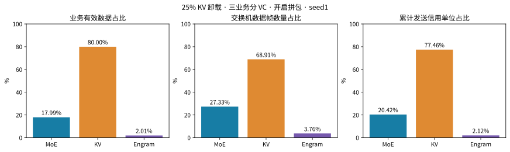

### 各种报文有多长、多少个

AXI记录是模型封装，包含配置的字段和8B记录头；它不是以太网帧。每个网络包另有4B封装头、17B SUE/MAC头，MAC最小填充到64B，线上再加8B preamble。实际MAC长度为`max(64, 17 + 4 + 记录数 × 单记录长度)`；当前模型没有在此之外额外计入FCS，数字应按模型口径使用。

| 业务 | AXI通道 | 单记录 B | 记录数 | 拼包后帧数 | MAC长度 min / P50 / P95 / max B | 平均记录/帧 |
|---|---|---|---|---|---|---|
| Engram | AR | 22 | 6,336 | 939 | 64 / 175 / 241 / 1275 | 6.75 |
| Engram | R | 302 | 6,336 | 942 | 323 / 1229 / 8175 / 8175 | 6.73 |
| KV | AR | 22 | 252,288 | 22,464 | 64 / 241 / 241 / 8205 | 11.23 |
| KV | R | 302 | 252,288 | 12,029 | 323 / 8175 / 8175 / 8175 | 20.97 |
| MoE | AW_W | 312 | 61,184 | 6,841 | 333 / 3141 / 6261 / 8133 | 8.94 |
| MoE | B | 11 | 61,184 | 6,840 | 64 / 131 / 241 / 307 | 8.95 |

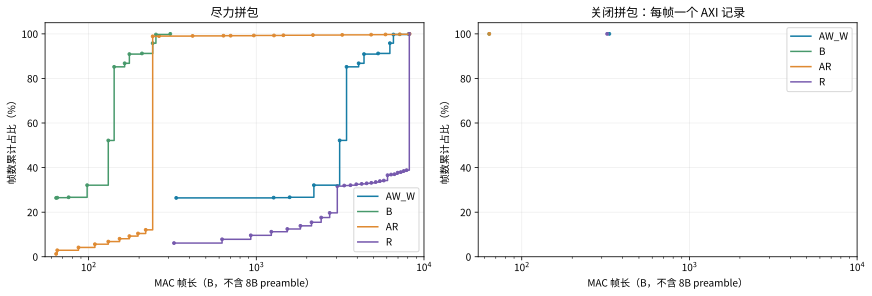

完整离散长度直方图、逐业务/通道数量以及dispatch/combine分项保存在[指标JSON](vc-packing/metrics.json)与[seed1长度计数CSV](vc-packing/seed1-best_effort/packet-lengths.csv)。每个长度的出现次数都保留，没有只保留均值。

### 如何用于CBFC信用分配

当前计费公式是`max(1, ceil(MAC帧长 / 256))`，PktOvhd=0，8B preamble不计入信用。上表“累计信用”是整个窗口反复消耗并归还的总量，**不是同时在途的信用窗口**。小包每帧至少占1个单位，因此字节占比、包数占比与信用消耗占比不同。

下表取开启拼包的三个种子最大值：信用占用CU与出口队列为500ns被动采样，可能漏过更短峰值；“两侧”包含端点发送侧与交换机发送侧，每一格都是某个实际端口/VC的最大值，不是全网CU之和。信用不足检查次数来自累计计数器。

| 业务 / VC | 最大单帧信用 | 两侧最忙端口峰值 | 交换机侧峰值 | 队列峰值 KiB | 信用不足检查次数 |
|---|---|---|---|---|---|
| MoE / VC0 | 32 | 133 | 104 | 14.99 | 0 |
| KV / VC1 | 33 | 373 | 165 | 128.00 | 0 |
| Engram / VC2 | 32 | 149 | 117 | 10.33 | 0 |

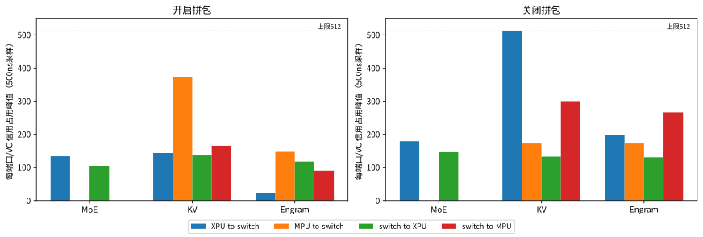

**KV占主要流量，但不能按总字节比例把Engram信用压得很小。** Engram的集中请求突发也需要独立窗口；其访问阶段、单帧大小和CF返回等待与平均流量占比不同。信用是逐端口、逐方向、逐VC的接收缓冲承诺：XPU侧与MPU侧应分别看[逐端口证据](vc-packing/seed1-best_effort/vc-ports.csv)，不能把8台交换机合计比例直接当成每个端口的分配比例。

开启拼包的三种子累计信用不足检查为0，512/VC的均分配置在这些条件下未暴露信用耗尽。关闭拼包则不同：

| 业务 / VC | 关拼包信用占用峰值 | 关拼包信用不足检查（三种子合计） |
|---|---|---|
| MoE / VC0 | 179 | 0 |
| KV / VC1 | 512 | 172,167 |
| Engram / VC2 | 266 | 0 |

关拼包三种子累计发生172,167次信用不足检查，KV出现信用窗口耗尽，但最终全部交付，六例均无重传和丢弃。检查次数不是丢包数、阻塞包数或阻塞时长；同一帧可以被检查多次。信用需求依赖拼包模式，因此两种模式必须分别评估。可用“最大单帧信用”和“实测CU峰值”作为缩小窗口的初筛依据，并为采样漏峰和突发留余量；不能将采样峰值直接认定为安全最小值。最终分配比例仍需在固定接收缓冲总预算下扫描各VC窗口，并复核完成时间、CU及阻塞。本次提供评估输入，不宣称已经找到最优比例。

## 8.8 业务流量对交换机转发包率的需求

当前IO Die采用**发送机会驱动的尽力拼包（`best_effort`）**：将已经就绪、可以一起发送的AXI事务记录合并为一个SUE数据帧。拼包位于端点IO发送队列与SUE设备出口队列之间，XPU请求和MPU返回均使用这套规则。

1. **事务入队。** 业务数据按256 B AXI事务拆分，写请求的AW＋W作为一个完整单元，读请求AR、写响应B、读响应R各自形成记录；每个源物理端口维护一个待封装队列。
2. **按队首确定拼包类别。** 每次封装以队首记录为基准，按入队顺序扫描当前队列，只选择源物理端口、目的`chip.die`、目的侧代理Die、VC和AXI通道类别均相同的记录。扫描时跳过不兼容记录，因此可以合并队列中不相邻的兼容记录；事务ID用于响应匹配，不要求相同，也允许跨任务合并。AW＋W只与AW＋W拼，AR、B、R分别同类合并。
3. **达到载荷上限即停止。** 本例每帧适配器载荷上限为8192 B，包含4 B封装头及各条记录的字段、数据和8 B记录头。下一条兼容记录放不下时结束本帧；外层再添加SUE/MAC头，短帧补齐到64 B MAC长度。
4. **有发送机会就提交。** 不等待未来请求，也没有等待凑满的定时器；当前只有一条记录时也会发送。出口队列无法接收时保留记录并重试；提交成功后移除所选记录，按帧长度和端口线速安排下一次封装机会。已经进入设备出口队列的帧不再重新合并，实际出线仍受SUE队列和CBFC信用约束。每端口待封装队列最多4096条记录，满时向事务生产者施加背压。

例如，同一发送机会下已有10条兼容AR记录，每条22 B，合并后的适配器载荷为`4 + 10 × 22 = 224 B`，加17 B SUE/MAC头和8 B preamble后为249 B线上数据帧。关闭拼包时，这10条AR各自形成72 B线上帧，共720 B、10次包转发。实际能拼入多少条取决于发送机会到来时的队列积累，不保证每帧装满。

使用§8.7同一份三业务、三VC输入，seed1/2/3分别做尽力拼包与关闭拼包对照。成对的任务、资源工作量、专家路由、HBM配置、AXI记录数和有效数据量一致，IO配置只改变`mode`。**关闭拼包仍保留256B AXI事务和全部通道，一个记录单独成帧**；开启拼包则在发送机会到来时合并兼容的已排队记录，没有等待凑满定时器。

### 包率的定义与结果

包率只统计交换机出口实际开始发送的业务数据帧，AW＋W、B、AR、R都计入。全窗口均值为`帧数 / 仿真结束时间`，包含最初1μs初始化和计算/内存空闲区间；“两步窗口”列扣除了最初1μs。峰值使用从0开始对齐的完整500ns桶，尾部不足500ns的桶不参与峰值。合计是8台交换机相加；不是单台交换机包率。

| seed | 拼包 | 两步窗口 μs | 交换机转发帧数 | 8交换机合计 Mpps | 合计峰值 Mpps（500ns） | 最忙单口峰值 Mpps（500ns） | 信用不足检查 |
|---|---|---|---|---|---|---|---|
| 1 | 开 | 441.825 | 50,055 | 113.036 | 1802 | 144 | 0 |
| 1 | 关 | 472.211 | 639,616 | 1351.652 | 5934 | 334 | 53,919 |
| 2 | 开 | 459.408 | 50,528 | 109.746 | 1646 | 122 | 0 |
| 2 | 关 | 506.657 | 640,080 | 1260.851 | 6054 | 334 | 59,258 |
| 3 | 开 | 496.286 | 51,098 | 102.754 | 1676 | 132 | 0 |
| 3 | 关 | 545.761 | 640,400 | 1171.262 | 5972 | 334 | 58,990 |

seed1开启拼包把帧数从639,616降为50,055，减少**92.17%**；对应线上数据帧字节减少18.86%。关闭拼包的包率更高，表示同一业务需要更多次包转发，并不表示应用完成得更快。两组任务有资源竞争和反馈，不能假定所有包的注入时刻相同。

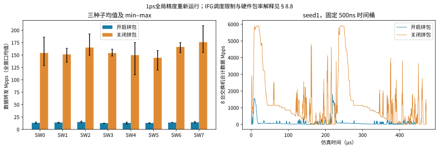

### 小包线时与帧间隔审计

**线时审计：**200Gb/s下72B线上帧为2880ps、331B为13240ps、341B为13640ps，9B控制发送为360ps；原先截断到整数ns的问题已消除。12B IFG的配置时长是480ps，但原有队列由空转非空时仍可能绕过待完成的IFG定时器。本轮seed1关闭拼包在交换机出口观察到的“72B帧结束到下一数据帧开始”最小间隔为10ps，其中28,551个间隔短于480ps；[逐例线时审计](vc-packing/line-time-audit.json)保存原始计数。**这些结果仍受该既有调度限制影响，不应作为严格以太网IFG约束下的硬件极限。**该既有机制保持不变；本轮不是严格IFG实现的性能验证。

### 每台交换机的包率（seed1）

每台交换机接66个端口（64个XPU Die端口＋2个MPU端口），下表为这些出口之和。完整三种子数据可从[汇总CSV](vc-packing/summary.csv)及对应种子的`switch-rates.csv`读取。

| 交换机 | 开拼包帧数 | 关拼包帧数 | 开拼包均值 Mpps | 关拼包均值 Mpps | 开/关峰值 Mpps（500ns） |
|---|---|---|---|---|---|
| SW0 | 6,644 | 88,132 | 15.004 | 186.243 | 232 / 790 |
| SW1 | 6,274 | 77,388 | 14.168 | 163.538 | 258 / 800 |
| SW2 | 7,442 | 91,120 | 16.806 | 192.557 | 252 / 738 |
| SW3 | 5,675 | 70,064 | 12.815 | 148.061 | 238 / 740 |
| SW4 | 6,170 | 77,606 | 13.933 | 163.999 | 246 / 740 |
| SW5 | 5,923 | 75,256 | 13.375 | 159.033 | 230 / 840 |
| SW6 | 6,035 | 82,848 | 13.628 | 175.076 | 230 / 780 |
| SW7 | 5,892 | 77,202 | 13.305 | 163.145 | 222 / 786 |

### 关闭拼包后的小包结构

| AXI通道 | 记录长度 B | 不拼包 MAC长度 B | 线上长度 B | 每帧信用单位 |
|---|---|---|---|---|
| AR | 22 | 64 | 72 | 1 |
| R | 302 | 323 | 331 | 2 |
| AW_W | 312 | 333 | 341 | 2 |
| B | 11 | 64 | 72 | 1 |

seed1关闭拼包的线上平均数据帧长度为202.46 B，开启时为2099.14 B。B和AR短记录单独发送时都填充到64B MAC帧，即72B线上帧，但仍各占1个信用单位。拼包对包率和信用取整开销的作用应同时考察。

种子1开拼包另观测到交换机侧9B控制发送424,513次、64B控制发送2,112次；关拼包分别为460,439和2,112次。它们包含本地LLR/CBFC信令，不能混入数据交换转发pps，控制消息的模型线时也应与MAC数据帧区分。

这里测到的是**该工作负载要求的实际转发包率**。当前交换机具有链路串行化、队列、固定转发预算及CBFC，但未设置独立ASIC包处理能力上限，因此不能由本实验宣称某颗交换芯片的最大硬件Mpps。

### 复现与验收

两组共6例，加上同一原始DAG的ps精度基线和采样关闭对照，共8例。所有案例均验证为ps精度，使用同一二进制；基线任务、资源输入及任务时间戳与本轮通信案例逐字节一致。seed1开关采样的任务/端口/UCIe/资源四类统计逐字节一致。逐包分析校验每记录交付一次、每帧两跳各出现一次、各端口帧数/字节守恒、VC映射与CU范围，以及配对AXI记录/有效数据量一致。

[运行计划](vc-packing/registered-plan.json) · [运行验收](vc-packing/run-verification.json) · [统计验收](vc-packing/verification.json) · [图表、CSV与复现脚本下载](vc-packing/evidence.zip)

```bash
python3 simulators/sue/harness/v2/vc_packet_study.py \
  results/sue/full-rerun-20261030-unified/communication \
  results/sue/vc-packing-repeat --time-resolution-ns 0
python3 simulators/sue/harness/v2/analyze_vc_packet_study.py \
  results/sue/vc-packing-repeat results/sue/vc-packing-repeat/analysis
```

原始运行目录为`/data/scale_up_evaluation-full-rerun-20261030-unified/vc-packing`。每例保留输入、命令/二进制哈希和原始CSV；大文件为无损gzip。下载包包含汇总、完整帧长计数、逐端口VC与包率统计及证据哈希，原始逐事务大文件保留在运行目录中。
<!-- END VC PACKING EXPERIMENTS -->

## 8.9 可以直接复制的运行命令

以下命令均从工作区根目录`/home/dell/scale_up_evaluation`运行。硬件示例与本章一致：128槽位、190 GB/s有效带宽，新案例默认1 ps与事件唤醒；精确复现需核对二进制与输入哈希。输出目录必须是新目录；下面使用`-repeat`后缀，避免覆盖已经完成的验收案例。

### 示例A：16卡、TP4、EP64、2MPU，Engram远置

并行配置文件已经提供：`configs/parallel/deepseek-16chip-tp4-ep64.json`。

```json
{
  "schema_version": 1,
  "name": "deepseek-16chip-tp4-ep64",
  "tp": 4,
  "dp": 16,
  "ep": 64,
  "expert_tp": 1,
  "pp": 1,
  "moe_transport": "tp-striped",
  "expert_placement": "round_robin",
  "token_assignment": "round_robin",
  "decode_expert_reuse_probability": 0.75
}
```

```bash
# 先校验模型、硬件、并行分组。check不执行逐包仿真，也不替代完整容量准入。
bin/sue check \
  --hardware docs/manual/examples/deepseek16-hardware.json \
  --model-config configs/models/deepseek-v4.1-flash-1017/config.json \
  --model-simulation configs/models/deepseek-v4.1-flash-1017/simulation.json \
  --parallel configs/parallel/deepseek-16chip-tp4-ep64.json \
  --chips 16 --mpus 2 --engram-remote \
  --batch 64 --context 32768

# 首次使用或后端尚未构建时执行
bin/sue build

# 真正执行容量准入、任务生成、SUE逐包仿真和统计分析
bin/sue run \
  --hardware docs/manual/examples/deepseek16-hardware.json \
  --io-die-profile configs/hardware/io-die/best-effort.json \
  --hbm-profile configs/hardware/hbm/fair-share.json \
  --model-config configs/models/deepseek-v4.1-flash-1017/config.json \
  --model-simulation configs/models/deepseek-v4.1-flash-1017/simulation.json \
  --parallel configs/parallel/deepseek-16chip-tp4-ep64.json \
  --chips 16 --mpus 2 --engram-remote \
  --batch 64 --context 32768 --steps 2 --seed 1 \
  --output results/sue/deepseek16-tp4-ep64-mpu2-repeat
```

`--engram-remote`才会启用远程Engram；仅加`--mpus 2`只是添加节点，不会自动迁移数据。两个MPU的chip编号为16、17；图里的MPU0/MPU1是这两个内存节点的局部序号。

运行后先看根目录`results.json`中的`status`、`capacity.admitted`和`run`。`run`指向不可覆盖的时间戳快照，里面的模型/硬件/并行JSON、`tasks.json`、`resource_statistics.csv`、`task_statistics.csv`和`moe_die_traffic.csv`是证据。`capacity_rejected`表示未启动逐包实验，不是运行成功。

### 示例B：相同16卡、相同TP4，Engram留本地

```bash
bin/sue run \
  --hardware docs/manual/examples/deepseek16-hardware.json \
  --io-die-profile configs/hardware/io-die/best-effort.json \
  --hbm-profile configs/hardware/hbm/fair-share.json \
  --model-config configs/models/deepseek-v4.1-flash-1017/config.json \
  --parallel configs/parallel/deepseek-16chip-tp4-ep64.json \
  --chips 16 --mpus 0 \
  --batch 64 --context 32768 --steps 2 --seed 1 \
  --output results/sue/deepseek16-tp4-local-repeat
```

这里显式使用本章的128条并发硬件JSON。省略补充模型路径时自动读取同目录的`simulation.json`。

### 示例C：增加MPU或改变TP，保持总卡数不变

```bash
# 4MPU，表分为4片，并不是复制4份
bin/sue run \
  --hardware docs/manual/examples/deepseek16-hardware.json \
  --io-die-profile configs/hardware/io-die/best-effort.json \
  --hbm-profile configs/hardware/hbm/fair-share.json \
  --model-config configs/models/deepseek-v4.1-flash-1017/config.json \
  --parallel configs/parallel/deepseek-16chip-tp4-ep64.json \
  --chips 16 --mpus 4 --engram-remote \
  --batch 64 --context 32768 --steps 2 --seed 1 \
  --output results/sue/deepseek16-tp4-mpu4-repeat

# TP8跨两张卡。JSON中DP固定16，因此覆盖TP时必须同时改DP为8。
bin/sue run \
  --hardware docs/manual/examples/deepseek16-hardware.json \
  --io-die-profile configs/hardware/io-die/best-effort.json \
  --hbm-profile configs/hardware/hbm/fair-share.json \
  --model-config configs/models/deepseek-v4.1-flash-1017/config.json \
  --parallel configs/parallel/deepseek-16chip-tp4-ep64.json \
  --tp 8 --dp 8 --chips 16 --mpus 2 --engram-remote \
  --batch 64 --context 32768 --steps 2 --seed 1 \
  --output results/sue/deepseek16-tp8-mpu2-repeat
```

### 示例D：按当前精度重做整套对照和瓶颈诊断

该实验定义已转换为统一JSON，可直接运行：

```bash
bin/sue check --config configs/experiments/deepseek-16chip-study.json
bin/sue run --config configs/experiments/deepseek-16chip-study.json \
  --output results/sue/deepseek16-unified
```

共18个条件，IO/HBM配置及敏感性覆盖均在JSON内；不再需要额外环境变量。输出按统一入口的conditions目录组织，汇总为summary.csv/results.json。历史冻结结果及其报告目录保持原样；重跑通过统一入口保存新结果。


统一入口在执行前保存`experiment.json`、`expanded.json`和`validation.json`。5种部署×3种子=15例，另有HBM带宽、计算效率、Scale-Up带宽三项单变量敏感性案例（seed1），共18例；MPU带宽×2不执行。各条件的完整参数保存在`conditions/<条件名>/experiment.json`，不能只读顶层硬件文件而忽略条件覆盖。
