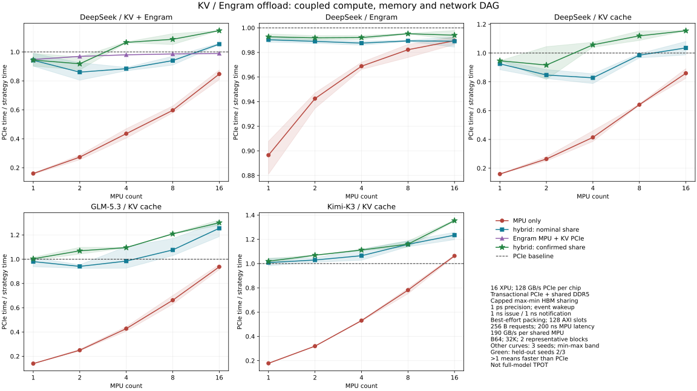

# 9. MPU与PCIe卸载对比

§9.1–9.8已使用事务级PCIe＋新的HBM带宽共享模型重新运行完整对比：固定16颗XPU，逐渐增加1/2/4/8/16个MPU，比较三种模型的KV cache、DeepSeek Engram及混合卸载。**PCIe基线、纯MPU、混合与分流确认曲线全部使用相同的PCIe与HBM配置；confirmed share在每个MPU数量下均实际测量，不由单点外推。** §9.9介绍模型机制及初始联动验证。

[独立交互报告](offload/report.html)保留工作负载筛选与下载；下文直接纳入主要图表、全部节点数对比、固定分流扫描和独立种子验证，离线手册无需联网阅读。

## 9.1 实验范围与统一配置

**结果版本：**本章330例采用同一冻结配置执行并补齐：事件唤醒、全局1 ps精度、任务注入/重试与依赖通知1 ns；XPU和MPU单向端口接入延迟各400 ns，交换机转发预算300 ns。IO Die启用尽力拼包，同端口、同目的SA、同VC、同事务类别合并；AW+W成对，AR/B/R各自合并。MPU以256 B AXI请求为并发单位，每节点128个在途槽位，200 ns访问延迟可重叠，带宽仍按FIFO逐周期分配。HBM采用公平共享。旧版结果独立保留，本章图表不混用历史基线。

共运行180个主对比条件、100个固定比例扫描条件，再运行50个独立种子确认条件，**330个最终结果全部通过，核验任务数与执行重试记录见9.8节**。

测量对象是带计算、HBM、TP/EP和卸载依赖的代表块，由仿真器从开始执行到最终任务完成；连续两个步骤的总窗口除以2，得到下文的“µs/代表块”。未包含完整逐层attention QK/AV、KV新增写回或prefill，**不是完整模型TPOT/TTFT，也不能乘层数当作整模型耗时**。每个代表块包含两张Engram表的完整查询，相关占比不能直接外推到全模型。

- 固定16颗XPU，每颗4个Die，PCIe端点单向128 GB/s；每8卡共享一个双路Host，每路CPU连接4卡。每Host 1 TB DDR，双路各12通道DDR5-6400。
- 每个MPU容量512 GB、单向190 GB/s，本轮`mpu_efficiency=1.0`；所有访问者共享该节点服务能力，不能把池带宽分配给每个XPU。
- 本轮所有MPU条件统一采用128条256 B AXI请求在途上限。仅按200 ns访问延迟计算，`128×256B/200ns=163.84 GB/s`仍低于190 GB/s；还需承担数据服务时间。覆盖190 GB/s的延迟至少约149个槽位（尚未计数据服务及其他开销），因此128槽位仍是有限并发配置，不能视为满带宽MPU。本轮不再混入64槽位对照。
- 固定八轨、八台256口交换机，使用明确的`hw-N-M`实验拓扑；增加MPU意味着增加节点和接入端口。
- Batch=64，上下文32768；GLM/DeepSeek固定TP4，Kimi因容量固定TP32，全部EP64。模型之间不能直接用耗时比较能力。
- HBM每Die有效总带宽1.875 TB/s；多个访问源按capped max-min共享，受限源用不完的份额重新分配。源内仍为FIFO；配置见[HBM JSON](examples/hbm-fair-share.json)。
- 主曲线使用seed1/2/3；同模型各方案配对token路由、计算量和读取字节。Kimi的KDA状态保留本地，只卸载MLA KV。
- KV先按256 KiB组织逻辑消息，再拆成256 B AXI；Engram按整行分配，同一目标MPU的行聚合后，按总返回字节拆成256 B AXI。后者尚不是逐行真实随机地址与对齐边界的AXI trace。使用确定性合成地址：KV连续DMA，Engram随机gather；不是实测文本热度或地址trace。

本章与第8章统一采用事件唤醒、1ps精度、1ns请求间隔、128条MPU在途和190GB/s有效服务带宽；第8章与第9章的数据放置及工作负载仍不同，不能直接混算加速比。

## 9.2 PCIe与MPU延时建模

| 延时组成 | PCIe路径 | MPU路径 |
| --- | --- | --- |
| DMA发起 | 每卡2引擎、64个驻留描述符；提交间隔100 ns、引擎启动200 ns | 每条AXI产生间隔1 ns；任务依赖通知1 ns |
| 事务并发 | MRRS 512 B、MPS 256 B；256 tags、256 KiB在途上限；有限信用 | 逐256 B AXI、尽力拼包、128个内存在途槽位，以及SUE的LLR/CBFC和发送队列 |
| 链路共享 | 单卡128 GB/s，每4卡共享512 GB/s NUMA上行，分方向排队 | 八轨200G端口，竞争交换机及端点链路 |
| 内存服务 | 每CPU理论614.4 GB/s，效率0.75，即460.8 GB/s；12通道队列、100 ns读取延时 | 每MPU单向190 GB/s、每AXI请求200 ns延迟，128槽位流水，带宽FIFO |
| 接收消费 | 每卡64 KiB接收缓冲，流水写HBM，写完释放缓冲；与专家等访问源共享HBM | 收齐消息后写HBM，再消费读取；写入源上限200 GB/s/Die，与其他源共享HBM |

MPU的128槽位只限制已准入的内存请求；尚未准入的AR可以在节点等待，当前没有把该等待队列容量耦合回SUE信用。已完成的内存结果等待网络发送时也不继续占用内存槽位。因此本轮不是完整的IO Die缓存/内存控制器背压模型。

本轮保留1ns全局网格以保证64→128槽位的单变量对照，因此小包序列化与亚纳秒IFG仍有量化误差；当前ps精度及设备空队列重新启动时的IFG限制见§8.8和IO说明。这轮对比不能当作严格PHY线时约束下的硬件性能证明。

上述非用户指定的事务参数是可修改的建模假设，不是硬件标定结果。配置见[PCIe JSON](examples/pcie-dual-socket-ddr5-6400.json)。事务级模型不包含PCIe PHY、真实DRAM时序及跨decode投机预取，完整边界见§9.9。

Host侧按NUMA存放KV分片及Engram副本，检查每CPU 500 GB容量。唯一数据集字节与Host物理复制容量不同；每例容量明细保存在results.json中。

## 9.3 分流策略与图例

- **MPU only**：全部卸载数据由MPU提供。
- **hybrid: nominal share**：按标称服务带宽分配，MPU比例为`190×M/(16×128+190×M)`，M为MPU数。8 MPU时约42.6%，是为对照而保留的预登记启发式，没有按共享DDR瓶颈或128个AXI槽位的吞吐上限重新优化；不是最优调度器。
- **hybrid: confirmed share**：对1/2/4/8/16 MPU分别用seed1从12.5%/25%/50%/75%和该节点数的nominal share中选最快比例，冻结后再用seed2/3验证。绿色曲线的25个点全部实测，无论是否加速均保留。“确认”不表示全局最优，也不保证在独立种子上优于nominal share。每个点的选定比例见§9.5。
- **Engram MPU + KV PCIe**：按数据类型分工，Engram全部放MPU，KV全部通过PCIe读取。

混合方案将互不重复的数据分片放在两个后端，请求并行执行，消费者等待两边都完成。速度比=PCIe基线平均耗时/当前方案平均耗时，**大于1才表示加速**。曲线阴影以同工作负载三种子PCIe均值作固定分子，分别除以方案最大/最小耗时得到范围，不是逐种子配对速度比范围，也不是置信区间；绿色确认曲线的分子和分母均仅使用确认种子2/3，阴影同样按该组最大/最小耗时计算。连线连接实测节点数，各点比例可能不同，不是同一固定比例的扩容曲线。



**读图结论（主曲线范围内）：**

- GLM-5.3 / KV cache：本次主曲线中最快混合点为16 MPU、230.781 µs，相对新PCIe基线延迟变化-20.33%。
- Kimi-K3 / KV cache：本次主曲线中最快混合点为16 MPU、664.563 µs，相对新PCIe基线延迟变化-19.00%。
- DeepSeek V4.1 Flash 1017 / KV cache：本次主曲线中最快混合点为16 MPU、152.500 µs，相对新PCIe基线延迟变化-3.44%。
- DeepSeek V4.1 Flash 1017 / Engram：本次主曲线中最快混合点为1 MPU、97.387 µs，相对新PCIe基线延迟变化+0.98%。
- DeepSeek V4.1 Flash 1017 / KV + Engram：本次主曲线中最快混合点为16 MPU、151.119 µs，相对新PCIe基线延迟变化-5.12%。

这些是有限节点数和固定启发式比例的扫描结果；候选比例的独立确认见§9.5，不代表全局最优。

## 9.4 逐渐增加MPU：全部主对比结果

以下均为µs/代表块、seed1/2/3均值。“混合”使用nominal share；调整比例后的结果另见9.5节。

### GLM-5.3：KV cache

PCIe基线 **289.657 µs**；全部卸载释放HBM约 **199.179 GB**。

| MPU数量 | 纯MPU µs | 纯MPU速度比 | 混合 µs | 混合速度比 | 混合MPU载荷% |
| --- | --- | --- | --- | --- | --- |
| 1 | 2073.897 | 0.140 | 295.551 | 0.980 | 8.490 |
| 2 | 1159.613 | 0.250 | 307.858 | 0.941 | 15.651 |
| 4 | 676.868 | 0.428 | 294.258 | 0.984 | 27.066 |
| 8 | 437.502 | 0.662 | 269.089 | 1.076 | 42.601 |
| 16 | 309.061 | 0.937 | 230.781 | 1.255 | 59.748 |

### Kimi-K3：KV cache

PCIe基线 **820.435 µs**；全部卸载释放HBM约 **57.982 GB**。

| MPU数量 | 纯MPU µs | 纯MPU速度比 | 混合 µs | 混合速度比 | 混合MPU载荷% |
| --- | --- | --- | --- | --- | --- |
| 1 | 4610.395 | 0.178 | 813.667 | 1.008 | 8.490 |
| 2 | 2568.330 | 0.319 | 796.827 | 1.030 | 15.651 |
| 4 | 1547.276 | 0.530 | 770.389 | 1.065 | 27.066 |
| 8 | 1049.967 | 0.781 | 707.863 | 1.159 | 42.601 |
| 16 | 771.458 | 1.063 | 664.563 | 1.235 | 59.748 |

### DeepSeek V4.1 Flash 1017：KV cache

PCIe基线 **157.941 µs**；全部卸载释放HBM约 **7.046 GB**。

| MPU数量 | 纯MPU µs | 纯MPU速度比 | 混合 µs | 混合速度比 | 混合MPU载荷% |
| --- | --- | --- | --- | --- | --- |
| 1 | 990.880 | 0.159 | 170.769 | 0.925 | 8.490 |
| 2 | 598.227 | 0.264 | 186.385 | 0.847 | 15.651 |
| 4 | 381.430 | 0.414 | 190.786 | 0.828 | 27.066 |
| 8 | 246.320 | 0.641 | 160.310 | 0.985 | 42.601 |
| 16 | 183.724 | 0.860 | 152.500 | 1.036 | 59.748 |

### DeepSeek V4.1 Flash 1017：Engram

PCIe基线 **96.442 µs**；全部卸载释放HBM约 **202.758 GB**。

| MPU数量 | 纯MPU µs | 纯MPU速度比 | 混合 µs | 混合速度比 | 混合MPU载荷% |
| --- | --- | --- | --- | --- | --- |
| 1 | 107.576 | 0.897 | 97.387 | 0.990 | 8.333 |
| 2 | 102.328 | 0.942 | 97.514 | 0.989 | 15.625 |
| 4 | 99.546 | 0.969 | 97.653 | 0.988 | 27.083 |
| 8 | 98.188 | 0.982 | 97.476 | 0.989 | 42.708 |
| 16 | 97.461 | 0.990 | 97.499 | 0.989 | 59.896 |

### DeepSeek V4.1 Flash 1017：KV + Engram

PCIe基线 **159.277 µs**；全部卸载释放HBM约 **209.804 GB**。

| MPU数量 | 纯MPU µs | 纯MPU速度比 | 混合 µs | 混合速度比 | 混合MPU载荷% |
| --- | --- | --- | --- | --- | --- |
| 1 | 995.589 | 0.160 | 169.039 | 0.942 | 8.489 |
| 2 | 582.947 | 0.273 | 185.152 | 0.860 | 15.651 |
| 4 | 365.754 | 0.435 | 180.124 | 0.884 | 27.066 |
| 8 | 266.862 | 0.597 | 169.403 | 0.940 | 42.602 |
| 16 | 187.996 | 0.847 | 151.119 | 1.054 | 59.749 |

纯MPU的25组配置中，1组快于新PCIe基线。

## 9.5 每个MPU数量的比例选择与独立验证

对五种工作负载、1/2/4/8/16 MPU分别选择比例。seed1候选为12.5%/25%/50%/75%与该节点数的nominal share；按代表块耗时最小选择，若相同则选较小比例。选定后不再根据seed2/3调整。每个点用seed2/3实测，PCIe基线也只用相同两个种子；负的延迟变化表示加速。候选网格有限，不代表全局最优。

### GLM-5.3 / KV cache

seed1候选耗时（µs/代表块）：

| MPU数 | 12.5% | 25% | 50% | 75% | nominal share |
| --- | --- | --- | --- | --- | --- |
| 1 | 379.128 | 654.566 | 1187.181 | 1622.173 | 308.834 |
| 2 | 267.560 | 420.926 | 632.459 | 931.125 | 313.250 |
| 4 | 264.460 | 296.339 | 445.681 | 555.533 | 312.743 |
| 8 | 264.460 | 239.548 | 290.832 | 338.375 | 247.463 |
| 16 | 264.460 | 239.548 | 202.504 | 288.455 | 226.462 |

独立种子2/3确认：

| MPU数 | 选定MPU比例% | PCIe µs | 混合 µs | 最小µs | 最大µs | 速度比 | 延迟变化% |
| --- | --- | --- | --- | --- | --- | --- | --- |
| 1 | 8.490 | 289.908 | 288.909 | 285.329 | 292.489 | 1.003 | -0.345 |
| 2 | 12.500 | 289.908 | 271.174 | 264.098 | 278.251 | 1.069 | -6.462 |
| 4 | 12.500 | 289.908 | 264.607 | 264.038 | 265.175 | 1.096 | -8.728 |
| 8 | 25.000 | 289.908 | 239.811 | 239.172 | 240.450 | 1.209 | -17.280 |
| 16 | 50.000 | 289.908 | 222.814 | 219.055 | 226.573 | 1.301 | -23.143 |

### Kimi-K3 / KV cache

seed1候选耗时（µs/代表块）：

| MPU数 | 12.5% | 25% | 50% | 75% | nominal share |
| --- | --- | --- | --- | --- | --- |
| 1 | 946.007 | 1482.194 | 2608.191 | 3587.118 | 836.049 |
| 2 | 771.191 | 980.688 | 1530.937 | 2026.787 | 811.306 |
| 4 | 771.191 | 729.691 | 1039.017 | 1248.772 | 798.396 |
| 8 | 771.191 | 718.238 | 784.106 | 868.865 | 713.625 |
| 16 | 771.191 | 718.238 | 618.323 | 701.302 | 652.362 |

独立种子2/3确认：

| MPU数 | 选定MPU比例% | PCIe µs | 混合 µs | 最小µs | 最大µs | 速度比 | 延迟变化% |
| --- | --- | --- | --- | --- | --- | --- | --- |
| 1 | 8.490 | 818.076 | 802.476 | 785.339 | 819.614 | 1.019 | -1.907 |
| 2 | 12.500 | 818.076 | 765.154 | 763.750 | 766.557 | 1.069 | -6.469 |
| 4 | 25.000 | 818.076 | 735.689 | 732.027 | 739.352 | 1.112 | -10.071 |
| 8 | 42.601 | 818.076 | 704.983 | 689.765 | 720.201 | 1.160 | -13.824 |
| 16 | 50.000 | 818.076 | 604.017 | 601.653 | 606.382 | 1.354 | -26.166 |

### DeepSeek V4.1 Flash 1017 / KV cache

seed1候选耗时（µs/代表块）：

| MPU数 | 12.5% | 25% | 50% | 75% | nominal share |
| --- | --- | --- | --- | --- | --- |
| 1 | 229.750 | 349.033 | 554.954 | 770.599 | 178.639 |
| 2 | 174.658 | 225.609 | 337.669 | 455.205 | 188.846 |
| 4 | 151.092 | 169.107 | 238.675 | 294.967 | 200.483 |
| 8 | 146.538 | 139.889 | 171.297 | 218.054 | 158.537 |
| 16 | 146.538 | 136.762 | 151.417 | 157.372 | 146.194 |

独立种子2/3确认：

| MPU数 | 选定MPU比例% | PCIe µs | 混合 µs | 最小µs | 最大µs | 速度比 | 延迟变化% |
| --- | --- | --- | --- | --- | --- | --- | --- |
| 1 | 8.490 | 157.884 | 166.834 | 166.832 | 166.836 | 0.946 | 5.669 |
| 2 | 12.500 | 157.884 | 172.295 | 151.162 | 193.427 | 0.916 | 9.128 |
| 4 | 12.500 | 157.884 | 149.361 | 146.867 | 151.854 | 1.057 | -5.398 |
| 8 | 25.000 | 157.884 | 141.040 | 136.912 | 145.169 | 1.119 | -10.668 |
| 16 | 25.000 | 157.884 | 136.712 | 136.513 | 136.912 | 1.155 | -13.409 |

### DeepSeek V4.1 Flash 1017 / Engram

seed1候选耗时（µs/代表块）：

| MPU数 | 12.5% | 25% | 50% | 75% | nominal share |
| --- | --- | --- | --- | --- | --- |
| 1 | 97.875 | 99.312 | 101.982 | 105.197 | 97.447 |
| 2 | 97.442 | 97.799 | 98.956 | 100.027 | 97.488 |
| 4 | 97.201 | 97.507 | 98.086 | 98.831 | 97.502 |
| 8 | 97.049 | 97.195 | 97.512 | 97.783 | 97.420 |
| 16 | 97.048 | 97.128 | 97.271 | 97.459 | 97.361 |

独立种子2/3确认：

| MPU数 | 选定MPU比例% | PCIe µs | 混合 µs | 最小µs | 最大µs | 速度比 | 延迟变化% |
| --- | --- | --- | --- | --- | --- | --- | --- |
| 1 | 8.490 | 96.650 | 97.357 | 97.131 | 97.583 | 0.993 | 0.732 |
| 2 | 12.500 | 96.650 | 97.440 | 97.267 | 97.613 | 0.992 | 0.818 |
| 4 | 12.500 | 96.650 | 97.417 | 97.253 | 97.582 | 0.992 | 0.794 |
| 8 | 12.500 | 96.650 | 97.112 | 97.084 | 97.141 | 0.995 | 0.479 |
| 16 | 12.500 | 96.650 | 97.232 | 96.859 | 97.605 | 0.994 | 0.602 |

### DeepSeek V4.1 Flash 1017 / KV + Engram

seed1候选耗时（µs/代表块）：

| MPU数 | 12.5% | 25% | 50% | 75% | nominal share |
| --- | --- | --- | --- | --- | --- |
| 1 | 233.799 | 323.027 | 614.526 | 793.460 | 169.635 |
| 2 | 176.612 | 239.346 | 355.544 | 454.914 | 197.889 |
| 4 | 149.419 | 177.302 | 275.792 | 326.169 | 178.800 |
| 8 | 149.465 | 142.054 | 177.323 | 209.546 | 175.223 |
| 16 | 149.412 | 138.624 | 146.456 | 169.598 | 151.367 |

独立种子2/3确认：

| MPU数 | 选定MPU比例% | PCIe µs | 混合 µs | 最小µs | 最大µs | 速度比 | 延迟变化% |
| --- | --- | --- | --- | --- | --- | --- | --- |
| 1 | 8.490 | 159.274 | 168.740 | 160.844 | 176.637 | 0.944 | 5.943 |
| 2 | 12.500 | 159.274 | 173.498 | 165.070 | 181.925 | 0.918 | 8.930 |
| 4 | 12.500 | 159.274 | 149.432 | 148.957 | 149.907 | 1.066 | -6.179 |
| 8 | 25.000 | 159.274 | 146.480 | 141.438 | 151.523 | 1.087 | -8.033 |
| 16 | 25.000 | 159.274 | 138.814 | 138.738 | 138.890 | 1.147 | -12.846 |

**DeepSeek KV＋Engram确认曲线：**1 MPU：168.740 µs → 2 MPU：173.498 µs → 4 MPU：149.432 µs → 8 MPU：146.480 µs → 16 MPU：138.814 µs。各点分别选择分流比例，因此不能把这条曲线解释成只改变MPU数量的单变量消融，也不能据此断言旧曲线低谷完全由网络拥塞造成。

## 9.6 Engram放MPU、KV放PCIe

这里两类数据各用一条路径；以两类数据全部通过新PCIe读取为配对基线。

| MPU数量 | µs/代表块 | 相对全PCIe速度比 | 延迟变化% |
| --- | --- | --- | --- |
| 1 | 168.006 | 0.948 | 5.480 |
| 2 | 164.318 | 0.969 | 3.165 |
| 4 | 162.520 | 0.980 | 2.036 |
| 8 | 161.492 | 0.986 | 1.391 |
| 16 | 160.997 | 0.989 | 1.080 |

16 MPU时为160.997 µs，相对全PCIe延迟变化+1.08%。该分工与小比例字节/行分流不同。

## 9.7 容量价值与适用边界

DeepSeek两张Engram表合计202,758,032,400字节，约202.758 GB；单个512 GB MPU就能容纳。每token只查询48行、12,672字节，batch64合计约0.811 MB，不能把整表容量当成每步传输量。

本轮卸载释放的唯一数据集容量如下。所有数据集均小于512 GB，因此增加MPU主要是增加并行服务资源，也增加硬件和闲置容量；本轮没有成本评估。

| 卸载数据集 | 释放HBM / 唯一数据集GB |
| --- | --- |
| GLM-5.3 / KV cache | 199.179 |
| Kimi-K3 / KV cache | 57.982 |
| DeepSeek V4.1 Flash 1017 / KV cache | 7.046 |
| DeepSeek V4.1 Flash 1017 / Engram | 202.758 |
| DeepSeek V4.1 Flash 1017 / KV + Engram | 209.804 |

核验5,933,238个DAG任务；330/330条件通过。

## 9.8 校验、原始证据与复现

逐例核验输入哈希、完整有效字节交付、DAG依赖、计算资源不重叠、MPU逐AXI延迟与在途上限、FIFO字节顺序与每周期带宽预算、HBM并发服务的字节积分和源/Die带宽上限，以及跨方案一致的token路由/计算/读取量。事务路径另核验描述符完成、请求/Completion线上字节、DDR与HBM写入字节守恒，以及tag、在途窗口、DMA队列、信用和接收缓冲上限。累计等待并不是端到端关键路径，不能直接相加。

- [本轮冻结的128条并发硬件JSON](offload/hardware-profile.json)。
- [全部汇总CSV](offload/summary.csv)与[主对比CSV](offload/main-comparison.csv)。
- [每例结果及原始run路径](offload/results.json)、[完整输入矩阵](offload/design.json)、[运行前计划与比例选择规则](offload/plan.json)。
- [全量校验记录](offload/verification.json)、[各芯片/MPU载荷与队列诊断](offload/resource-diagnostics.json)。
- [报告来源与文件SHA256](offload/source-manifest.json)、[生成器与输入输出哈希](offload/report-generation.json)、[图表SVG](offload/offload-speedup.svg)。

完整原始轨迹保存在`results/sue/full-rerun-20261030-unified/offload-primary/conditions/`及`offload-confirmation/conditions/`。每个条件保存可复用的统一JSON输入、程序哈希和原始统计。大型IO CSV无损gzip保存，SHA256按解压后字节计算。

先运行登记的280个主/扫描条件，按每个工作负载和MPU数量的seed1完成时间选择分流比例，再冻结25个选定比例并执行seed2/3的50个确认条件。独立种子不参与选参。完整步骤与校验记录位于该研究目录；输入分别为`inputs/offload-primary.json`和`inputs/offload-confirmation.json`，可用同一入口复现：

```bash
SUE_COMPRESS_TRACES=1 bin/sue run   --config results/sue/full-rerun-20261030-unified/inputs/offload-primary.json   --output results/sue/offload-primary-repeat
```

再次选参必须基于这次新运行的seed1结果；不能把旧确认配置冒充新一轮选参。所有案例使用独立进程与冻结的模型/硬件/行为输入；任何失败会保留并阻止整套结果发布。

本章表格和离线附件由`build_offload_chapter.py`直接读取该次已冻结的汇总生成，`build_manual.py`将其并入手册、图像内嵌并更新下载包。

## 9.9 PCIe事务级模型：双路Host、有限队列与背压

§9.1–9.8将本PCIe模型与HBM公平共享联用，登记330项矩阵；完成数、精度与MPU槽位以该章冻结输入及校验记录为准。通过独立JSON配置。它是ns-3时间轴上的事务级离散事件模型，不是PCIe PHY或认证级协议栈。

[机制测试记录](pcie/mechanism-verification.json) · [配置JSON](examples/pcie-dual-socket-ddr5-6400.json)

### Host布局和默认参数

每Host8张XPU、双路CPU、总DDR容量1TB（十进制），每路接4张XPU。全局XPU0–3接CPU0，4–7接CPU1，8–11接下一个Host的CPU0，依此类推。每路12个DDR5-6400通道，理论带宽614.4GB/s；默认效率0.75，得到每路460.8GB/s、双路均衡访问时合计921.6GB/s。没有将DDR读/写再翻倍。

| 资源 | 默认值 | 选取与作用 |
|---|---|---|
| DDR容量 | 500GB/NUMA，1TB/Host | 用户指定总容量，双路均分 |
| DDR有效带宽 | 460.8GB/s/NUMA | 12×6400MT/s×8B×0.75；效率为工程假设 |
| DDR读固定延迟/并发 | 100ns / 每NUMA最多128项 | 延迟阶段可以重叠；之后按12通道分别序列化 |
| 内存访问粒度 | 64B | 按地址覆盖的cache line计DDR字节，再按line号取模分到通道 |
| DMA引擎/描述符容量 | 每芯片2个/64项 | 描述符容量包括已接纳、等待引擎和正在执行者；软件上游可以等待 |
| 提交间隔/引擎启动 | 100ns / 200ns | 提交按芯片串行，引擎启动占用引擎 |
| tag/在途字节 | 每芯片256 / 256KiB | 四个Die共同竞争，不按Die复制额度 |
| 描述符读请求前瞻 | 最多128项 | 已就绪描述符内部的有限read lookahead，不是跨decode步预测预取 |
| 端点/每NUMA共享上行 | 单向128 / 512GB/s | 默认四卡共享一个PCIe Switch上行，无额外4:1超售；上下行独立 |
| 每链路固定延迟 | 50ns | 端点、上行分别计入；读取往返还有DDR和排队 |
| MRRS / MPS / RCB | 512B / 256B / 128B | 读请求不跨4KiB，Completion首段对齐RCB，后续不超过MPS |
| 请求头额度 | 每方向链路64个 | 请求进入下游后才允许返还额度 |
| Completion额度 | 256个头＋64KiB数据 | 数据额度按16B向上取整，不把包头计入数据额度 |
| 额度返还延迟 | 40ns | 下游接纳后延迟返还，形成有限缓存的背压 |
| Completion线上开销 | 每片24B | 固定的序列化开销近似，不对应特定代际FLIT/FEC；读请求为32B |
| 接收缓冲 | 每芯片64KiB | 四Die共享，完成对应HBM写入才释放 |
| HBM写入 | 每Die1.875TB/s | 与当前硬件15TB/s÷4×0.5一致；第9章主实验已启用按源公平共享 |
| NUMA互连 | 单向128GB/s、100ns | 默认本地访问；remote_numa=true时经过CPU间链路，是未校准假设 |
| Host打包吞吐 | 每NUMA64GB/s | 仅host_pack模式启用；另计DDR读写，不代替DDR开销 |
| 页粒度/页缓存 | 4KiB / 每Die1MiB | 仅page模式使用；容量设0可关闭缓存 |

除用户明确指定的Host构成、DDR规格和原有XPU规格外，上述时延、效率、并发、缓冲、tag和包开销均为**可修改且未经实测校准的默认假设**。链路bytes/s是模型中的字节序列化预算，之后再计配置的包开销，不能同时拿实测有效载荷带宽来重复扣同一开销。

### 请求在仿真器里如何推进

```text
依赖就绪 → 上游等待 → 接纳描述符 → 提交 → 获得DMA引擎
  → 引擎启动 → 获取tag/在途额度 → MRRS与4KiB边界拆分读请求
  → 端点请求链路 → Switch共享上行 → [可选NUMA互连]
  → DDR并发槽位 → 读取延迟 → 通道带宽服务
  → Completion按MPS/RCB拆分
  → [可选NUMA互连] → 共享下行 → 端点返回链路
  → 接收缓冲 → HBM调度器写入（本章主实验为按源共享） → 描述符完成 → 消费者
```

同一时刻各段可处理不同请求。tag在该读事务的全部Completion进入端点接收缓冲后释放，而接收缓冲在对应HBM写入后释放。消费者默认等待其描述符全部数据落入HBM；不会假装所有算子都可消费半份输入。HBM拥塞时，接收缓冲逐渐占满、链路额度无法返还、在途额度和tag耗尽，后续请求停止发起。

链路采用FIFO序列化，DMA活跃描述符按轮转尝试发起请求；没有实现PCIe全部TC/VC仲裁。各链路接收空间有限，无法接纳的数据仍由上游生产者持有；软件待提交描述符队列不当作已接纳的硬件描述符槽位。DDR本身也有有限并发槽位，固定延迟可重叠，不是每个小读将整个DDR阻塞100ns。

### 四种访问模式

`access.kv`与`access.engram`可独立选择`sequential`、`gather`、`page`、`host_pack`。默认KV用sequential、Engram用gather。

| 模式 | 实际行为 |
|---|---|
| sequential | 连续地址按MRRS和4KiB边界拆分，Completion流水返回 |
| gather | 按行地址发起请求；默认Engram每行264B、行距4096B，DDR按实际覆盖cache line计费 |
| page | 获取整页，统计传输放大；每Die独立LRU，页面写完HBM才加入缓存；同描述符重复页面合并 |
| host_pack | 先随机读取各行，再执行Host打包服务、写入连续缓冲，最后DMA重新读取缓冲；明确计三类DDR访问 |

地址来自稳定的合成映射，包含chip/Die/请求标签；相同步骤结构跨decode步复用地址，因此页模式刻意体现稳定工作集的热缓存场景。这不是模型的真实查表地址或热度trace。跨描述符同时未命中的同一页不合并，可能重复获取；没有KV脏页写回、页故障OS开销、IOMMU、Host CPU cache或投机跨步预取。Host打包先准备整份描述符，随后PCIe按分片流水。

容量准入也随之补充：KV按XPU分片到NUMA，Host侧Engram分区在每个NUMA保留完整副本以支持本地查表；每NUMA不能超过500GB。报告同时给出唯一数据集字节与实际Host复制占用，不再把它们混为一谈。remote_numa模式交换两路映射并加入互连；不支持跨Host直接寻址。

### 如何配置和运行

默认配置位于工作区`configs/hardware/pcie/dual-socket-ddr5-6400.json`。复制后修改即可运行其他参数；未知字段、非法MRRS/MPS、无法装下Completion的缓冲、零tag等会在运行前被拒绝。

```bash
# 构建新增事务模型
bin/sue build

# 机制测试；需新输出目录
python3 simulators/sue/harness/v2/verify_pcie.py \
  results/sue/pcie-mechanism-repeat

# 默认JSON下的12项联动矩阵，含新旧PCIe、纯MPU控制、混合、三模型
python3 simulators/sue/harness/v2/run_pcie_cases.py \
  results/sue/pcie-integration-repeat \
  --pcie-profile configs/hardware/pcie/dual-socket-ddr5-6400.json --workers 2

# 分析工具依赖markdown-it-py；不参与仿真
python3 simulators/sue/harness/v2/pcie_report.py \
  results/sue/pcie-integration-repeat

# 在原offload矩阵入口启用新模型；--smoke只运行3个DeepSeek代表案例
python3 simulators/sue/harness/v2/offload_experiments.py \
  results/sue/pcie-smoke-repeat --smoke \
  --pcie-profile configs/hardware/pcie/dual-socket-ddr5-6400.json
```

`offload_report.py`核验kind=5事务模型及共享HBM的带宽积分，用于完整扫描报告。新模型没有修改SUE的AFH/LLR/CBFC。

### 输出与证据

每次run保存`pcie.json`和编译后的`pcie.tsv`，以及逐描述符`pcie-requests.json/tsv`；运行前核对二者一致，command manifest保存输入、二进制和C++头文件哈希。

- `pcie_descriptors.csv`：有效/传输/DDR/HBM字节，读请求和Completion个数，入队/接纳/引擎开始/完成时间，tag及在途受限检查次数，页命中数。
- `pcie_resources.csv`：各端点和上行的线上字节、数据额度占用峰值、头额度峰值、累计准入/序列化等待，DDR通道累计忙碌时间、接收缓冲占用和HBM写入服务。
- `pcie_chips.csv`：每芯片的tag峰值、在途字节峰值、已接纳描述符峰值和结束剩余数量。
- `resource_statistics.csv`中kind=5不使用固定service_ns计时，实际过程见上述PCIe表；HBM staging已在kind=5内部完成，不能额外再加一遍整块HBM写入。

所有累计等待是多个请求的时间之和，不能直接与端到端时间相加。DDR busy_ps是各通道服务时间之和，算平均忙碌率需除以通道数与观测窗口。资源表中bytes表示该资源累计计费/占用额度字节，链路真实序列化字节另列wire_bytes。结束时少量链路额度返还事件可能尚未触发，但所有有效数据必须落入HBM、全部tag与描述符必须释放；这不属于丢包。

### 本次机制与联动验证

机制验证覆盖tag/在途窗口、描述符接纳、共享和独立NUMA上行、DDR争用、跨NUMA、直连、HBM背压、随机gather与Host打包、页放大与缓存命中、4KiB边界、MPS拆分、单Completion额度。

完整实验结果见§9.1–9.8。
