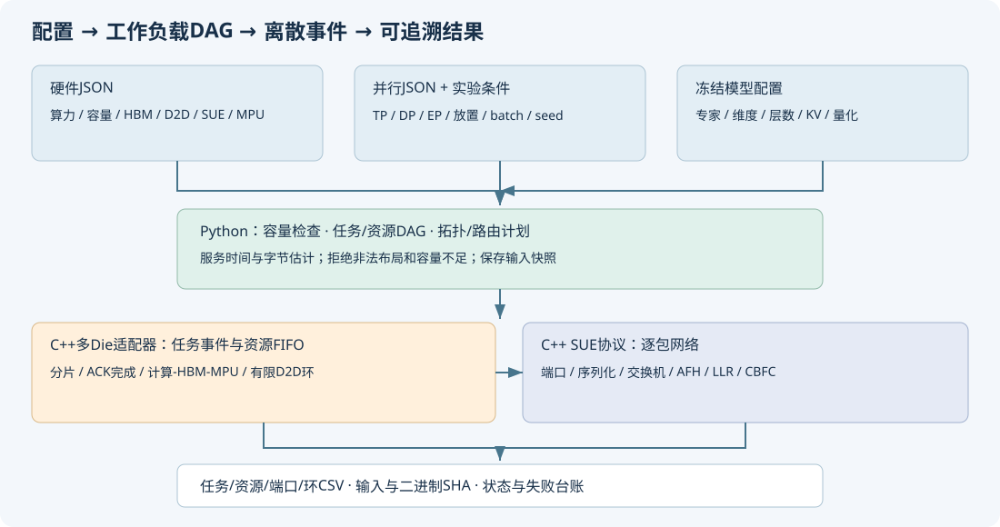
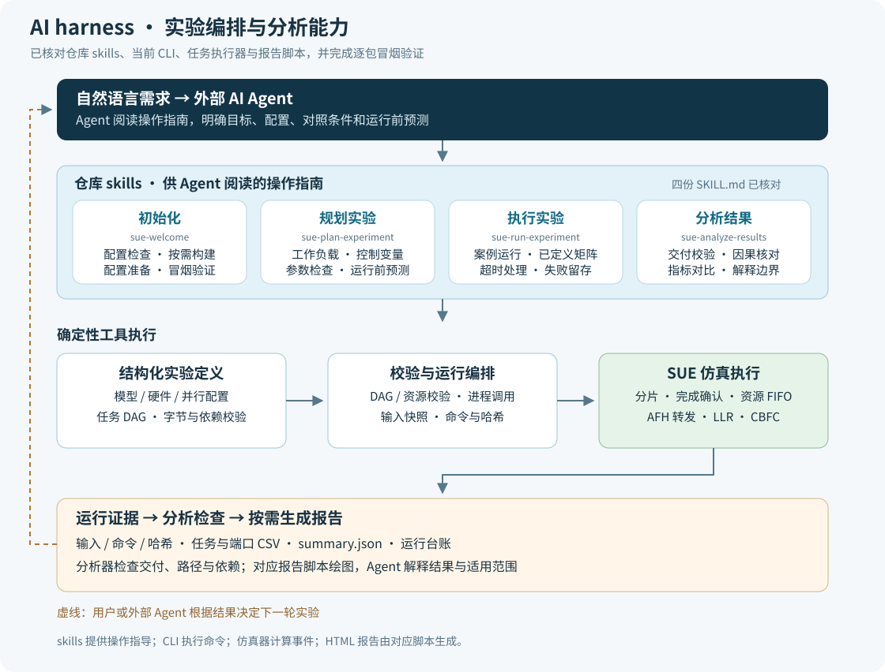

# 1. 系统定位、架构与能力范围

## 1.1 要回答什么问题

本平台用于探索给定AI通信与资源需求在SUE Scale-Up网络上的行为，例如：拓扑导致的直接/绕行路径差异、每Die出口热点、TP规模的通信代价、专家放置、MPU远端访存、信用窗口、LLR重传，以及算力/本地内存/链路哪个资源限制当前阶段。

它不能直接回答“真实GLM部署一定能达到多少完整模型token/s”。这样的结论还需要真实模型执行图、kernel时间、KV布局、编译器与通信库实现、硬件时延和服务端调度校准。

## 1.2 三层实现

| 层 | 实现语言/组件 | 承担的职责 |
|---|---|---|
| 实验与模型层 | Python，`harness/v2/` | 读取模型/硬件/并行参数，检查容量，生成DAG、字节数、服务时间、拓扑和路由计划 |
| 多Die适配层 | C++，`scratch/sue-harness-v3.cc` | 创建节点和端口，消费DAG，分片发包，目的侧UCIe转交，完成确认，资源FIFO，导出统计 |
| 网络协议层 | C++，ns-3 fork中的`src/sue/` | AFH转发、链路序列化、交换机队列、LLR、CBFC和相关控制帧 |

ns-3是离散事件模拟器：按照仿真时间顺序执行事件，计算下一次传输完成、信用更新、任务结束等时间。**仿真时间与程序在电脑上运行的墙钟时间不同**。一段100µs的模拟可能需要数秒墙钟时间。

一个XPU芯片在适配器中对应一个ns-3 host Node，其4个Die通过不同端口身份和资源键区分；“32个rank”不代表一定创建32个独立ns-3 Node。交换机单独创建SUESwitchNode。

### AI harness：从需求到实验结论

AI harness 由仓库操作指南、Python 实验工具和 C++ 任务适配器组成。四份 `SKILL.md` 均保存在 `simulators/sue/.agents/skills/`，供外部 AI Agent 阅读，指导初始化、规划、执行和分析。自然语言解释、对照条件和运行前预测由用户或外部 Agent 给出；CLI 按显式配置执行，不内置 LLM 服务或自动加载这些 skills。

下表按当前源码核对图中的能力。代码路径除 `bin/sue` 外，均相对 `simulators/sue/`。

| 图中能力 | 实际文件与行为 | 使用范围 |
|---|---|---|
| 四类 skills | `.agents/skills/` 下的 `sue-welcome`、`sue-plan-experiment`、`sue-run-experiment`、`sue-analyze-results`，每个目录均有 `SKILL.md` | 操作指导文件；具体命令、参数与完成口径以当前手册和 CLI 为准 |
| 配置检查与构建 | `bin/sue check/build`；`harness/v2/hardware_run.py` 读取模型、硬件和并行 JSON | 检查输入与布局约束；构建单独按需执行，完整任务与资源校验发生在生成案例后 |
| DAG 生成与仿真 | `harness/v2/inference_experiments.py` 生成任务与资源侧车，`harness/v2/run.py` 校验并调用 `scratch/sue-harness-v3.cc` | 当前硬件入口实际接通计算/HBM/MPU FIFO、本地环、分片和回源确认 |
| 案例与矩阵执行 | `harness/v2/hardware_run.py` 提供 case/matrix/restore/prefill 模式；`harness/v2/explore.py` 定义受控探索条件 | 矩阵由脚本预先定义，当前没有面向任意配置字段的统一扫描器 |
| 证据与失败记录 | `harness/v2/run.py` 的 `run_case/analyze` 保存独立运行目录、输入快照、命令及哈希、CSV、`summary.json` 和 `run-ledger.jsonl` | 检查字节交付、路径、依赖及资源服务；执行超时或任务未完成记为失败 |
| 分析与离线报告 | `harness/v2/render.py`、`explore_report.py`、`inference_report.py` 及案例专用分析脚本 | 报告脚本对应各自输入结构；单次 `bin/sue run` 默认输出统计与 JSON，HTML 需调用匹配的报告脚本 |

下一轮实验由用户或外部 Agent 根据结果决定，当前没有自动调参或自动迭代服务。报告中的图表与结论应保留对应运行证据，不能仅由图中的工作流推断实验已经执行。

2026-10-23 核对时，GLM 单步小案例完成 **118/118 个任务、123,200 B 逻辑字节**，包含78个资源任务；18份运行输入的哈希一致，重复运行生成独立目录，非法TP被拒绝，故意设置的仿真截止负例按预期记为失败。[核对记录](harness-capability-check.json)保存源码哈希、实际运行位置和检查范围；本次没有重新验收全量矩阵、构建、墙钟超时或所有报告生成器。

## 1.3 当前有两条工作负载入口

| 入口 | 适用问题 | 计算行为 |
|---|---|---|
| `bin/sue run` → `hardware_run.py` | 当前芯片规格、TP/EP、MoE、MPU与资源耦合实验 | 按FLOPs/字节数换算服务时间，进入FIFO |
| `harness/v2/run.py init` | 原16种拓扑的合成prefill/decode/train窗口、通用DAG | 旧工作负载默认使用固定本地等待 |

二者使用同一多Die C++适配器，但**工作负载模型不同**。不能把旧拓扑报告里的“固定等待”理解成当前资源模型，也不能说历史96项实验已经采用新的可配置EP或多Die分片。

更早的 `harness/sue_harness.py` 是另一条通用单口入口，它保留自己的拓扑和协议开关。本文主要描述多Die入口。底座有RoCE/RDMA等模块，不表示当前AI harness已能用它们替换SUE。

## 1.4 目前能力与边界

| 能力 | 当前状态 |
|---|---|
| 每Die独立8端口、可配置XPU/MPU端口速率 | 已接入逐包模型 |
| 本地4Die双向环、有向边带宽与共享缓冲 | 已接入，属于UCIe抽象模型 |
| 公共TP、派生DP、EP分组及专家副本 | 可配置并影响容量与通信 |
| 专家内部TP、流水线PP | 只支持1，其他值拒绝 |
| TP rank多Die分片发送及返回AllGather | 已接入；可显式选择旧leader对照 |
| 计算/HBM/MPU共享资源队列 | 已接入粗粒度FIFO |
| 真实模型tensor计算、kernel、tokenizer、推理正确性 | 不执行 |
| 实测MoE路由trace、生产调度和连续批处理 | 当前未接入，使用合成路由 |
| 全模型端到端prefill、decode、训练 | 当前资源实验是代表块/阶段，不是完整执行 |
| PFC/MTP底座能力 | 存在，但当前多Die入口固定单线程SUE＋LLR＋CBFC |
| 显式随机PHY延迟、BER/FEC/PCS电气模型 | 未建模；有确定性错误注入与争用产生的时延变化 |

## 1.5 工作区文件分工

`simulators/sue/`保存当前工程；`hardware/`保存物理规格和效率假设；`configs/parallel/`保存布局策略；`results/sue/`保存证据；`docs/`保存本手册与拓扑资料；`archive/`保存旧项目和材料；`ops/report-hosting/`保存发布服务。原路径软链接是兼容机制，不能当成第二份代码删除。
