# 8. 完整案例：DeepSeek V4.1 Flash 1017，16卡与MPU部署

## 8.1 部署方式介绍

本案例选择 TP4 × DP16、全局EP64、专家内部TP=1、PP=1，配2个MPU。每卡4个Die构成一个TP组，公共层的集合通信留在卡内；热专家权重与KV留在本地HBM，约202.76GB的Engram表分片放到MPU。Batch=64，每个公共层DP组承接4个token，上下文长度32768。

这是“探索共享内存池”的合理起点，不是本次最低时延方案，也不是宣称全局最优。19个对照/敏感性实验表明：TP4优于本次测试的TP1和TP8，但16卡完全有容量把Engram放在本地。本地方案更快；选择MPU是用额外访问延迟换取HBM容量释放和共享池能力。若单模型低时延是唯一目标，本例应优先保留本地Engram。

本节实测窗口包含：一个代表MoE块、均摊到该块的公共计算与KV访存、每token的完整Engram查表，两次连续decode步骤。它不是40层完整推理，不是TPOT或TTFT，不能把窗口除以2或乘以40解释成真实模型测速。 完整模型参数仅用于容量与解析预算。


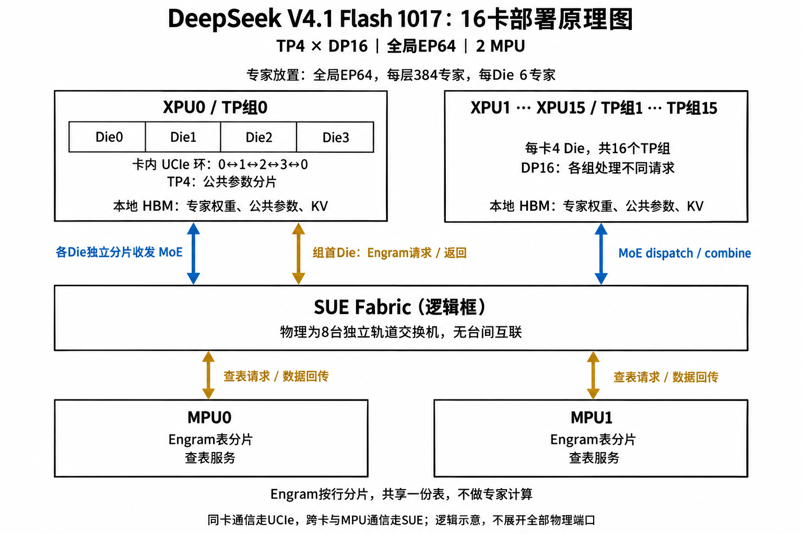

- **上方计算卡框**：左侧展开XPU0，右侧用XPU1…15表示其余15张卡；全系统一共64个Die/rank，不是16张卡合成一个TP组。
- **左侧展开的一张卡**：Die0↔Die1↔Die2↔Die3↔Die0形成双向UCIe环。每张卡是一个TP4组；公共参数分成4份，16个组各有完整的一套公共参数。
- **蓝色路径**：MoE激活由活跃TP组的4个Die分片发出，跨卡走SUE，同卡走UCIe；目标专家计算完成后，把结果分片返回各源Die。本例64个Die均实际发送了跨卡dispatch/combine流量，但不代表每个端口持续跑满。
- **中间SUE Fabric逻辑框**：抽象表示8台独立轨道交换机，并非单台交换机或互联总线；各轨之间没有交换机级联，图中不展开物理端口。
- **金色路径**：Engram查询由每个TP组的首Die聚合，经SUE请求MPU；MPU服务完成后，经SUE把查表结果送回首Die的HBM。这是当前Engram简化布局，与MoE的全Die分片收发不同。
- **底部2个MPU**：按行均衡放置两张Engram表的数据，各承担约101.38GB。不是一台一张表，也不是双副本、主备或容错镜像。每个MPU的190GB/s规格是单向带宽，不应再因方向折半。本轮实验另外采用`mpu_efficiency=0.5`，因此模型中的95GB/s是效率假设的结果，而非单/双向换算；这一假设与硬件规格分开记录。

## 8.2 完整并行策略与具体映射

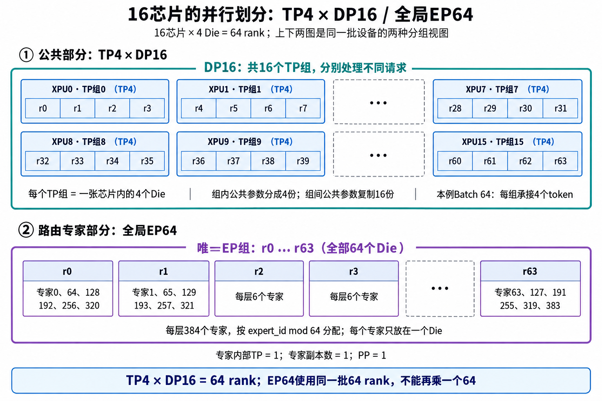

上图和下图是同一批64个Die的两种分组视图。蓝框是卡内TP组，绿色范围表示公共部分的16个DP副本，紫框是覆盖所有Die的唯一全局EP组。省略框代表未展开的组或rank，不是额外设备。图由内置GPT Image生成，[提示词](images/deepseek-16chip-parallel-prompt.txt)随文档保存。

| 项目 | 本例配置 | 含义 |
|---|---|---|
| 芯片 / Die | 16 / 64 | 每Die一个rank，`r=4×chip+die` |
| 公共部分TP | 4 | TP组g为rank `4g…4g+3`，恰好一张卡 |
| 公共部分DP | 16 | 16套公共参数副本；不同组接收不同token |
| 专家EP | 64 | 所有64个Die组成一个全局专家组 |
| 专家副本数 | 1 | 每层384个路由专家各只有一个owner |
| 每Die专家数 | 每层6个 | `owner(expert)=expert_id mod 64` |
| 专家内部TP | 1 | 一个专家的GEMM在一个Die上执行 |
| PP | 1 | 没有流水线stage切分 |
| Top-K | 6 | 每token选择6个专家；合成均匀采样 |
| MoE收发 | tp-striped | 全部TP rank按特征维度分片收发 |
| token分配 | round_robin | token t交给公共组 `t mod 16` |
| 跨步专家复用 | 0.75 | 以0.75概率沿用该token上一步的专家集合 |

例如公共组3就是XPU3，使用rank12、13、14、15，承接token3、19、35、51。rank12的专家ID为12、76、140、204、268、332；每一层都按这个规则放置。专家可以接收来自任意一个公共DP组的token，不被限制在本卡。

## 8.3 数据放在哪里：完整容量账本

本例使用已冻结的[官方HF配置](https://huggingface.co/deepseek-ai/DeepSeek-V4.1-Flash-1017/blob/1bae0e1088993b9b82de08f59de5be5a34e42170/config.json)与独立`simulation.json`假设，文本部分40层、384专家、Top-K6、hidden=5120、专家中间维度2304；视觉、DSpark/MTP不执行。

以下为十进制GB。每Die物理36GB，预留20%之后可分配预算28.8GB。

| 数据 | 放置规则 | 每Die占用 | 全部16卡 / 远端占用 |
|---|---|---:|---:|
| 路由专家权重 | 全局EP64，每Die每层6专家，FP4平均0.53125B/参数 | 4.512GB | 本地288.778GB |
| 公共矩阵与embedding/head | 每卡一套、TP4切分；公共FP8，embedding/head按2B预留 | 2.540GB | 本地162.584GB |
| 64条32K上下文KV | 容量按64个Die均衡分片 | 0.110GB | 本地7.046GB |
| Engram两张表 | 跨2个MPU按行分片，一份全局表 | 0 | 远端202.758GB，约101.379GB/MPU |
| 本地合计 | 上述本地三项 | **7.163GB** | **458.409GB** |
| 无MPU、Engram也在本地 | Engram额外按Die均衡分片 | **10.331GB** | **661.167GB** |

因此远置Engram释放本地202.758GB，即每卡约12.672GB、每Die约3.168GB。16卡总物理容量2304GB、扣预留后1843.2GB，两种方案都能放下；MPU不是本例“能跑起来”的必要条件。2个MPU总容量1024GB，平均只用约19.8%；选择2个是当前入口支持的最小非零MPU数，并能分摊服务队列。单个512GB节点在纯容量上也能装下，但当前CLI不支持1个MPU，未做单节点逐包对照。

KV容量均衡放置与运行时TP组KV读取仍是抽象模型：没有逐KV页映射和跨组取页事务。本地Engram也按容量均衡，但访问直接记到组首Die的HBM，未逐行模拟从其他Die取数据。因此无MPU对照有乐观成分；表中差值不能当作真实系统确定的延迟罚时。公共参数量来自显式估算，不是逐tensor权重清单。

### 为什么远置Engram，而不远置热专家

Engram容量大，但每token只返回`2张表×3种n-gram×8个头=48`行，每行`256+8=264B`，合计12,672B。这里没有把整张202.76GB表拉回XPU。

一个专家的一层权重为`3×5120×2304×0.53125=18,800,640B`，约18.8MB，适合留在高带宽HBM；若每次使用都从MPU流式拉取，会把小规模激活通信变成大规模权重搬运。本例专家远置比例为0，MPU不执行专家GEMM，也不充当专家流量中转。

## 8.4 实际运行结果：TP4是本次对照中的合适起点

所有条件都使用同样的模型、16卡、batch64、32K上下文、2步、全局EP64以及逻辑专家采样规则。表中窗口为完整两步代表块窗口，取seed1/2/3均值；范围是这3次的min–max，不是置信区间。

| 部署 | 两步窗口均值（μs） | 三种子范围（μs） | 本地全模型容量（GB） | 远端容量（GB） |
|---|---:|---:|---:|---:|
| TP4 × DP16，Engram本地 | **182.45** | 181.51–183.30 | 661.17 | 0 |
| TP4 × DP16，2MPU | **232.36** | 232.18–232.51 | 458.41 | 202.76 |
| TP4 × DP16，4MPU | **208.51** | 208.24–208.97 | 458.41 | 202.76 |
| TP1 × DP64，2MPU | **393.88** | 392.95–395.39 | 946.16 | 202.76 |
| TP8 × DP8，2MPU | **256.06** | 255.77–256.22 | 377.12 | 202.76 |

可以得到三条有证据支持的判断：

1. **TP并非越大越好。** TP8减少公共副本容量，但跨卡集合通信和更多轮次抵消了一部分收益，本次比TP4慢约10.20%。这不等价于“跨卡带宽不够做TP”，而是给定batch、消息规模和实现算法下的净效果。
2. **MPU先体现容量价值。** 2MPU比本地窗口增加约27.35%，同时释放202.76GB本地容量。若容量没有压力、也不需要共享池，不能用本次数据证明购买MPU会加速推理。
3. **4MPU有效，但收益与成本要一起看。** 相比2MPU，4MPU窗口缩短约10.26%，不是吞吐直接翻倍；两种远置方案释放的HBM容量完全相同。2MPU是较小资源投入的示例，4MPU更适合在确实需要远置、又希望降低查表排队时进一步评估。

实际验收目录：`results/sue/deepseek-16chip-case-study/`；19例全部完成、无失败。独立CLI验收目录：`results/sue/deepseek16-tp4-ep64-mpu2-cli/`，其任务时间戳与矩阵的TP4/2MPU/seed1逐字节一致。这个额外CLI案例不计入19例矩阵。

## 8.5 一步到底传了什么

### 公共计算与TP通信

每个组有4个token。4个Die分别执行公共计算和读取其分片参数/KV，计算队列与HBM队列允许重叠，两者完成后做卡内AllReduce。随后公共激活在TP组中复制，每个Die负责其中一段特征去发MoE。

### MoE dispatch、专家计算、combine

每个token选择6个专家；5120维FP16激活拆成4片，每片1280维，消息记录为`1280×2+8=2568B`。同一source/owner组合会聚合多条记录。专家owner等待需要的分片到达，再执行一次该专家计算与权重读取，结果分片返回源TP组各Die；各Die做Top-K结果求和，最后执行卡内AllGather。

一个token每个方向的逻辑分片字节合计为`6×4×2568=61,632B`。但这不是SUE线速计费字节：同Die无需传输，同卡走UCIe，跨卡才进入SUE；报头、确认与控制流另计。本例seed1的dispatch和combine均有64个活跃跨卡发送Die，证据见`moe_die_traffic.csv`。

### Engram请求与返回

每组首Die处理4个token，即192行；2MPU均分为每节点96行。

- 每个请求：`64+96×8=832B`。
- 每个MPU的返回：`96×264=25,344B`。
- 每组发往2个MPU，16组同时访问；每个MPU每步需要服务16个请求。
- 全网每步返回`64×12,672=811,008B`，约0.811MB；两步为1,622,016B。

路径为“组首Die → SUE请求事务 → MPU队列/服务 → SUE数据回传事务 → 本地HBM写入”。两个SUE事务分别等待接收完成响应，随后公共计算才能继续。没有把约202.76GB总容量当成每步传输量。

当前实现没有模拟Engram回传数据随后在TP组内的完整算子分发，也没有跨步热点缓存或预取；查表由组首Die集中发起。这限制了结论的外推范围，不能将该实现直接当作真实推理框架的最佳Engram布局。

## 8.6 通信热力图、链路负载与拥塞观测

本节在完全相同的16卡、TP4×DP16、全局EP64、2MPU、batch64、32K上下文、两步代表块上重新仿真，不是套用其他实验的图。保留种子1/2/3，另跑seed1关闭观测的控制组，共4次执行全部完成。输入沿用§8.4冻结的任务和资源配置；MPU190GB/s为单向规格，历史效率假设0.5仍单独保留，未借新增可视化改动性能参数。

**[打开交互通信看板](communication/report.html)** · [下载原始通信证据](communication/communication-evidence.zip) · [指标CSV](communication/metrics.csv) · [图表校验记录](communication/verification.json)

### 本例首先能看出什么

| 指标 | seed1 | seed2 | seed3 |
|---|---:|---:|---:|
| 两步代表块窗口（μs） | 232.1846 | 232.5106 | 232.3755 |
| 完成的网络任务数 | 4752 | 4744 | 4984 |
| 交换机出口最大队列快照（KiB） | 24.05 | 17.57 | 7.54 |
| 交换机发送侧最大信用占用快照 | 12.89% | 12.89% | 12.89% |
| 最忙端点发送端口的全窗口忙碌率 | 2.68% | 3.55% | 3.56% |
| 信用不足检查次数 / 重传帧 / 丢弃 | 0 / 0 / 0 | 0 / 0 / 0 | 0 / 0 / 0 |
| MPU最多同时等待的任务数（采样） | 15 | 15 | 15 |
| 最忙Die的HBM / 计算服务时间占比 | 74.17% / 5.20% | 74.07% / 5.30% | 74.10% / 5.19% |

这些数字支持一个更具体的判断：**该case存在短暂网络排队和流量热点，但没有证据表明CBFC信用耗尽或链路饱和是主瓶颈；MPU服务队列和HBM服务更值得关注。** 不能为了让拥塞图“更热”而改变输入制造拥塞。各图颜色范围会随种子自动变化，比较种子时应看色条和数值，不只比较深浅。

交换机出口快照并非设备全部缓存：它不含正在上线的帧、独立控制/重传队列，以及可能尚未获准进入出口队列的上游pending帧。500ns采样会漏过更短峰值，因此“最大队列/信用快照”是采样值；只有累计失败计数等事件统计不受这一采样间隔漏峰的影响。本例无PFC，不能拿CBFC信用图称作PFC暂停时长图。

### 图8.6-1：卡间通信矩阵

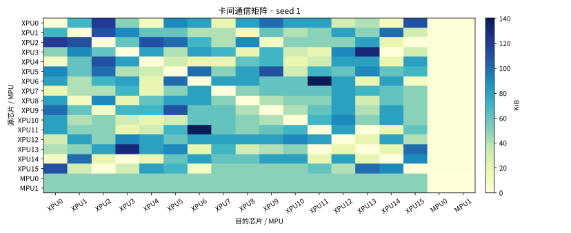

**怎么测：**逐任务网络有效载荷按源/目的芯片汇总；包含MoE及Engram请求/返回，不含本地UCIe及协议控制帧。颜色是字节数，不是带宽。

**怎么看：**检查MoE是否分布到多张卡，以及MPU的集中读服务方向。矩阵不包含等待时间，不能单凭颜色判断拥塞。

**本次观察：**seed1的4752个网络任务累计交付16,199,872B有效载荷。XPU间颜色来自MoE，MPU→XPU的条带来自Engram回传；XPU→MPU请求更小。对角线为空主要因为同卡通信走UCIe，不能解释为同卡没有通信。

### 图8.6-2：Die间MoE dispatch矩阵

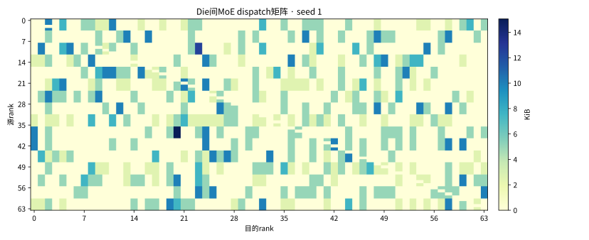

**怎么测：**只选dispatch任务；跨卡任务取bytes，同卡UCIe取resource.units与peer_die；同Die直接使用不计搬运字节。

**怎么看：**64个发送Die分散工作，矩阵每4行/列对应一张卡。专家热点和TP特征分片共同决定矩阵；不能把一格当一条物理链路。

**本次观察：**TP4组内的4个Die对相同token-expert集合发送不同特征片，因此会出现4行一组的结构；它不是4份重复的完整激活。全局专家owner决定列方向的热点。

### 图8.6-3：端点发送端口忙碌率

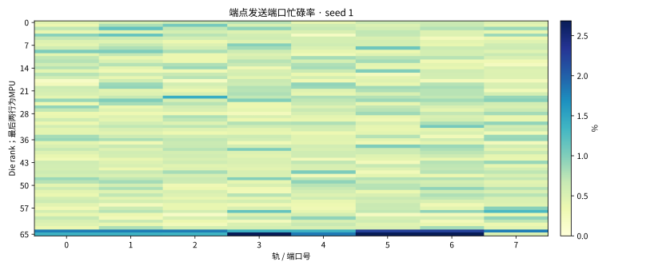

**怎么测：**host侧tx_busy_ps / 仿真结束时间，统计从0开始，含首次注入前1μs及控制帧；不含IFG等空闲时间。

**怎么看：**看同一Die的8轨是否均匀。平均忙碌率低不代表没有短突发，也不是有效应用吞吐率。

**本次观察：**最忙端点端口的全窗口忙碌率也只有2.68%（seed1）。这不否定MoE阶段存在突发，只说明把计算与访存等待都纳入后，链路并未持续饱和。更不能将200G×2.68%解释成模型吞吐。

### 图8.6-4：交换机出口随时间的平均忙碌率

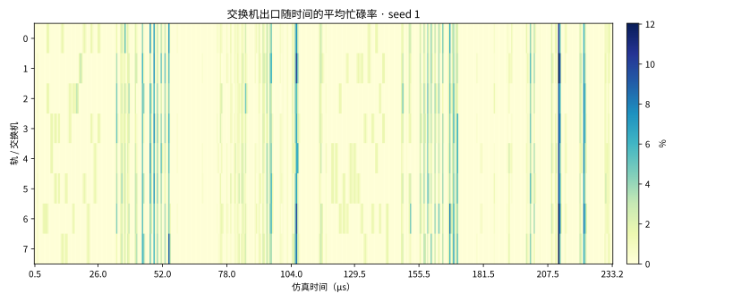

**怎么测：**相邻500ns快照累计tx_busy_ps之差除以真实区间长度，再平均同轨66个交换机出口；最后区间可能短于500ns。

**怎么看：**时间轴能看出Engram、公共处理和MoE产生的通信波段。66口平均会稀释单端口热点，须结合队列图。

**本次观察：**seed1最热500ns区间的单轨66个出口平均忙碌率约12.04%。这只是端口平均，不是所有单口的上限；看板放大后能区分两个decode步骤中的波段和空闲期。

### 图8.6-5：交换机出口队列热点

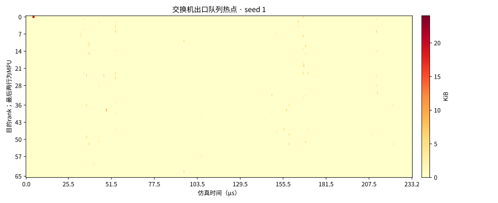

**怎么测：**500ns快照读取设备发送队列8个VC的字节总和；每目的Die在8个轨中取最大队列。不是交换机全部缓存，不含正在发送帧/重传控制队列或上游pending帧。

**怎么看：**可以定位微突发排队出现在哪个目的Die与时间。采样峰值是实际峰值下界，可能漏过短于500ns的尖峰。

**本次观察：**seed1交换机出口采样峰值24.05KiB，seed3为7.54KiB；但两者窗口只差约0.19μs。较深的短队列未必落在全局关键路径，不宜把最大队列大小直接排序为模型性能。

### 图8.6-6：CBFC信用占用快照

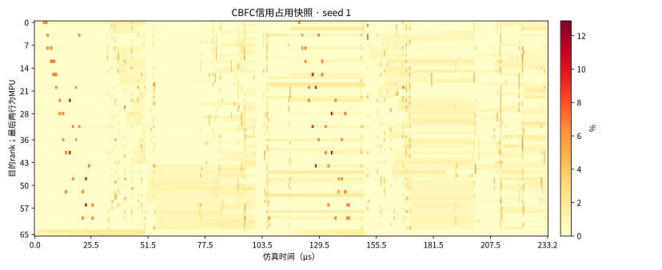

**怎么测：**交换机发送侧CU/CL；对每设备8个VC取最大，再对目的Die的8轨取最大。读取getter，不调用会更新计数的CanSend。

**怎么看：**占用高表示在途信用多，并不自动等于阻塞。只有结合credit_exhausted等证据才判断信用门控；本例该失败检查计数为0。

**本次观察：**本图仅展示交换机发送侧；其最大采样信用占用12.89%，累计信用不足检查为0。所有端点和交换机方向的重传/丢弃也为0，因此不能得出“信用窗口太小导致该case变慢”。

### 图8.6-7：网络任务完成时延分布

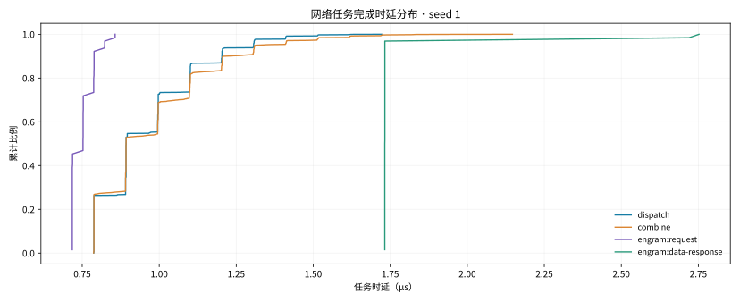

**怎么测：**各网络任务(end_ps-start_ps)/1e6，分dispatch、combine、Engram请求和回传；包含适配器事务确认，不是单包传播时延。

**怎么看：**比较方向与阶段的尾部；不同阶段消息大小不同，不能单凭CDF给协议排名。零字节计算/资源任务不纳入。

**本次观察：**seed1 dispatch P50/P99为0.893/1.412μs，combine为0.892/1.619μs；Engram请求为0.753/0.857μs，数据回传为1.732/2.752μs。Engram网络返回任务时延不包含此前MPU服务排队，不能拿它代表完整远程读延迟。

### 图8.6-8：消息大小与完成时延

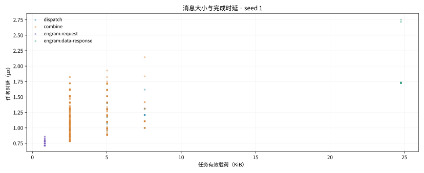

**怎么测：**每点一个网络任务，横轴逻辑有效载荷，纵轴事务完成时延；颜色按四个阶段区分。

**怎么看：**相近大小但时延不同，提示排队、路径与同步背景不同；同一任务可能分片，不能把散点数当包数。

**本次观察：**回传任务有更多字节，其时延分布与小请求不同。纵轴差异同时包含帧串行化、网络排队和确认路径；若要分离各项，需要更多逐帧事件，当前不伪造分解。

### 图8.6-9：专家owner负载分布

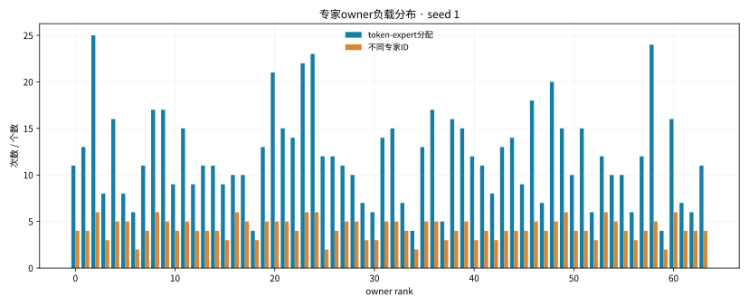

**怎么测：**token_routes.csv逐条(token,expert)分配计数，合并两步；同时展示两步内不同专家ID数量。专家复用概率0.75，不是独立同分布两步。

**怎么看：**检查合成路由负载是否均匀；不是所有Die计算量必然一样，Expert数相同也不保证token命中均匀。

**本次观察：**seed1各owner收到的两步token-expert分配数从4到25，而平均为12。每Die静态存放6个专家，并不意味着动态专家负载均匀；0.75的跨步复用会使热点延续。

### 图8.6-10：UCIe有向边流量

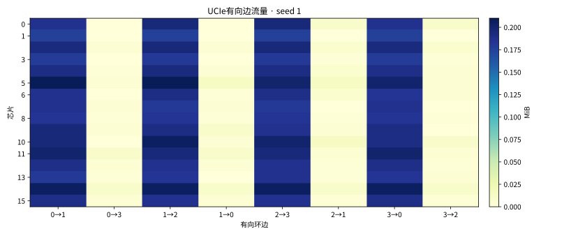

**怎么测：**ring_statistics.csv的bytes；每次经过一条边计一次，含TP集合通信及卡内MoE搬运。两跳会被计两次。

**怎么看：**方向不对称来自ring算法及任务路径，不等同于链路缺失。不能与应用端到端字节直接求和。

**本次观察：**这里包括卡内TP AllReduce、输出AllGather和卡内MoE搬运。ring方向上流量不同是算法和路由的结果；图中的MiB是逐跳累计，不能与卡间网络有效载荷直接比较“协议开销”。

### 图8.6-11：计算与HBM资源忙碌率

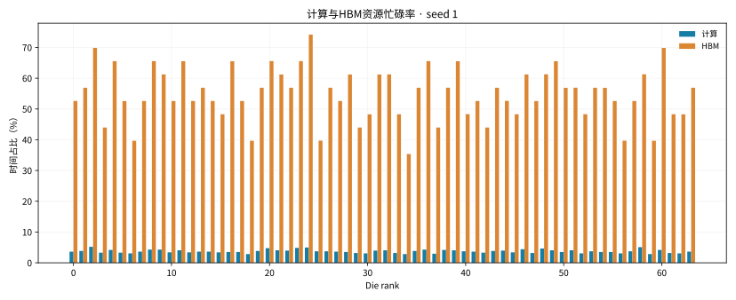

**怎么测：**每Die服务时间之和 / 仿真结束时间；计算和HBM是独立FIFO资源，可以重叠，排队与网络等待不算服务时间。

**怎么看：**用于把算力空闲、HBM服务与网络活动区分。当前这是行为模型的资源占用，不是硬件GPU profiler实测。

**本次观察：**seed1最忙HBM资源占比74.17%，最忙计算资源5.20%。不同Die的max并不一定来自同一个Die。

### 图8.6-12：MPU服务队列中的等待任务

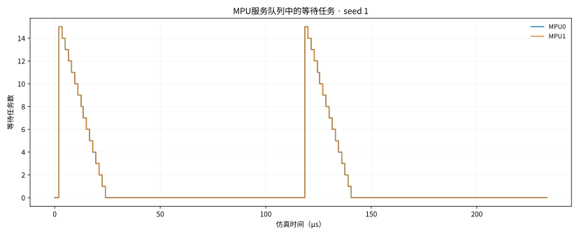

**怎么测：**按资源任务[start_ps,service_start_ps)区间重建每个MPU的FIFO等待数，绘制500ns采样；正在服务的任务不计入。

**怎么看：**这是MPU内存服务队列，不是SUE交换机队列。两者对照可解释网络并不拥塞但远程读取仍慢。

**本次观察：**每个MPU在突发阶段最多有15个任务等待，即除正在服务者外，其余组请求在单FIFO排队。网络信用不紧张并不意味着远程读取没有瓶颈；MPU服务的固定批次延迟和串行化属于另一层资源。

### 如何复现与扩展

单次案例可以直接开启观测：

```bash
bin/sue run \
  --model-config configs/models/deepseek-v4.1-flash-1017/config.json \
  --parallel configs/parallel/deepseek-16chip-tp4-ep64.json \
  --chips 16 --mpus 2 --engram-remote \
  --batch 64 --context 32768 --steps 2 --seed 1 \
  --port-sample-ns 500 \
  --output results/sue/deepseek16-observed-repeat
```

默认`--port-sample-ns 0`关闭观测；开启时必须为不小于100ns的整数。更细采样增加输出量，且当前按所有端口采样，不宜直接在大规模长时间场景中使用极细间隔。发生代码更新时先运行`bin/sue build`。

完整复现本节的三个种子与关闭采样控制组：

```bash
python3 simulators/sue/harness/v2/run_communication_case.py \
  results/sue/deepseek-16chip-case-study \
  results/sue/deepseek16-communication-repeat

# 可视化依赖 matplotlib、numpy、plotly；它们只用于分析，不参与仿真。
python3 simulators/sue/harness/v2/communication_report.py \
  results/sue/deepseek16-communication-repeat
```

输出包含`report/report.html`、`report/metrics.csv`、12组SVG/PNG、图表数据及证据压缩包。当前完整记录在`results/sue/deepseek16-communication/`。证据包包含三个种子的原始`port_timeseries.csv`、逐任务/端口/资源/UCIe统计、输入和运行manifest；没有把旧结果覆盖成新结果。

若后续要研究“更拥塞”的条件，应另建有明确变量的实验，例如提高batch、缩小信用窗口、热点专家路由或共享MPU的更多并发请求，并固定其他条件。当前图表已经能揭示这些变量带来的变化，但本节没有把压力实验与原始case混在一起。

## 8.7 可以直接复制的运行命令

以下命令均从工作区根目录`/home/dell/scale_up_evaluation`运行。输出目录必须是新目录；下面使用`-repeat`后缀，避免覆盖已经完成的验收案例。

### 示例A：16卡、TP4、EP64、2MPU，Engram远置

并行配置文件已经提供：`configs/parallel/deepseek-16chip-tp4-ep64.json`。

```json
{
  "schema_version": 1,
  "name": "deepseek-16chip-tp4-ep64",
  "tp": 4,
  "dp": 16,
  "ep": 64,
  "expert_tp": 1,
  "pp": 1,
  "moe_transport": "tp-striped",
  "expert_placement": "round_robin",
  "token_assignment": "round_robin",
  "decode_expert_reuse_probability": 0.75
}
```

```bash
# 先校验模型、硬件、并行分组。check不执行逐包仿真，也不替代完整容量准入。
bin/sue check \
  --hardware hardware/profiles/current.json \
  --model-config configs/models/deepseek-v4.1-flash-1017/config.json \
  --model-simulation configs/models/deepseek-v4.1-flash-1017/simulation.json \
  --parallel configs/parallel/deepseek-16chip-tp4-ep64.json \
  --chips 16 --mpus 2 --engram-remote \
  --batch 64 --context 32768

# 首次使用或后端尚未构建时执行
bin/sue build

# 真正执行容量准入、任务生成、SUE逐包仿真和统计分析
bin/sue run \
  --hardware hardware/profiles/current.json \
  --model-config configs/models/deepseek-v4.1-flash-1017/config.json \
  --model-simulation configs/models/deepseek-v4.1-flash-1017/simulation.json \
  --parallel configs/parallel/deepseek-16chip-tp4-ep64.json \
  --chips 16 --mpus 2 --engram-remote \
  --batch 64 --context 32768 --steps 2 --seed 1 \
  --output results/sue/deepseek16-tp4-ep64-mpu2-repeat
```

`--engram-remote`才会启用远程Engram；仅加`--mpus 2`只是添加节点，不会自动迁移数据。两个MPU的chip编号为16、17；图里的MPU0/MPU1是这两个内存节点的局部序号。

运行后先看根目录`results.json`中的`status`、`capacity.admitted`和`run`。`run`指向不可覆盖的时间戳快照，里面的模型/硬件/并行JSON、`tasks.json`、`resource_statistics.csv`、`task_statistics.csv`和`moe_die_traffic.csv`是证据。`capacity_rejected`表示未启动逐包实验，不是运行成功。

### 示例B：相同16卡、相同TP4，Engram留本地

```bash
bin/sue run \
  --model-config configs/models/deepseek-v4.1-flash-1017/config.json \
  --parallel configs/parallel/deepseek-16chip-tp4-ep64.json \
  --chips 16 --mpus 0 \
  --batch 64 --context 32768 --steps 2 --seed 1 \
  --output results/sue/deepseek16-tp4-local-repeat
```

这里省略硬件路径时仍使用`hardware/profiles/current.json`；省略补充模型路径时自动读取同目录的`simulation.json`。

### 示例C：增加MPU或改变TP，保持总卡数不变

```bash
# 4MPU，表分为4片，并不是复制4份
bin/sue run \
  --model-config configs/models/deepseek-v4.1-flash-1017/config.json \
  --parallel configs/parallel/deepseek-16chip-tp4-ep64.json \
  --chips 16 --mpus 4 --engram-remote \
  --batch 64 --context 32768 --steps 2 --seed 1 \
  --output results/sue/deepseek16-tp4-mpu4-repeat

# TP8跨两张卡。JSON中DP固定16，因此覆盖TP时必须同时改DP为8。
bin/sue run \
  --model-config configs/models/deepseek-v4.1-flash-1017/config.json \
  --parallel configs/parallel/deepseek-16chip-tp4-ep64.json \
  --tp 8 --dp 8 --chips 16 --mpus 2 --engram-remote \
  --batch 64 --context 32768 --steps 2 --seed 1 \
  --output results/sue/deepseek16-tp8-mpu2-repeat
```

### 示例D：复现整套对照和瓶颈诊断

```bash
python3 simulators/sue/harness/v2/deepseek_case_study.py \
  configs/experiments/deepseek-16chip-study.json \
  results/sue/deepseek16-study-repeat

python3 simulators/sue/harness/v2/analyze_deepseek_case.py \
  results/sue/deepseek16-study-repeat
```

计划在执行前写入`registered-plan.json`。5种部署×3种子=15例，另有4个单变量敏感性案例（seed=1），共19例；3个worker只并行执行独立实验，单个仿真仍为单线程。敏感性覆盖值记录在`design.json`和每例metadata中，底层硬件原始快照保留默认值，不能只读根目录hardware.json就忽略每例`hardware_overrides`。
