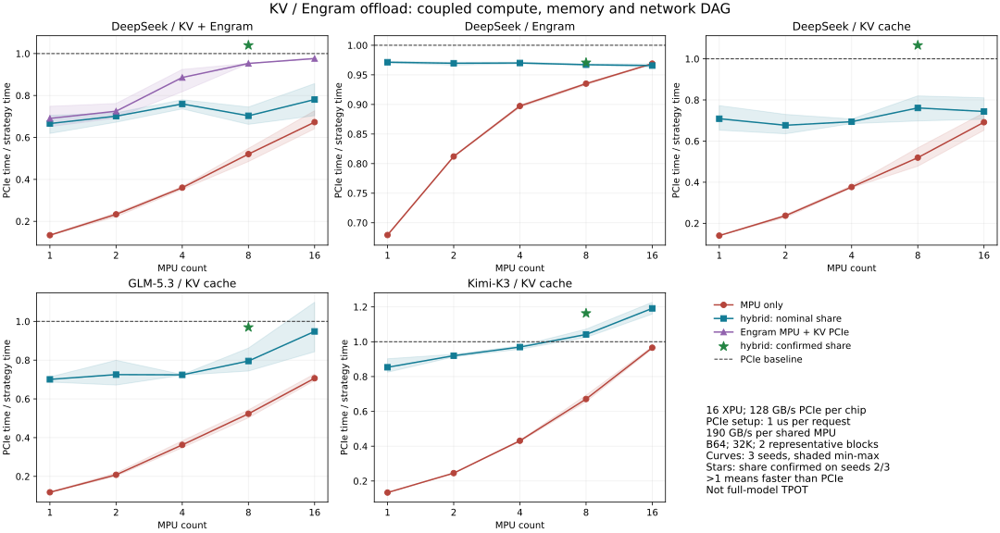

# 9. MPU与PCIe卸载对比

本章整合2026-10-23完成的1 µs重跑报告：固定16颗XPU，逐渐增加1/2/4/8/16个MPU，比较三种模型的KV cache卸载、DeepSeek的Engram卸载，以及MPU与PCIe混合使用。**所有含PCIe的方案均使用每请求1 µs启动延时，所有速度比使用同工作负载、同种子的1 µs PCIe基线。**

[独立交互报告](offload/report.html)保留工作负载筛选与下载；下文直接纳入主要图表、全部节点数对比、固定分流扫描和独立种子验证，离线手册无需联网阅读。

## 9.1 实验范围与统一配置

共运行200个主矩阵/固定比例条件，再运行10个独立种子确认条件，**210例全部通过，核验4,174,062个任务，无失败案例**。原0 ns报告保留为历史记录，不再用作本章基线。

测量对象是带计算、HBM、TP/EP和卸载依赖的代表块，由仿真器从开始执行到最终任务完成；连续两个步骤的总窗口除以2，得到下文的“µs/代表块”。未包含完整逐层attention QK/AV、KV新增写回或prefill，**不是完整模型TPOT/TTFT，也不能乘层数当作整模型耗时**。每个代表块包含两张Engram表的完整查询，相关占比不能直接外推到全模型。

- 固定16颗XPU，每颗4个Die，每颗独立PCIe单向128 GB/s。
- 每个MPU容量512 GB、单向190 GB/s，本轮`mpu_efficiency=1.0`；所有访问者共享该节点服务能力，不能把池带宽分配给每个XPU。
- 固定八轨、八台256口交换机，使用明确的`hw-N-M`实验拓扑；增加MPU意味着增加节点和接入端口。
- Batch=64，上下文32768；GLM/DeepSeek固定TP4，Kimi因容量固定TP32，全部EP64。模型之间不能直接用耗时比较能力。
- 主曲线使用seed1/2/3；同模型各方案配对token路由、计算量和读取字节。Kimi的KDA状态保留本地，只卸载MLA KV。
- KV请求按256 KiB分块；Engram按整行分配，同一目标MPU的行合并为请求。使用合成字节/行计数，没有真实文本热度、键地址、缓存或预取trace。

本章与第8章属于不同实验：第8章保留其当时的MPU效率0.5与部署条件，本章明确采用190 GB/s、效率1.0和独立PCIe队列，不能混合两章数字计算加速比。

## 9.2 PCIe与MPU延时建模

| 延时组成 | PCIe路径 | MPU路径 |
| --- | --- | --- |
| 固定启动延时 | 所有方案统一1 µs/请求；排队前等待，不占链路 | 内存服务每批200 ns，还要加网络事务延时；Engram每16行一批 |
| 数据服务带宽 | 每个XPU独立单向128 GB/s | 每个MPU单向190 GB/s，本轮效率设为1 |
| 排队范围 | 同一XPU的4个Die共用一个PCIe FIFO；不同XPU可并行 | 同一MPU的所有内存请求共用一个FIFO；不同MPU可并行 |
| Host内存读取 | 未计入DDR随机访问延时和带宽争用 | 显式计入MPU内存服务 |
| 数据到达后 | 写入HBM，再由计算侧读取 | 同样写入HBM，再由计算侧读取 |

PCIe启动等待可以与其他请求的启动或传输重叠，因此不能用“请求数×1 µs”直接推算窗口增加量。MPU网络采用SUE逐包仿真；PCIe采用每芯片独立的事件队列，未实现TLP/PHY。PCIe仍假定host能本地提供所需数据，没有额外host DDR瓶颈；Engram在多个物理host上的复制容量与host分组未建模，容量列仅表示唯一数据集字节数。这个假设边界随结果一同保留。

## 9.3 分流策略与图例

- **MPU only**：全部卸载数据由MPU提供。
- **hybrid: nominal share**：按标称服务带宽分配，MPU比例为`190×M/(16×128+190×M)`，M为MPU数。8 MPU时约42.6%，是预登记启发式，不是优化调度器。
- **hybrid: confirmed share**：先用seed1从8 MPU下12.5%/25%/50%/75%四档中选最快比例，再用seed2/3验证；无论是否加速均保留结果。“确认”不代表一定有优势。
- **Engram MPU + KV PCIe**：按数据类型分工，Engram全部放MPU，KV全部通过PCIe读取。

混合方案将互不重复的数据分片放在两个后端，请求并行执行，消费者等待两边都完成。速度比=PCIe基线平均耗时/当前方案平均耗时，**大于1才表示加速**。曲线阴影是三个种子的min–max范围，不是置信区间；星号使用独立确认种子。



## 9.4 逐渐增加MPU：全部主对比结果

以下均为µs/代表块、seed1/2/3均值。“混合”使用nominal share；调整比例后的结果另见9.5节。

### GLM-5.3：KV cache

PCIe基线 **228.633 µs**；全部卸载释放HBM约 **199.179 GB**。

| MPU数量 | 纯MPU µs | 纯MPU速度比 | 混合 µs | 混合速度比 | 混合MPU载荷% |
| --- | --- | --- | --- | --- | --- |
| 1 | 1937.681 | 0.118 | 326.255 | 0.701 | 8.490 |
| 2 | 1098.247 | 0.208 | 315.229 | 0.725 | 15.651 |
| 4 | 630.370 | 0.363 | 315.750 | 0.724 | 27.066 |
| 8 | 436.982 | 0.523 | 287.413 | 0.795 | 42.601 |
| 16 | 323.576 | 0.707 | 241.110 | 0.948 | 59.748 |

### Kimi-K3：KV cache

PCIe基线 **543.300 µs**；全部卸载释放HBM约 **57.982 GB**。

| MPU数量 | 纯MPU µs | 纯MPU速度比 | 混合 µs | 混合速度比 | 混合MPU载荷% |
| --- | --- | --- | --- | --- | --- |
| 1 | 4062.733 | 0.134 | 636.652 | 0.853 | 8.490 |
| 2 | 2213.872 | 0.245 | 590.669 | 0.920 | 15.651 |
| 4 | 1259.847 | 0.431 | 560.435 | 0.969 | 27.066 |
| 8 | 809.798 | 0.671 | 521.527 | 1.042 | 42.601 |
| 16 | 562.557 | 0.966 | 455.923 | 1.192 | 59.748 |

### DeepSeek V4.1 Flash 1017：KV cache

PCIe基线 **129.383 µs**；全部卸载释放HBM约 **7.046 GB**。

| MPU数量 | 纯MPU µs | 纯MPU速度比 | 混合 µs | 混合速度比 | 混合MPU载荷% |
| --- | --- | --- | --- | --- | --- |
| 1 | 922.253 | 0.140 | 182.549 | 0.709 | 8.490 |
| 2 | 545.656 | 0.237 | 191.125 | 0.677 | 15.651 |
| 4 | 343.544 | 0.377 | 186.384 | 0.694 | 27.066 |
| 8 | 249.083 | 0.519 | 169.979 | 0.761 | 42.601 |
| 16 | 187.053 | 0.692 | 173.908 | 0.744 | 59.748 |

### DeepSeek V4.1 Flash 1017：Engram

PCIe基线 **92.684 µs**；全部卸载释放HBM约 **202.758 GB**。

| MPU数量 | 纯MPU µs | 纯MPU速度比 | 混合 µs | 混合速度比 | 混合MPU载荷% |
| --- | --- | --- | --- | --- | --- |
| 1 | 136.441 | 0.679 | 95.421 | 0.971 | 8.333 |
| 2 | 114.139 | 0.812 | 95.591 | 0.970 | 15.625 |
| 4 | 103.290 | 0.897 | 95.548 | 0.970 | 27.083 |
| 8 | 99.111 | 0.935 | 95.833 | 0.967 | 42.708 |
| 16 | 95.654 | 0.969 | 95.976 | 0.966 | 59.896 |

### DeepSeek V4.1 Flash 1017：KV + Engram

PCIe基线 **130.927 µs**；全部卸载释放HBM约 **209.804 GB**。

| MPU数量 | 纯MPU µs | 纯MPU速度比 | 混合 µs | 混合速度比 | 混合MPU载荷% |
| --- | --- | --- | --- | --- | --- |
| 1 | 978.082 | 0.134 | 196.463 | 0.666 | 8.489 |
| 2 | 561.078 | 0.233 | 186.647 | 0.701 | 15.651 |
| 4 | 363.118 | 0.361 | 172.334 | 0.760 | 27.066 |
| 8 | 251.474 | 0.521 | 186.180 | 0.703 | 42.602 |
| 16 | 194.532 | 0.673 | 167.690 | 0.781 | 59.749 |

25组工作负载/MPU数量的纯MPU方案均未快于各自的PCIe基线。Kimi在16 MPU加默认比例PCIe混合时，从543.300 µs降至455.923 µs，延迟降低约16.08%；其他工作负载的混合收益需结合比例验证判断。

## 9.5 8 MPU＋PCIe：选择比例与独立验证

先在seed1上扫描以下四个比例，单位为µs/代表块；完整保留四个候选结果。

| 工作负载 | 12.5% MPU | 25% MPU | 50% MPU | 75% MPU |
| --- | --- | --- | --- | --- |
| GLM-5.3 / KV cache | 211.209 | 193.939 | 326.751 | 377.651 |
| Kimi-K3 / KV cache | 509.640 | 472.003 | 555.939 | 676.121 |
| DeepSeek V4.1 Flash 1017 / KV cache | 121.436 | 135.448 | 194.872 | 233.357 |
| DeepSeek V4.1 Flash 1017 / Engram | 95.307 | 95.347 | 95.530 | 98.864 |
| DeepSeek V4.1 Flash 1017 / KV + Engram | 125.677 | 140.250 | 185.451 | 214.903 |

选定比例后使用seed2/3确认，下表双方均使用这两个种子。负的延迟变化表示加速，正值表示更慢。

| 工作负载 | MPU分流% | PCIe µs | 混合 µs | 延迟变化% |
| --- | --- | --- | --- | --- |
| GLM-5.3 / KV cache | 25.000 | 228.772 | 235.952 | 3.139 |
| Kimi-K3 / KV cache | 25.000 | 541.065 | 465.019 | -14.055 |
| DeepSeek V4.1 Flash 1017 / KV cache | 12.500 | 129.473 | 121.454 | -6.193 |
| DeepSeek V4.1 Flash 1017 / Engram | 12.500 | 92.695 | 95.496 | 3.021 |
| DeepSeek V4.1 Flash 1017 / KV + Engram | 12.500 | 130.969 | 125.985 | -3.806 |

独立验证中，Kimi KV、DeepSeek KV、DeepSeek KV＋Engram的选定混合比例分别降低约14.05%、6.19%、3.81%的代表块延迟；GLM所选25%比例慢约3.14%，Engram所选12.5%比例慢约3.02%。不能继续沿用旧0 ns报告中GLM混合加速的结论，也不能把seed1上最佳比例解释为稳定收益。

## 9.6 Engram放MPU、KV放PCIe

这里两类数据各用一条路径。基线是两类数据全部通过PCIe读取，三种子均值130.927 µs/代表块。

| MPU数量 | µs/代表块 | 相对全PCIe速度比 | 延迟变化% |
| --- | --- | --- | --- |
| 1 | 189.531 | 0.691 | 44.760 |
| 2 | 180.564 | 0.725 | 37.911 |
| 4 | 147.785 | 0.886 | 12.875 |
| 8 | 137.403 | 0.953 | 4.946 |
| 16 | 134.095 | 0.976 | 2.420 |

16 MPU时，该分工方案为134.095 µs，比全PCIe慢约2.42%。本轮没有测出这种分工的延迟优势；小比例字节/行分流与按数据类型分工是不同策略。

## 9.7 容量价值与适用边界

DeepSeek两张Engram表合计202,758,032,400字节，约202.758 GB；单个512 GB MPU就能容纳。每token只查询48行、12,672字节，batch64合计约0.811 MB，不能把整表容量当成每步传输量。

本轮卸载释放的唯一数据集容量如下。所有数据集均小于512 GB，因此增加MPU主要是增加并行服务资源，也增加硬件和闲置容量；本轮没有成本评估。

| 卸载数据集 | 释放HBM / 唯一数据集GB |
| --- | --- |
| GLM-5.3 / KV cache | 199.179 |
| Kimi-K3 / KV cache | 57.982 |
| DeepSeek V4.1 Flash 1017 / KV cache | 7.046 |
| DeepSeek V4.1 Flash 1017 / Engram | 202.758 |
| DeepSeek V4.1 Flash 1017 / KV + Engram | 209.804 |

Engram纯PCIe为92.684 µs，16 MPU纯卸载为95.654 µs，后者慢约3.21%。这说明在当前请求规模、串行MPU服务和host内存假设下，增加带宽未抵消固定事务与等待成本；不能由此推断真实硬件中PCIe必然更快。改变host访存、实际拓扑、请求并发、缓存或预取策略都可能改变结论。

## 9.8 校验、原始证据与复现

本轮校验包括输入任务/资源哈希、完整字节交付、DAG依赖顺序、服务时间、共享PCIe及MPU队列不重叠、请求字节守恒，以及跨方案一致的token路由/计算/读取工作量。另逐请求核验实际1 µs启动等待。75个纯MPU重跑精确复现旧任务哈希与时间；10个新主矩阵条件精确复现旧1 µs敏感性案例。

- [全部汇总CSV](offload/summary.csv)与[主对比CSV](offload/main-comparison.csv)。
- [每例结果及原始run路径](offload/results.json)、[完整输入矩阵](offload/design.json)、[运行前计划与比例选择规则](offload/plan.json)。
- [全量校验记录](offload/verification.json)、[各芯片/MPU载荷与队列诊断](offload/resource-diagnostics.json)。
- [报告来源与文件SHA256](offload/source-manifest.json)、[图表SVG](offload/offload-speedup.svg)。

完整原始逐任务轨迹保存在工作区 `results/sue/offload-mpu-pcie-1us-20261023/` 的matrix与confirmation目录；离线包包含报告、汇总和追溯信息，没有复制数GB逐任务轨迹。

以下命令从工作区根目录执行，使用一个新的输出目录；复制该次实验保存的`hybrid-selection-plan.json`后运行比例确认。报告绘图需要matplotlib。

```bash
python3 simulators/sue/harness/v2/offload_experiments.py FRESH_ROOT/matrix --workers 3
cp results/sue/offload-mpu-pcie-1us-20261023/hybrid-selection-plan.json FRESH_ROOT/
python3 simulators/sue/harness/v2/offload_confirm.py FRESH_ROOT
python3 simulators/sue/harness/v2/offload_report.py FRESH_ROOT/analysis
```

本章表格和离线附件由`build_offload_chapter.py`直接读取该次已冻结的汇总生成，`build_manual.py`将其并入手册、图像内嵌并更新下载包。
