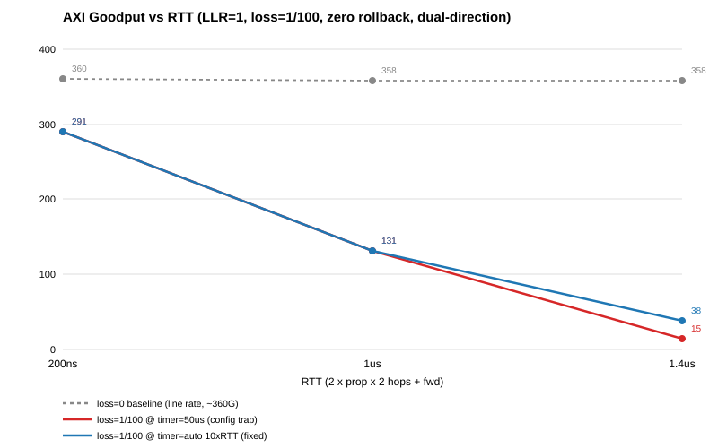
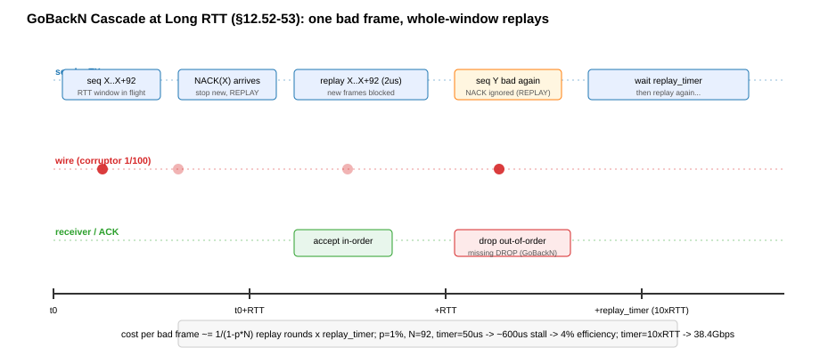

# SUE 仿真平台应用实例集(2026-08-25)

> 已分析清楚的应用实例,每个含:问题 → 方法 → 结论 → 复现命令。数据均为实测;
> 详细排查过程见 `docs/rtt-investigation-2026-08.md`,验证报告见 `docs/validation-report.md`。

---

## 实例 1:LLR 链路级重传的价值量化(有 vs 无)

**问题**:链路误码下 LLR 值多少带宽?无 LLR 会怎样?

**方法**:2 节点直连交换机,100G,2048B 帧,确定性坏帧注入 1/N(N=0..10000),A/B 两臂
(`THPT_LLR=1/0`,0=无 LLR 纯丢包链路)。

**结论**:
- LLR=1:四档全部零丢失、replay==nack 配平;丢 1/100 吞吐仅损 2.8%(95.15 vs 97.93
  Gbps)——重传只占返回链路 ~3%
- LLR=0:精确丢 ⌊sent/N⌋ 帧,速率线性下滑;1/100 丢 6103 帧
- 干净链路差 0.58%(98.50 vs 97.93)= LLR 前导+ACK 的"无损定价"
  (口径注:实物中 LLR 序号在既有前导区内传,不计端口带宽;仿真将其做成包内 8B 头并计线时,
   故该差值偏保守——按 MAC 口径净开销≈ACK 的 ~0.2pp)
- 应用层重传解析上界:帧级+RTT 400ns=96.2Gbps(略胜 LLR 的纯带宽);消息级 ≥4KB+
  RTT≥1µs = 91.2/89.6/71.6 Gbps(**全面输给 LLR**)——LLR 的核心价值是**延迟**
  (链路级恢复,应用零感知)

**复现**:`./run-s5c-thpt.sh`;LLR A/B:`THPT_LLR={1,0} THPT_LOSS_EVERY={0,100,1000,10000} $BIN/ns3.36.1-sue-thpt-line-rate-default`

## 实例 2:AXI 事务 GoBackN——LLR 对上层应用的保护

**问题**:AXI DMA 事务(读 AR→R / 写 AW+W→B)在丢包下回滚多少?

**方法**:sue-axi-workload,32KB 事务×500,outstanding=16,4-VC 通道分离
(AW+W→VC1/AR→VC2/B→VC3/R→VC4,VLAN PCP),loss=1/100,RTT 扫描。

**结论**:
- LLR=1:**全 RTT 档零事务回滚**(retries=0)——LLR 完全吸收链路损失,应用零感知
- LLR=0:回滚随丢包率线性上升(1/10000→1 次,1/1000→17,1/100→251-285)
- FLUSH 场景(data-age 修复后)不再出现假死循环

**复现**:`AXI_LLR={1,0} AXI_LOSS_EVERY=100 AXI_TXNS=500 $BIN/ns3.36.1-sue-axi-workload-default`

## 实例 3:RTT × GoBackN 效率曲线(长链路的本质代价)

**问题**:ScaleUp RTT 变长(跨机柜/光互连)对误码恢复代价多大?

**方法**(v2 口径,2026-08-27):AXI workload,**LLR 回环 RTT = 2×链路时延**
(ACK/NACK 由邻接接收端就地生成原路返回,不经芯片流水线,fwd 预算不计入);
链路时延五档 {20,100,200,300,500}ns,loss=0 与 1/100 对照,replay_timer auto(10×RTT)。

**结论**(LLR=1,零回滚,双向口径):

| 链路时延 | LLR-RTT | loss=0 基线 | loss=1/100 | 效率 |
|---|---|---|---|---|
| 20ns | 40ns | 364.9 | 335.9 | 92% |
| 100ns | 200ns | 364.1 | 290.7 | 80% |
| 200ns | 400ns | 363.1 | 241.6 | 67% |
| 300ns | 600ns | 362.1 | 199.8 | 55% |
| 500ns | 1µs | 360.1 | 130.8 | 36% |

- **机制**:GoBackN 每坏帧丢弃+重传整个 RTT 窗口(N≈RTT/wire 帧),级联放大;loss=0
  时全部 RTT 线速(排除 CBFC/交换机/LLR 本身)
- **结论**:RTT>1µs × 误码 >1/1000 时 GoBackN 代价急剧上升——**这正是 UEC 预留选择性
  重传 AR 的动机**;D2D(IO Die)延迟会进一步放大(纳入 RTT)
- **配置敏感**:replay_timer 必须 10×RTT(规范值);50µs 硬编码曾把 1.4µs RTT 打到
  4% 效率(§12.53)

**复现**:`AXI_PROP_NS={100..1000} AXI_LOSS_EVERY={0,100} $BIN/...sue-axi-workload-default`;timer 扫描加 `AXI_REPLAY_TIMER_NS=`

## 实例 4:CBFC vs PFC 同量 A/B

**问题**:信用流控与优先级暂停流控,同载荷谁好?

**方法**:VRF 8 平面 all-to-all(56 对×1Gbit,IO Die 编址:每 GPU 4 Die×8 口,XPUID 含 Die 位),同注入纪律同标尺,只换 FC 模式;
PFC 的 drain(接收驻留)从 0 扫到 5000ns。

**结论**:
- drain=0(PFC 实质未生效):48,658.5 Gbps,与 CBFC 臂(48,658.4)重合
- **PFC 生效即塌落**:drain 1/2/5µs → 79.69%/45.31%/19.68% 天花板
- 无损契约全臂保持(delivered==sent)——**PFC 代价纯是带宽**;机制:阈值-迟滞整链路
  stop-and-go 震荡 vs 逐 VC 信用连续均衡

**复现**:`VRF_PL_FC=PFC VRF_PL_PFC_DRAIN_NS={0,1000,2000,5000} $BIN/...sue-vrf-planes-default`

## 实例 5:VRF 转发域(8 平面精确隔离,Die 编址)

**问题**:单交换机 256 口按 VRF 划 8 平面(每 GPU 4 个 IO Die 编址进 XPU-ID),帧不携带 VRF 是否可靠?

**结论**(2026-08-27 复验):逐-(出口口,源XPU) 单元 == N' 帧的强断言成立;逐平面/逐端口
整数精确;VRF0 零流量;lookup miss=0;聚合 99.31% 载荷天花板。SPLIT 变体(8 台
32 口平面交换机,§12.45 v2)与单机逐位一致——"VRF 隔离=可分解"的实证。

**复现**:`$BIN/...sue-vrf-planes-default`;SPLIT:`VRF_PL_SPLIT=1`

## 实例 6:incast 2:1 无损背压

**问题**:两源打满单出口(超额)会不会丢帧?

**结论**:出口→入口信用背压,发送端真实节流(credit_exhausted>0)、交换机挂起
(pend>0)、200G 出口钉线速 195.87Gbps、**零丢帧**;两源公平 50/50。

**复现**:`./run-s5e-incast.sh`

## 实例 7:MTP 多线程并行

**问题**:仿真本身能并行加速吗?

**结论**(自动分区,节点=LP):
- stress 满负载(578LP):**3.33×**(12.1s→3.64s)
- VRF SPLIT(40LP):**1.89×**
- smoke 64/128/256 机:**1.74×/2.14×/2.53×**
- 条件:链路传播时延 ≥100ns(lookahead,§12.46);行为 hash 与单线程逐字节一致

**复现**:`SCALE_THREADS=8` / `VRF_PL_THREADS=8` / `./run-vrf-mtp.sh 8`

## 实例 8:控制面与 THU 交换机实测对齐

**结论**:ACK spacing / CF 阈值 / CC 周期三键与 THU 实测偏差 ≤1%(多数 ≤0.3%);
512B ACK 档与 CF min 档为 THU 口径疑点(待确认);CC max 档 128ns 低于 µs 键分辨率
(SDK 芯片粒度,已记录)。

**复现**:文档曲线 `docs/thu-cf-update-verify.md`;扫档 `scratch/sue-cf-rate-scan`

---

## 使用提示

- 所有实例的输入/预期/实测对照表见 `docs/validation-report.md`
- 新场景先读 `docs/platform-capabilities.md` 的"使用条件"(尤其 RTT 组成与 timer 配置)
- 排查方法(对账先于推测、spec 优先)见 `docs/rtt-investigation-2026-08.md` §9
