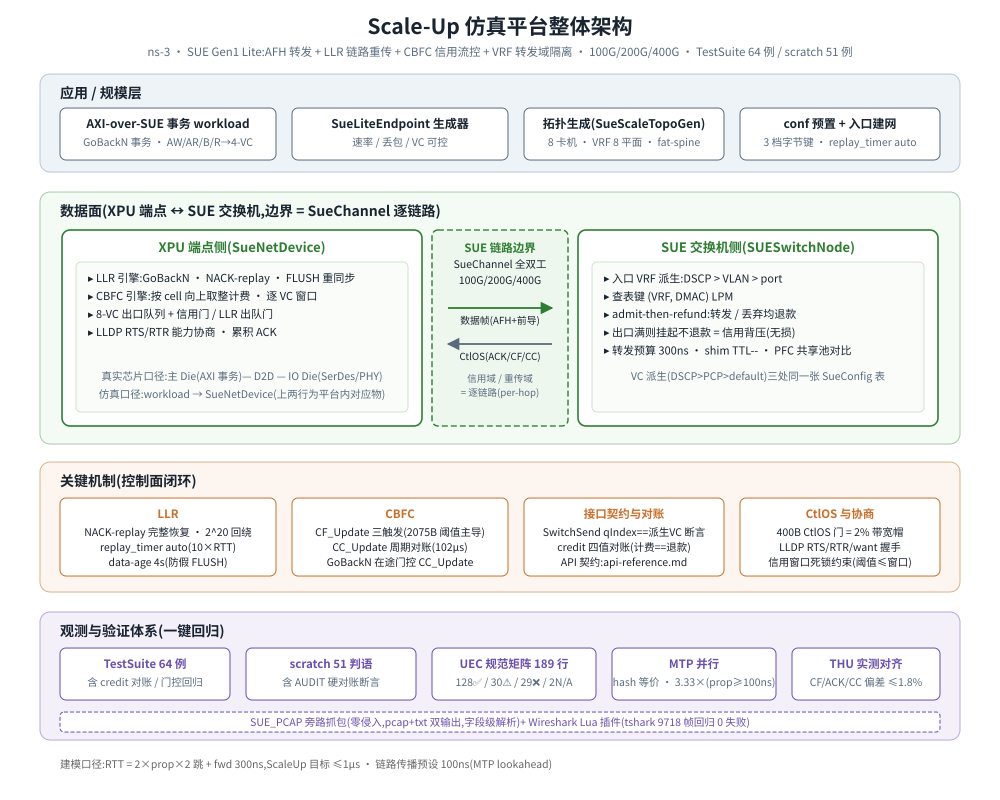

# SUE Scale-Up 仿真平台阶段性总结(2026-08-17)

> 基线:2026-08-17 主分支(TestSuite 61 例 / scratch 47 判语全 PASS)。
> 数据口径:仿真器 = ns-3 MAC 层速率,NS 分辨率 1ns(子 ns 线时经 PS 分辨率);THU = 交换机实测(reference/THU-SPEC.md)。

## 1. 整体实现方案

### 1.1 目标与范围

在 ns-3 上实现 **UEC(Ultra Ethernet Consortium)SUE Gen1 Lite** 规范的 scale-up 转发仿真平台,覆盖链路层重传(LLR)+ 信用流控(CBFC)+ 能力协商(LLDP RTS/RTR)+ PFC 对比基线(32 平面 all-to-all 实测 CBFC vs PFC A/B,§12.43),支持 100G/200G/400G 端口速率与交换机 VRF 转发域(端口/VLAN/DSCP 三源映射,默认 VRF0,§12.40),并可复现 THU 交换机的实测控制面行为。

### 1.2 整体架构



自上而下四层:**应用/规模层**(拓扑生成、3 档 conf 预置、入口建网)→ **数据面**(主机/端点与多级交换机经 SueChannel 全双工互联,设备内 LLR/CBFC/LLDP 引擎 + 出口队列,交换机侧含出口→入口信用背压)→ **关键机制**(LLR 重传协议、CBFC 信用流控与 CF_Update 三触发、400B CtlOS 门、RTS/RTR 握手)→ **验证体系**(TestSuite + scratch 自检 + UEC 规范矩阵 + MTP 等价 + THU 实测对齐)。

### 1.3 CF_Update 三触发模型(THU 对齐核心)

UEC §5.2.6.1 双触发 + 数据量阈值触发,三键合流:

```
收帧 → R_VC_CF 累计
        ├─[CBFC_CF_THRESHOLD_BYTES] 累计 ≥ 2075B ──→ 逐量子触发(数据量主导,速率无关)
        ├─[CBFC_CF_MIN_TIMER_BYTES] 距上一条 ≥ 地板 ──→ 放行(0=无引擎地板,400B 门兜底)
        └─[CBFC_CF_MAX_TIMER_BYTES] 周期全量上报(丢 CF 自愈)
```

- **字节键语义**:阈值字节 × 端口速率 = 恒定周期字节数 → CF 计数 ∝ 流量字节、速率无关;控制开销比跨速率恒定。
- **THU 实测验证**:默认档等效周期 2074.7B 三速率恒定;max 档 960B 字节地板 ×2/×4 精确——字节键被 THU 数据实锤(§thu-cf-update-verify 3.10/3.13)。

### 1.4 THU 对齐方法

不依赖任何实现内部细节,仅以 THU 交换机实测数据(reference/THU-SPEC.md)反推控制面三键的等效参数并落入预置:默认档等效周期 2074.7B(阈值 2048B + ~27B 消息线时)、max 档 960B 字节地板、CC 周期 102.1µs——三列实测全部由仿真配置复现(§2.3),偏差来源与口径说明见 §2.4。

### 1.5 验证体系

- **TestSuite 61 例**(`./run-sue-tests.sh`):LLR 两相/三行为、NACK-replay、seq 回绕、CF_Update 节奏/丢帧补偿、LLDP 四象限、VC 映射、**VRF 转发域(§12.40)**、**延迟退款 preamble 不变性(§12.42)**、PFC 共享池、计数器保真……
- **scratch 47 判语**(`./run-scratch-checks.sh`):自检式 PASS/FAIL 单程序验证(含 11 条 CF 速率扫描配方 + **VRF 32 平面 all-to-all LLR=1/0 双档 + CBFC vs PFC A/B 档**,§12.41/§12.43)
- **UEC 规范矩阵**:docs/combined-l6-specs.csv 189 行 → 128 ✅ / 30 ⚠️ / 29 ❌ / 2 不适用
- **MTP 并行等价**:多线程 vs 单线程行为 hash 逐字节一致

## 2. THU 交换机实测对照(偏差小结)

### 2.1 LLR ACK CtlOS 速率(spacing 档位)

THU 配置值 2KB=2048B 与仿真预置一致(400G 档 2050B,见口径说明)。

| spacing | THU 100G | 仿真 100G | 偏差 | THU 400G | 仿真 400G | 偏差 |
|---|---|---|---|---|---|---|
| 512B | 13,023,635 | 25,000,000 | ⚠️ THU 疑点 2(实测只有 line/512 一半) | 52,091,758 | 100,000,000 | ⚠️ 同上方向 |
| 2KB(default) | 6,300,654 | 6,134,969 | -2.6% | 24,414,902 | 24,390,244 | **-0.1%** |
| 16KB | 765,992 | 763,359 | **-0.34%** | 3,051,795 | 3,058,104 | +0.21% |
| 20KB(max) | 612,229 | 610,501 | **-0.28%** | 2,441,358 | 2,444,988 | +0.15% |

- 2KB 档 100G 行的 -2.6% = THU 按 64b/66b 物理层速率(103.125G)计数的口径差(400G 行 THU 按 MAC 干净计数,直接可比:-0.1%)。
- 16KB/20KB 档偏差 ≤0.34%(除 512B 档的 THU 疑点 2 外)。

### 2.2 CBFC CC_Update 速率(时间键,与速率无关)

| 档 | THU | 仿真 | 偏差 |
|---|---|---|---|
| default | 9,790/s | 9,804/s(102µs) | **+0.14%** |
| min | 1,222/s | 1,222.5/s(818µs,可表达) | +0.04% |
| max | 7,814,426/s | —(128ns 低于 µs 键分辨率) | SDK 芯片粒度,仿真键不可表达(已记录) |

### 2.3 CBFC CF_Update 速率(字节键,三速率表)

| 列 | THU 100G/200G/400G | 仿真 | 偏差 |
|---|---|---|---|
| default | 6,024,685 / 12,050,807 / 24,101,669 | 6,076,220 / 12,189,700 / 24,528,300 | +0.9% / +1.2% / +1.8% |
| max | 13,020,601 / 26,046,236 / 52,091,984 | 13,157,800 / 26,315,600 / 52,631,200 | +1.05% / +1.03% / +1.04% |
| min(仅 100G) | 993,479 | **触发口径 993,479/s 精确命中**(消息 ×4 批量差异) | 0% |

- default 列 = 阈值 2075B(2048B 阈值配置 + ~27B CF 消息自身线时计入计数器)主导;残差 = 周期全量叠加 +0.66% + 组帧效率 + NS 网格。
- max 列 = 960B 字节地板;+1.0% = NS 网格(76.8→76ns)。
- 扫档曲线与模型公式**精确一致**(scratch sue-cf-rate-scan,11 配方全 PASS):threshold 扫档 200B..256KB = line/(8×T);CF_MIN 扫档 256B..64KB = 1/⌊CalculateBytesTxTime⌋。

### 2.4 口径说明(偏差来源,均已文档化)

1. **64b/66b 口径**(thu-spec-compliance 疑点 5):THU 100G/200G ACK 行按 103.125G/206.25G 计数,400G 行按 MAC——同一张表混用口径,待 THU 确认统一。
2. **NS 分辨率网格**:1ns 下 2048B@400G=40.96ns 截断 40ns(+2.4%)——400G 预置改 2050B=41.0ns 精确消除;2075B@400G=41.5ns 落 41ns(+1.2%,1ns=50B 分辨率下不可避免)。
3. **消息批量**:仿真 CF_max 周期全量按 UEC 报全部 8 VC = 4 条/次;THU 每触发 1 条——触发速率一致(0.55% 内)。
4. **512B ACK 档与 CF min 档**:THU 侧配置语义待确认(疑点 2 / min 档 993,479/s 的对应配置),建议 THU 读回实际生效值。

## 3. 数据面仿真曲线

### 3.1 Incast 2:1(两个 2048B 帧源 → 单出口,各端口速率)

| 速率 | 出口(host2 汇聚) | 源 0 | 源 1 | 无损交付 | replay/discard |
|---|---|---|---|---|---|
| 100G | **97.9352 Gbps**(钉线速 97.9%) | 48.9652(50%) | 48.9652(50%) | 122,072/122,072 | 0 / 0 |
| 200G | **195.871 Gbps** | 97.933(50%) | 97.933(50%) | 122,072/122,072 | 0 / 0 |
| 400G | **391.734 Gbps** | 195.868(50%) | 195.868(50%) | 122,072/122,072 | 0 / 0 |

时间序列(200G,每 200µs 采样):0–400µs 窗口填充爬坡(48.9→97.9 Gbps/源),之后**双源交替钉在 97.9 Gbps、出口恒定 195.87 Gbps**——2:1 超额带宽被交换机出口信用背压吸收:
- 交换机 egress VC 队列满 → 持有 R_CF 退款(switch pending maxDepth=226,累计 121,817 帧)→ 发送端 credit_exhausted 累计 293,208 → 两侧公平 50/50(共享 VC0 FIFO)。
- 全程无 LLR replay/discard、无丢帧——**无损 incast**。

### 3.2 LLR 丢包/无丢包速率曲线(100G,10Gbit,2048B 帧)

| 场景 | 吞吐 | 相对 clean | replay | nack | discard |
|---|---|---|---|---|---|
| 无丢包(clean) | **97.9301 Gbps** | — | 0 | 0 | 0 |
| 丢包 1/100 | 95.148 Gbps | -2.84% | 6,227 | 6,227 | **0** |
| 丢包 1/1000 | 97.652 Gbps | -0.28% | 611 | 611 | **0** |
| 丢包 1/10000 | 97.914 Gbps | -0.02% | 61 | 61 | **0** |

- **NACK-replay 完整恢复**:四种场景收齐 610,352/610,352 帧,重传计数 = NACK 计数(每丢一帧重传一次,无重复/漏传),discard 恒 0。
- 吞吐损失随丢包率非线性收窄:1/100 丢包率仅损失 2.8% 线速(重传仅占 ~3% 带宽),1/10000 损失 0.02%。
- 无损 clean 基线 97.93% 线速 = 协议开销(12B IFG + 8B preamble + ACK CtlOS 占返回链路,全双工不影响数据向)。

### 3.3 CBFC 信用窗口曲线(THU 对齐后的新曲线,creditSize=56B,512B 帧)

阈值即时退款(CBFC_CF_THRESHOLD_BYTES=2075,CF_MIN=0),交互图表见 [credits-vs-rate.html](test-report/credits-vs-rate.html):

| 窗口 CL(credits) | 窗口字节 | 100G 吞吐 | 400G 吞吐 | 说明 |
|---|---|---|---|---|
| ≤9 | ≤504B | **0(死锁)** | 0(死锁) | 窗口放不下单帧(526B = 512 载荷+14 头,计 ceil(526/56)=10 credits) |
| 10 | 560B | 0.055 Gbps | 0.219 Gbps | 单帧在途,退款须等第 2 帧跨 2075B 阈值或 CF_max 周期兜底 → 逐帧节流 |
| 16/32 | 896B/1.79KB | 0.055 / 0.171 | 0.219 / 0.684 | 同上(窗口 < 阈值+单帧) |
| 47 | 2.63KB | **92.49 Gbps** | **369.97 Gbps** | 窗口 ≥ 阈值 2075 + 单帧 526 = 2601B → 阈值即时退款,线速 |
| ≥48 | ≥2.69KB | 93.47 Gbps | 373.86 Gbps | 平坦(93.5% 载荷效率天花板:512/546≈93.8%,差值=ACK/CtlOS 线占) |

- **线速窗口下界 = 阈值 + 单帧**(2075+526=2601B → CL=47),模型与实测精确吻合;
- 对比旧曲线(CF_MIN=125000 每 10µs 退款,§12.36 实测,CS=256/2048B 帧):64/128/256/512 credits → 11.5/22.9/45.9/91.8 Gbps@100G——**退款节奏 60× 变快后窗口需求大幅下降**,小窗口场景行为与 THU 交换机同构("阈值 ≤ 窗口"死锁约束,§9 已文档化)。

**曲线陡峭的理论解释与链路时延关系**(2026-08-14 实测验证,§12.39):

阈值即时退款下窗口曲线是**台阶形**(死锁 → 节流 → 跳变到线速),不是经典"窗口 ∝ BDP"的线性爬坡——后者是定时器/往返节拍退款时代的规律。三段模型(离散量化精确版):

| 区间 | 机制 | 速率 |
|---|---|---|
| CL < ⌈F/CS⌉(≤9) | 放不下单帧 | 0 |
| k×F < Q(在途批次 k=⌊CL/⌈F/CS⌉⌋ 帧跨不过阈值) | 靠 CF_max 周期(100µs)兜底 | ≈ 2.2×kF/100µs,**与时延无关**(实测 prop 0/1000ns 相同) |
| k×F ≥ Q | 批次内跨阈值 → 退款即时到达 | 线速 × kF/(kF + RTT×线速),RTT 小时即线速 |

- **跳变点是离散量化的**:CL = ⌈Q/F⌉×⌈F/CS⌉(Q=2075/F=526/CS=56 → CL=40,实测 CL=39 节流 0.171 / CL=40 跳变 92.49 Gbps);
- **释放量子 Q 的影响**(THPT_CF_THRESHOLD 扫描):跳变点随 Q 迁移——Q=8192→CL=160(92.90)、Q=16384→CL=320(93.33 Gbps);控制报文频率 = 数据率/Q(Q 越大越省);
- **延迟释放/链路时延的影响**(THPT_FWD_NS/THPT_PROP_NS 扫描):RTT 每加一个转发预算或传播时延,速率 = 线速×W/(W+RTT×线速)——fwd=300ns 实测 CL=47 从 92.49 掉到 37.50 Gbps、CL=128 完全恢复;prop 0/100/500/2000ns → 92.49/42.95/13.76/3.87 Gbps;
- **几何意义**:`W = RTT×线速` 时恰为半速——事件驱动退款下 **BDP 是半速点而非线速点**;跳变点本身与时延无关。
- 工程含义:窗口选型 = 防阈值死锁下界(⌈Q/F⌉×⌈F/CS⌉)+ RTT 补偿余量;拥塞时限速靠**延迟释放**(出口服务时间计入退款 RTT),不靠窗口值。

### 3.4 creditSize 无关性结论

五种 creditSize(32/56/64/128/256B,UEC/THU 56B cell 在内)× 窗口 8..1024 credits 的完整矩阵(交互图表 [credits-vs-rate-creditsize.html](test-report/credits-vs-rate-creditsize.html))的结论:**曲线只由信用窗口字节数(CL×creditSize)决定,与 creditSize 本身无关**——字节归一后五种 creditSize 逐点完全重合,线速窗口下界恒为"阈值 + 单帧"。creditSize 只影响该下界折算成 credits 的数量(2601B ÷ creditSize),不改变字节语义。

## 4. 其他成果与开放项

### 4.1 其他成果

- **UEC 规范覆盖**:189 条逐条判定(128 ✅ / 30 ⚠️ / 29 ❌ / 2 N/A),含 5 项合规缺口报告(thu-spec-compliance)。
- **MTP 并行等价**:多线程分区模拟与单线程**行为 hash 逐字节一致**(NACK/FLUSH 双模式),CF 触发网格按绝对时刻调度、与线程数无关。
- **replay-buffer 理论模型**:NS 分辨率量化(slot 10ns、RATE_MAC 10000 B/µs)下的缓冲下界公式与实测逐点验证(误差 ≤13.7%)。
- **长突发 seq 回绕修复**:512B 小帧 10Gbit 长突发(244 万帧 = 2.33 次 2^20 seq 回绕)暴露接收侧回绕后全部判 missing 的缺陷——每回绕丢 ~3 帧;修复后零丢失零 NACK,并新增 TestSuite 回绕用例(§12.38)。

### 4.2 开放项(诚实披露)

1. THU 2KB ACK 列 100G/200G 行 64b/66b 口径混用(疑点 5,待 THU 确认统一)。
2. THU 512B ACK 档实测只有 line/512 一半(疑点 2,待确认测量条件)。
3. THU CF min 档(993,479/s)的对应配置语义待 THU 侧确认(建议读回实际生效值)。
4. MTP 并行加速比:64 机 7.5× 倒退**根因已定位并修复**(§12.46:lookahead=0 轮数暴雨;smoke/stress 预设 100ns 已落地——stress sat **3.33×**、smoke **1.74×** 正加速,sat 截面积 93.7%→90.85% 为 RTT 代价;历史 prop=0 口径可复现);VRF 32 平面 SPLIT 变体(§12.45)1.89×。fork 级优化(空 LP 跳过/时钟读去除/屏障改造)候选待评审。
5. UEC 规范矩阵剩余 30 行 ⚠️ 中 C 类 29 行的后续评估。

---

数据与文档索引:THU 对照 [thu-cf-update-verify.md](thu-cf-update-verify.md) §3.13 / [thu-spec-compliance.md](thu-spec-compliance.md);实现基准 [DESIGN.md](../DESIGN.md) §12.37;测试 [test-report.md](test-report.md)。
