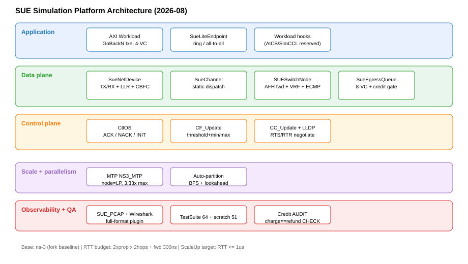
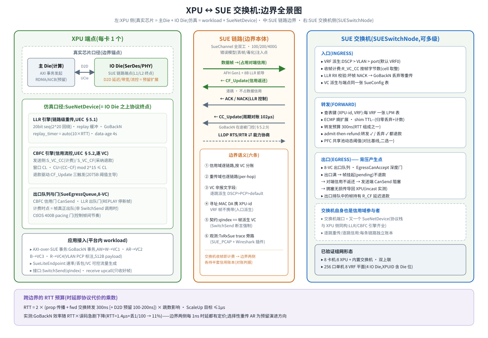
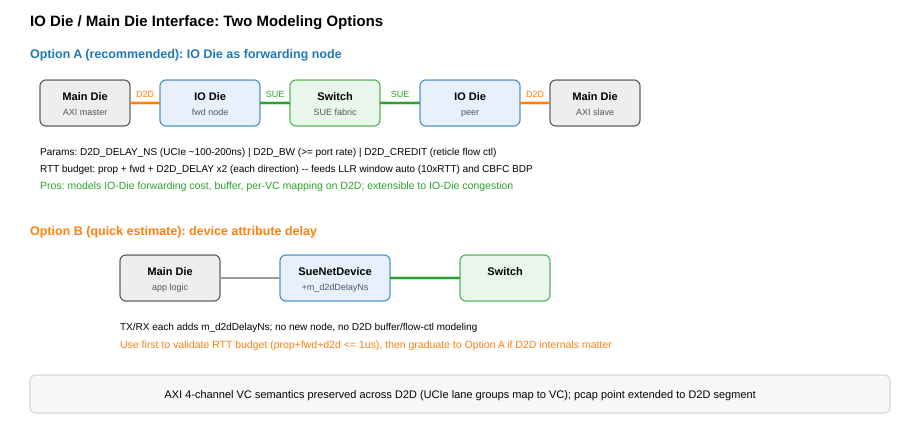

# SUE 仿真平台:能力、使用条件与扩展接口(2026-08-25,08-27 增补边界图)

> 面向新使用者的平台总览:能仿真什么、怎么用、边界在哪、以及 IO Die 扩展的接口设计。
> 设计基准 `DESIGN.md`;测试全集 `docs/test-cases.md`;排查档案 `docs/rtt-investigation-2026-08.md`。

---



## 0. XPU ↔ SUE 交换机边界(2026-08-27 增补)



要点:**信用域与重传域都终止在每条 SUE 链路上**(per-hop,交换机每个端口是全协议栈);
VC / VRF 均非报文字段(VC 逐跳派生 DSCP>PCP>default,VRF 在交换机入口 DSCP>VLAN>port
派生);拥塞传导路径 = 交换机出口满 → 挂起不退款 → 对端信用不返还 → XPU 发送门阻塞
(无损背压);接口契约 `SwitchSend(qIndex==帧派生 VC)` 带断言强制。整体架构四层视图见
`images/sue-arch.svg`(2026-08-27 修订,★ 标注 08-17 基线后的新增)。

## 1. 平台能力总览

| 能力 | 载体 | 状态 | 关键指标 |
|---|---|---|---|
| AFH Gen1 转发 | SUESwitchNode(LPM/ECMP/VRF) | ✅ | 4 组合(±shim/±VLAN);VRF 8 平面精确隔离(4 IO Die,XPUID 含 Die 位) |
| LLR 链路级重传 | SueLlrEngine(NACK-replay/FLUSH/INIT) | ✅ | 丢 1/100 吞吐仅损 2.8%(2 节点);GoBackN 窗口=RTT 窗口 |
| CBFC 信用流控 | SueCbfcEngine(阈值+CF_min/max 三触发) | ✅ | THU 对齐 ≤1%;incast 2:1 无损钉线速 |
| PFC 对比基线 | SuePfcEngine(共享池动态阈值) | ✅ | 同量 A/B:PFC 生效即塌落(99.97%→45.4%) |
| AXI 事务 workload | sue-axi-workload(GoBackN+4-VC) | ✅ | RTT=1µs 130.8Gbps 双向零回滚 |
| 多线程 MTP | NS3_MTP(自动分区) | ✅ | stress 3.33×/VRF-SPLIT 1.89×/smoke 256 机 2.53× |
| 报文级观测 | SUE_PCAP + Wireshark 插件 | ✅ | 全格式解析;9718 帧回归 0 失败 |
| 规模 | 8 卡机+2-plane fat spine | ✅ | 64/128/256 超节点冒烟全 PASS |
| 回归体系 | TestSuite 64 + scratch 51 判语 | ✅ | 含 VC credit 对账/CC_Update 门控等防护用例 |

## 2. 使用条件

**构建**:`./build.sh`(CMake 直调,GCC15/Py3.14 workaround 已固化);勿建 `all`。

**运行入口**:
- 回归:`./run-sue-tests.sh`(64 例,0.6s)/ `./run-scratch-checks.sh`(51 判语)
- MTP:`./run-s8-mtp.sh [2,4,8]` / `./run-vrf-mtp.sh [2,4,8]`
- 场景:`./run-s5c-thpt.sh` / `./run-s5e-incast.sh` / AXI 直接跑 scratch 二进制

**建模口径(必须理解)**:
- 端口速率按 ns-3 MAC 层;NS 分辨率 1ns;**链路传播时延预设 100ns**(MTP lookahead,
  §12.46;`SCALE_PROP_NS=0` 可复现历史)
- **replay_timer / data-age 用 auto/4s**(§12.53/§12.48:规范 10×RTT;短值在高 RTT
  下引发假 FLUSH/放大)
- CF_Update 逐跳(单跳传播);CBFC 信用窗 = per-VC 独立(无跨 VC 依赖)
- RTT 双口径:**LLR 回环 = 2×链路时延**(ACK/NACK 邻接终结不穿芯片,fwd 不计入);E2E/CBFC ≈ 2×prop×跳数+fwd(300ns)。ScaleUp E2E 目标 ≤1µs

**已知边界**:
- GoBackN 在 RTT×误码联合高时代价大(RTT=1.4µs+丢 1/100 → 效率 11%)——协议本质,
  非 bug;选择性重传 AR 是预留扩展位
- MTP 满负载需 prop≥100ns(lookahead=0 轮数暴雨,§12.46)
- 应用层为 AXI 事务模型(4 通道→4-VC),无完整 RDMA/AICB(§1.2 预留)

## 3. IO Die / 主 Die 接口设计(建议,未实现)

真实 AI 芯片:主 Die(计算)↔ IO Die(PHY/SerDes)↔ Scale-Up 网络。D2D 接口
(UCIe/XSR/BoW)承担 Die 间搬运。**仿真建模建议**:



### 方案 A:IO Die 作为转发节点(推荐,可仿真转发代价)

```
主Die ──D2D── IO Die ──SUE链路── 交换机 ──SUE── IO Die ──D2D── 主Die
```

- IO Die = 新节点类型(或复用 SUESwitchNode 的转发预算参数):入口收 AXI 事务帧 →
  D2D 延迟(`D2D_DELAY_NS`,UCIe 典型 ~100-200ns)→ 出口上 SUE 链路
- **关键参数**:`D2D_DELAY_NS`(逐跳固定延迟)、`D2D_BW`(D2D 带宽,通常 ≥ 端口
  速率避免成为假瓶颈)、`D2D_CREDIT`(D2D 流控窗,UCIe 有 reticle 级流控)
- AXI 4 通道在 D2D 段保持 VC 语义(UCIe 多 lane 归属 VC),映射关系可配
- 优点:RTT 组成显式(prop + fwd + d2d),可直接仿真"IO Die 内延迟对 LLR 窗口/GoBackN
  代价的放大"(本案已证明 RTT 是 GoBackN 代价的乘数)

### 方案 B:IO Die 作为设备属性(简化,只加延迟)

`SueNetDevice` 加 `m_d2dDelayNs`(TX/RX 各加一次),不建节点。适合快速评估,无法仿
真 IO Die 内部缓冲/流控。

### 与现有模型的衔接

- AXI workload 的 master/slave 逻辑不变,发送目标从网卡改为 IO Die 的 D2D 端口
- LLR 窗口推导(auto 10×RTT)自动包含 d2d 延迟;CBFC 信用窗需求同理(BDP 增大)
- 抓包点扩展到 D2D 段(需新的 trace source,建议沿用 SueScratchPcap 模式)

**参数建议(方案 A)**:

| 参数 | 建议值/来源 | 说明 |
|---|---|---|
| D2D_DELAY_NS | 100–200ns(UCIe 典型) | 主Die↔IO Die 单向;计入 RTT → 影响 LLR 窗口(auto 10×RTT)与 CBFC BDP |
| D2D_BW | ≥ 端口线速(如 200G→≥220G) | 低于线速会成为假瓶颈,需显式声明 |
| D2D_CREDIT | UCIe reticle 流控窗 | 防止 D2D 段成为无建模的无限缓冲 |
| VC 映射 | AXI 4 通道→UCIe lane 组→VC | 与现有 PCP→VC 恒等映射衔接(AUDIT 自动覆盖) |
| 抓包点 | D2D 段新 trace source | 沿用 SueScratchPcap 模式 |

**RTT 预算核算**(ScaleUp 目标 ≤1µs,prop=300ns 档):
`RTT = 2×(prop 300 + fwd 300 + d2d 100~200) ≈ 1.4~1.6µs` —— **加入 IO Die 后
预算紧张,prop 可能需降到 100ns 档或 fwd/d2d 优化**;这正是方案 B 先验证的价值。

**实现优先级建议**:先用方案 B 验证 RTT 预算(prop+fwd+d2d ≤1µs 是否成立),再按需
落方案 A。

## 4. 快速上手路径

0. `docs/api-reference.md` — **对外接口契约**(SwitchSend/Receive/SendCtl*/交换机背压三件套/引擎对账查询/装配 checklist/常见误用)
1. `docs/demo-guide.md` — 演示手册(10 分钟精华路线)
2. `docs/validation-report.md` — 验证报告(用例/输入/预期/实测)
3. `docs/app-notes.md` — 应用实例集(本文档姊妹篇)
4. `DESIGN.md §12.41-53` — 本期全部演进记录
