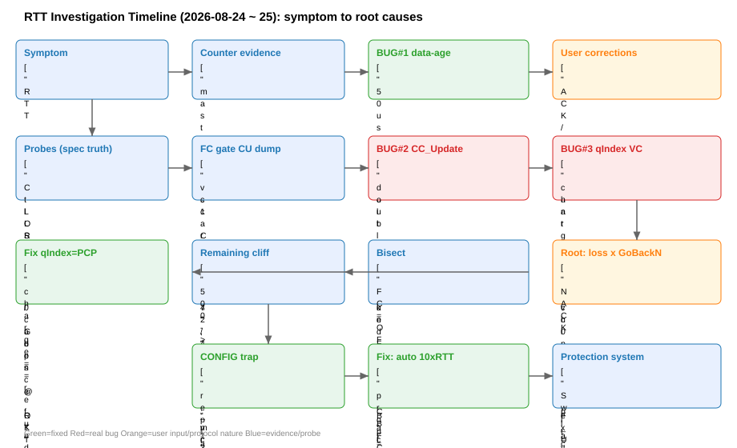
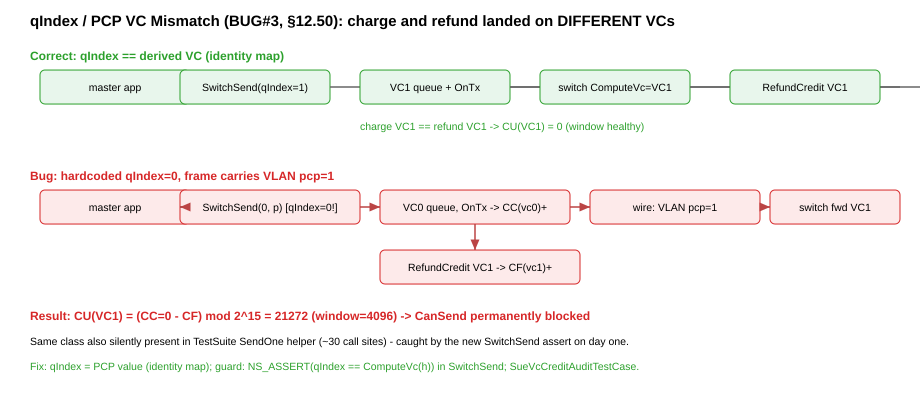
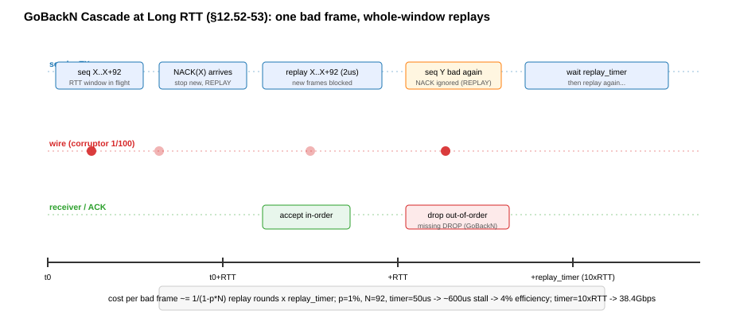
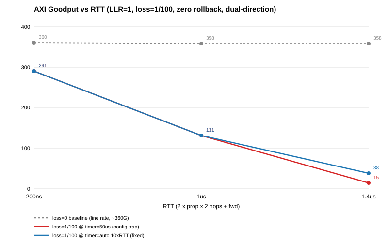

# RTT×LLR×CBFC 排查档案(2026-08-24 ~ 08-25)

> 背景:AXI workload 按用户要求做 RTT 扫描(100ns~1000ns,目标 ScaleUp RTT≤1µs),发现
> LLR=1 在 RTT≥1µs 时带宽断崖(0 Gbps)→ 经 8 轮排查定位 **3 个真缺陷 + 1 个协议本质
> 代价 + 1 个配置陷阱**,全部闭环。本档案按时间线记录完整排查过程、每个结论的证据、
> 用户的关键纠正、以及沉淀的防护体系——防止同类问题复发,也为后续排查提供方法论。

---

## 1. 现象与时间线

**起点**:AXI workload RTT 扫描(prop=链路传播时延,RTT=2×prop×2 跳 + fwd):

| prop | RTT | LLR=1 带宽(loss=1/100) | LLR=0 带宽 |
|---|---|---|---|
| 100ns | ~400ns | 110.6 Gbps | 17.5 |
| 500ns | **~1µs(目标)** | **0 Gbps(FULL FAIL)** | 17.9 |
| 700ns | ~1.4µs | 0 Gbps | 15.2 |
| 1000ns | ~2µs | 0 Gbps | 17.5 |

用户判断"是不是死循环了"——**部分正确**(下面 §2 假死循环)。



整个排查的证据链如上图:蓝=证据/探针、绿=已修复缺陷、红=真 bug、橙=用户输入/
协议本质。**关键转折点有三处**:④用户纠正方向(排除 ACK 饿死假设)、⑥CU dump
发现 mod-2^15 假满、AUDIT 绝对值对账一击定位 VC 错配。

---

## 2. 缺陷①:LLR data-age 50µs 误触发 FLUSH(假死循环)

**证据**:设备计数器诊断(scratch 新增 dev[n][d] llr/cbfc 打印)——master `discard=3504`
(发送侧 FLUSH 丢帧)、交换机 `rx_missing=16201`、retries=672(>500 事务,多笔多次回滚)。

**根因**:axi conf 未设 `LLR_DATA_AGE_TIMER_MAX_NS` → 注册默认 50µs。长 RTT 下 replay
风暴使帧在 replay buffer 滞留 >50µs → 被误判"数据过期" → FLUSH → 丢帧 → 事务超时 →
回滚 → 重发 → 又风暴……直到 maxRetry abort。thpt 的注释早已写明"data-age 调到 4s,只有
真断链才 FLUSH"——**axi 漏配**。

**修复**:conf 加 `LLR_DATA_AGE_TIMER_MAX_NS 4000000000`(4s)。RTT=1µs 从 0 恢复到
61.6Gbps 零回滚。(commit 2720f0f,§12.48)

**附带**:timeout 公式加 RTT 项(8×prop);CheckTimeouts 扫描上限 10ms→800ms。

---

## 3. 用户纠正①:ACK 不应饿死 CF_Update;② CF_Update 是逐跳的

**用户指出**(查 SDK 后):芯片里 LLR ACK 与 CF_Update 计数 1:1,不存在 ACK 一直发、
CF 被挤;优先级语义是"同频率下优先 ACK";且 **CF_Update 是直连链路(单跳),没有端到
端 RTT**。

**探针验证**(TransmitControl + OnDrain + SendCfUpdateBatch 三级探针):
- CtlOS 发送节奏 82ns/条正常,ACK 未物理占满时隙 → **用户的"ACK 未饿死 CF"判断正确**
- CF_Update 每 4 帧阈值触发正常(2075B/526B)
- 我此前的"3×RTT 退款环路"框架**错误**,已修正(逐跳模型)

**插队修复无效果**(CF_Update 插到排队 ACK 前)——反证 ACK 不是瓶颈。尝试保留在历史
记录,最终随探针回退。(commit 24ec140 记录了结论)

---

## 4. 决定性发现:CU 假满 → Credit 绝对值对账

FC gate 探针(DequeueAndTransmit 的 q<0 处 dump CU):

```
vc0:CU=4094/4096  vc1:CU=21272/4096  vc2:CU=32709/4096   ← 窗口全 4096!
```

**CU=(S_VC_CC−S_VC_CF) mod 2^15**;巨大 CU ⇔ 退款超前计费 ~11496 credits(多退 23%)。

**方法论转折点**:此前多轮探针都在推测"多退从哪来"(方向错误);**credit 绝对值对账
(AUDIT:master CC/CF vs switch RCC/RCF 四值并排)一打印就定位了**——计费全在 vc0,
退款全在 vc1。

## 5. 缺陷②:CC_Update 双退(UEC §5.2.9 note 3)

**按用户指引查规范**:note 3"previously discarded LLR-eligible packets make the CC
counter checks invalid";note 1"they will be updated later when retransmits land"。

机制:RxFrame 对乱序帧 `return DROP`(GoBackN,§5.1.7)→ NACK 清除后、重传帧未全部
计费的间隙内,CC_Update 把在途重传误判 lost 并虚退 → 重传落地又正常退 → **双退**。

**实现**(最小侵入):LLR 引擎 discard 跟踪(m_discardMaxSeq,missing DROP 记录最高
丢弃 seq,next_rx_seq 越过清除)+ 设备 CC_UPDATE 接收分支 `HasPendingDiscard()` 时
丢弃整条。**窗口保持 spec 字面**(NACK 清除即关),rule 3/9 语义不变。
(commit 73b72de,§12.49)

**两次错误尝试留档**:① guard 时间扩窗 50µs → rule 9 副作用(CC_Update 不发)反噬;
② m_discardMaxSeq 初始 0 是合法 seq,首次比较语义错 → 窗口卡死。教训:**首次丢弃无
条件记录;窗口不扩,只门控 CC_Update 处理**。

## 6. 缺陷③(真根因):qIndex/PCP VC 错配

**AUDIT 揭示**:计费(master OnTx,按入队 qIndex)在 **vc0**;退款(交换机
RefundCredit,按 ComputeVc)在 **vc1** → CU(vc1)=(0−CF) mod 2^15 假满。

**根因**:AXI scratch 6 个发送函数硬编码 `SwitchSend(0, p)`,而帧 VLAN pcp=1/2/3/4。
thpt 复制来的 qIndex=0(单 VC 恰好正确),AXI 4-VC 场景首次暴露。



如上图:同一个帧,入队走 qIndex=0(计费记 VC0),线上的 VLAN pcp=1 让交换机
转发/退款走 VC1——**计费与退款分裂在两个 VC**。VC1 只有退款没有计费,
CU=(0−CF) mod 2^15 直接翻到 21272,CanSend 永久假阻塞。

**修复**:qIndex=PCP(PCP→VC 恒等映射)。对账清零(CC=RCC、CF=RCF、CU=0),带宽
×2.6:prop=100/300/500/700 → **290.7/199.8/130.8/14.6 Gbps**。(commit ec301bc,§12.50)

修复前后的 credit 对账(以 prop=500ns 为例):

| VC | 修复前 master CC / switch RCC | 修复前 master CF / switch RCF | 修复后 |
|---|---|---|---|
| vc0 | **48250** / 48250 | 0 / 0 | 0/0, 0/0 |
| vc1 | 0 / 0 | **15482** / 15482 | 48250/48250, 15482/15482 |
| vc2 | 0 / 0 | 250 / 250 | 250/250, 250/250 |
| CU | vc1 假满 17286 | — | **全 0** |

**用户追问"为什么基本功能还有 bug"的复盘**(三点盲区):已有测试恰好全单 VC;API 无
防御(SwitchSend 信任 qIndex);症状伪装成模型 bug(CU mod 翻转像"多退")。

## 7. 防护体系(用户指令:绝不能再出现 VC 计数错配)

三层(commit 093078b,§12.51):
1. **API 防御断言**:SwitchSend 内 `NS_ASSERT(qIndex == ComputeVc(h))`——上线即抓到
   TestSuite SendOne 的存量错配(服务 30 处调用,credit 计费 VC 一直错)
2. **TestSuite 62→64**:SueVcCreditAuditTestCase(VC1-6 端到端五值闭环)+ 
   SueCcUpdateDiscardGateTestCase(§12.49 回归)
3. **scratch 硬断言**:AXI AUDIT 升级 CHECK,每臂每 VC 强制对账

## 8. 剩余断崖:坏帧 × GoBackN 交互

**二分排除**(AXI_FC/AXI_FWD_NS 旋钮):FC=OFF 与 CBFC 逐位同 → 排除;fwd 无关;
**loss=0 时 prop=700ns 线速 357.8Gbps → 崩塌只由坏帧触发**。



**机制**(上图):坏帧 X → NACK → 重传整个 RTT 窗口(X..X+92,~2µs 线时)→ 期间
新帧全部停止(REPLAY 态)→ 重传中 seq Y 又坏(92 帧 × 1%≈0.92 个)→ 新 NACK
**被 REPLAY 态忽略**(符合 UEC §5.1.4)→ 只能等 replay_timer 到期再重放 → 级联。
(commit 7a056d1,§12.52)

**放大源闭环**(§12.53):REPLAY 中 NACK 被忽略(符合 UEC §5.1.4)+ replay_timer
硬编码 50µs(规范明确建议 **10×RTT**)→ 每坏帧 ≈12 轮×50µs。Timer 扫描 50/20/10/5µs
→ 14.6/31.1/49.8/71.0 Gbps 线性确认。**修复**:conf 改 auto(10×RTT)→ 38.4Gbps。
(commit b93f436)



**最终曲线**(LLR=1,loss=1/100,零回滚,双向):

| prop | RTT | 带宽 | loss=0 基线 | 效率 |
|---|---|---|---|---|
| 100ns | 200ns | 290.7 | 360 | 81% |
| 500ns | 1µs(目标) | 130.8 | 358 | 36% |
| 700ns | 1.4µs | 38.4(修复前 14.6) | 358 | 11% |

剩余衰减 = GoBackN 协议本质代价(UEC 预留选择性重传 AR 的动机)。

---

## 9. 方法论沉淀

1. **对账先于推测**:计数器类 bug,先做两端绝对值对账(AUDIT 四值),再做机制推测——
   本案多轮探针方向错误,对账一击定位。
2. **用户/规范的领域知识是捷径**:两次关键纠正(ACK/CF 1:1、CF_Update 逐跳)和一次
   规范指引(§5.2.9 note 3)都直接改变了排查方向。**实现疑问先查 spec 再发明修复**。
3. **API 防御 > 测试覆盖**:SwitchSend 断言上线即抓存量错配,比任何事后测试都快。
4. **配置也是代码**:50µs replay_timer、50µs data-age 都是"合法但错误"的配置——conf
   预置须与规范建议值(auto)对齐,显式值需注释出处。
5. **mod 空间的静默失败**:CU mod 2^15 翻转后巨大值被当"窗口满"而非错误——循环计数
   器上界断言(CU≤CL)现已入 AUDIT CHECK。

## 10. 涉及参数速查(本案教训值)

| 参数 | 本案错误值 | 正确值 | 依据 |
|---|---|---|---|
| LLR_DATA_AGE_TIMER_MAX_NS | (漏配→默认 50µs) | **4s** | thpt 注释/spec:仅真断链 FLUSH |
| LLR_REPLAY_TIMER_MAX_NS | 50000(50µs) | **0=auto(10×RTT)** | UEC §5.1.4 line 276 |
| SwitchSend qIndex | 0(硬编码) | **=ComputeVc(h)** | 计费/退款同 VC 恒等 |
| 事务 timeout | 无 RTT 项 | 500×K×wire+16×prop+500µs | 覆盖 CBFC 背压+RTT |
| 事务 retry timeout(丢帧快速恢复) | — | 同上(短值在高 RTT 误超时) | §12.48 教训 |
| CheckTimeouts 扫描上限 | 10ms | 800ms | 覆盖 Stop=1s |
