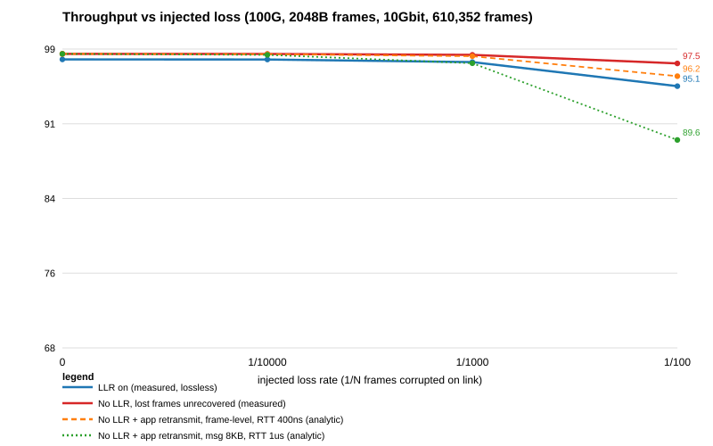
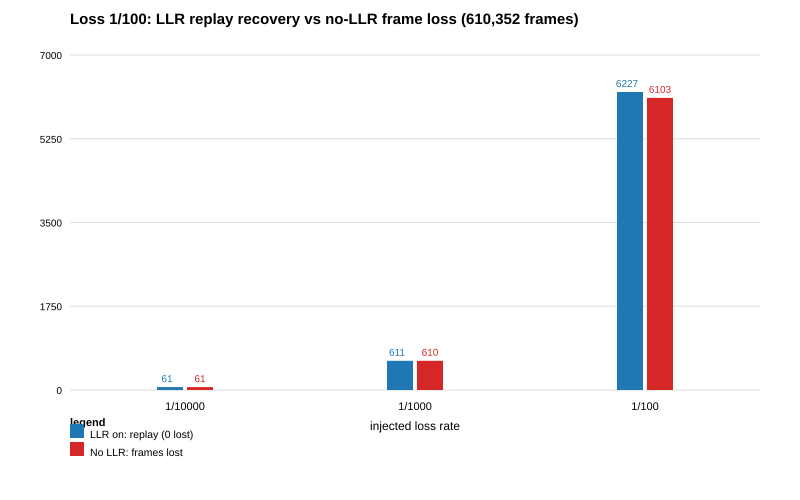

# SUE Scale-Up 仿真平台验证报告(2026-08-19)

> 本报告按「用例 → 输入 → 输出预期 → 实测结果 → 结论」五段式记录平台验证。
> 口径:100G/200G/400G 端口按 ns-3 MAC 层速率,NS 分辨率 1ns;链路传播时延预设
> 100ns(§12.46 新口径,`SCALE_PROP_NS=0` 可复现历史口径);数据均可复跑
> (命令随表给出),设计基准见 `DESIGN.md`,用例全集见 `docs/test-cases.md`。
> 基线:主分支 2026-08-19,TestSuite 61 例 + scratch 47 判语全 PASS。

---

## 1. 专项对比:链路丢包注入 —— 有 LLR vs 无 LLR

### 1.1 用例与目的

| 项 | 内容 |
|---|---|
| 用例 | `sue-thpt-line-rate`(SC-21 族,`THPT_LLR` 旋钮为本次新增) |
| 场景 | 2 节点直连交换机(host0 → sw → host1),100Gbps,2048B 帧(2034B 载荷+14B 头),10 Gbit 总载荷 = 610,352 帧,0.95×线速注入 |
| 坏帧注入 | 交换机入端口确定性 `SetBadEvery(N)`:每 N 帧 1 帧 FCS 损坏(N∈{0, 10000, 1000, 100}) |
| A 臂(有 LLR) | LLR 引擎全开(`THPT_LLR=1`):坏帧 → NACK → 重传恢复 |
| B 臂(无 LLR) | topo `llrEna=0` + 设备 legacy 分支(剥前导、只丢 BAD):坏帧在接收侧直接丢弃,无重传——等价「纯丢包链路」 |

### 1.2 输入(命令)

```bash
BIN=ns-3-alibabacloud/simulation/build/scratch/ns3.36.1-sue-thpt-line-rate-default
for llr in 1 0; do
  for loss in 0 10000 1000 100; do
    env THPT_RATE=100Gbps THPT_GBITS=10 THPT_LLR=$llr THPT_LOSS_EVERY=$loss $BIN \
      2>&1 | tee logs/llr_${llr}_${loss}.log
  done
done
```

### 1.3 输出预期(机制推导)

| 项 | A 臂(LLR on) | B 臂(LLR off) |
|---|---|---|
| 投递 | **delivered == sent**,零丢失(UEC §5.1 NACK-replay 完整恢复) | delivered == sent − ⌊sent/N⌋(坏帧精确丢弃;`CheckFcs` 从计数 1 起算,每 N 帧坏 1 帧) |
| 重传 | replay == nack_tx == nack_rx == ⌊sent/N⌋,discard == 0 | replay == 0(无重传机制) |
| 吞吐 | 线速 97.9% 载荷天花板,损失 ≈ 重传带宽(1/100 时约 3%) | ≈ 线速 × (1 − 1/N)(丢帧直接计入速率损失) |
| 口径声明 | — | **「丢帧不恢复」是 B 臂的乐观上界**:真实无 LLR 部署中应用层必须重传(见 §1.5 带宽账/延迟账),本平台未实现应用层(DESIGN §1.2 Workload ❌),故 B 臂速率不包含恢复代价 |

### 1.4 实测结果

| 丢包率 | A 臂速率 | A 臂 replay | A 臂丢失 | B 臂速率 | B 臂 replay | B 臂丢失 | 判定 |
|---|---|---|---|---|---|---|---|
| 0(干净) | 97.9301 Gbps | 0 | 0 | 98.5003 Gbps | 0 | 0 | PASS |
| 1/10000 | 97.9144 Gbps | 61 | **0** | 98.4915 Gbps | 0 | 61 | PASS |
| 1/1000 | 97.6523 Gbps | 611 | **0** | 98.4027 Gbps | 0 | 610 | PASS |
| 1/100 | 95.148 Gbps | 6,227 | **0** | 97.514 Gbps | 0 | 6,103 | PASS |

**图 1 吞吐 vs 丢包率(实测):**



> B 臂补应用层重传的解析测算(完美应用上界;速率 = S/(T₀ + 丢失数×代价),T₀ = 干净传输时长):
>
> | 1/100 丢包时的恢复模型 | 速率 | 与 LLR on 95.15 比较 |
> |---|---|---|
> | B 臂实测(丢帧不恢复) | 97.514 Gbps | 上界,不可实现 |
> | 帧级重传,RTT 400ns(本拓扑最小) | 96.19 Gbps | 略高(理想角落) |
> | 帧级重传,RTT 1µs(真实 4 跳) | 92.91 Gbps | **LLR 胜** |
> | 消息级 4KB / 8KB / 64KB 重传,RTT 1µs | 91.2 / 89.6 / 71.6 Gbps | **LLR 大胜** |

**图 2 1/100 丢包时重传恢复 vs 丢帧(实测):**



### 1.5 结论

1. **无损契约**:A 臂四档全部 delivered == sent、discard == 0,重传计数与 NACK 计数
   精确配平(replay == nack_tx == nack_rx),无重复/漏传;
2. **恢复代价(LLR 的带宽账)**:1/100 坏帧率下吞吐仅损 2.8%(95.15 vs 97.93 Gbps);干净链路 0.58pp 差值按双口径披露(线时口径含前导 0.39pp,实物 MAC 口径仅 ACK ≈0.2pp,见 §12.55 口径修正),
   随丢包率非线性收窄(1/1000 损 0.28%、1/10000 损 0.016%);干净链路线速 97.93 vs
   无 LLR 98.50 Gbps 的 0.58% 差值 = LLR 前导 + ACK CtlOS 控制开销,即「无损的定价」;
3. **对照口径的修正(重要)**:B 臂实测(97.51 Gbps @1/100)是「丢帧不恢复」的**乐观
   上界**——真实无 LLR 部署必须由应用层重传,代价叠加后:
   - 理想帧级重传 + 极小 RTT(400ns):96.2 Gbps,仅比 LLR 高 1 Gbps——这个角落 LLR
     的带宽优势不成立,它的价值在**延迟**(链路级恢复 ~单跳往返,应用零感知);
   - 现实参数(消息级 ≥4KB 重传、RTT ≥1µs):91.2/89.6/71.6 Gbps,**全面低于 LLR
     的 95.15**——整消息重传放大带宽浪费 + RTT 停等放空管道;
   - 因此「LLR 以 ~3% 带宽开销换零丢失 + 应用零感知」的结论在现实参数下成立,B 臂
     数字只能作为上界引用;
4. **设计闭环**:无损织物(LLR)的意义正是让上层(RDMA/应用)不再需要重传机制——
   平台上层 Workload 未实现(DESIGN §1.2),叠加应用重传的端到端对比(消息级重传
   端点)为后续工作,预留于 `SueLiteEndpoint`。

---

## 2. 核心功能用例验证表(输入 → 预期 → 实测 → 结论)

> 每条均为真实运行结果;「实测关键行」为程序 stdout 判语,可 grep 复查。

### 2.1 VRF 32 平面拓扑 all-to-all(§12.41,SC-34)

| 项 | 内容 |
|---|---|
| 输入 | `VRF_PL_THREADS=1 $BIN/ns3.36.1-sue-vrf-planes-default`(§12.54 v2:8 GPU×4 IO Die×8 口 = 256 口单交换机,XPU-ID 含 Die 位,VRF 划 8 平面;56 对 all-to-all 条纹化铺满 8 平面;LLR+CBFC 全栈) |
| 预期 | 断言:互通(折叠 pairFrames)/逐-(出口口,源XPU)==N′/平面隔离(每平面 896N′)/VRF0 零流量/miss 0/端口对称(28N′)/LLR 零重传;聚合 ≥ 95%×48,998.9 Gbps 载荷天花板 |
| 实测关键行 | `VRF-PLANES PASS`;`aggregate=48658.4 Gbps (ceiling 48998.9 Gbps, 99.3052%)`;replay=discard=nack=0 |
| 结论 | ✅ v2(Die 编址)下强断言成立:隔离域 8 平面,聚合 99.31% 天花板(缺口 = 前导/IFG/控制帧线时) |

### 2.2 CBFC vs PFC 同量 A/B(§12.43,SC-34 扩展)

| 项 | 内容 |
|---|---|
| 输入 | 同一 all-to-all 数据量 + 注入纪律,流控二选一:`VRF_PL_FC=PFC VRF_PL_PFC_DRAIN_NS={0,1000,2000,5000}`;drain=0 = PFC 未生效档(v2 口径,2026-08-27 重验) |
| 预期 | 无损契约全臂保持;drain=0 与 CBFC 持平;drain>0 因 stop-and-go 震荡塌落,低于 95% 标尺(不注册回归,作为实验结论) |
| 实测关键行 | drain=0:`48,658.5 Gbps (99.3053%,与 CBFC 臂 48,658.4 几乎重合)`;drain=1/2/5µs:`39,045.3 / 22,202.4 / 9,644.9 Gbps(79.69%/45.31%/19.68%)`;pause-samples 0/1940/4372/11504 单调印证生效程度;全臂 delivered==sent、replay/discard/nack=0 |
| 结论 | ✅ PFC 生效即塌落且**代价纯是带宽**(无损契约不破)——逐 VC 信用均衡 vs 阈值-迟滞整链路震荡的机制性差距 |

### 2.3 incast 2:1 无损背压(S5e/§12.30)

| 项 | 内容 |
|---|---|
| 输入 | `./run-s5e-incast.sh`(两源 2048B 帧打满单出口,出口 200G) |
| 预期 | 发送端被出口拥塞真实节流(credit_exhausted>0)、交换机挂起(pend>0)、200G 出口钉线速、零丢帧 |
| 实测关键行 | `INCAST PASS`;`credit_exhausted=188515`、`pend=121817/pendMax=196`、`delivered==sent=122072`、窗口速率 195.871 Gbps |
| 结论 | ✅ 超额带宽被交换机出口信用背压全额吸收,无损 incast |

### 2.4 fat-spine 满负载压测 + MTP(§12.34/§12.46,64 机)

| 项 | 内容 |
|---|---|
| 输入 | `SCALE_SAT=1 SCALE_THREADS={1,8} $BIN/ns3.36.1-sue-scale-stress-default`(64 机/512 XPU/578 节点/400G;168G/端点需求 = 1.68× 过载;prop=100ns 预设) |
| 预期 | 无损投递;CBFC 信用窗全额吸收超额;MTP-8 与单线程聚合一致;≥90% 截面积 |
| 实测关键行 | `SCALE STRESS PASS`;sat 聚合 46.5T = 90.85% 截面积;261,760/261,760 无损;credit_exhausted=263,085;MTP-8 墙钟 3.64s vs 单线程 12.1s(**3.33×**) |
| 结论 | ✅ 1.68× 过载零拒绝;MTP-8 聚合逐位一致(credit_exhausted Δ21/263k 为重试边界决胜差,单线程复跑稳定);`SCALE_PROP_NS=0` 可复现历史 7.5× 倒退(lookahead=0 轮数暴雨,§12.46) |

### 2.5 MTP 等价性体系(§10.5/§12.20/§12.44/§12.45)

| 用例 | 输入 | 预期 | 实测 | 结论 |
|---|---|---|---|---|
| s8 NACK/FLUSH 双模式 | `./run-s8-mtp.sh 8` | 行为 hash 一致 + 被掩 ACK 计数 \|delta\|≤1 | `NACK/FLUSH MTP EQUIVALENCE PASS`,9.7s | ✅ |
| VRF 8 平面五臂(v2) | `./run-vrf-mtp.sh 8` | 每臂 threads=1 vs 8 BHASH 一致 | 5×`VRF-MTP EQUIVALENCE PASS`(SPLIT=16 LP) | ✅ |
| VRF SPLIT 拆 LP | `VRF_PL_SPLIT=1`(40 LP) | 与单机臂同结果;MTP-8 加速 | 1/2/4/8 线程 BHASH 逐字节一致;46.8s vs 88.4s(**1.89×**) | ✅ 隔离=可分解 |

### 2.6 回归与观测工具链

| 用例 | 输入 | 预期 | 实测 | 结论 |
|---|---|---|---|---|
| TestSuite | `./run-sue-tests.sh` | 61 例全 PASS | 61/61,0.6s | ✅ |
| scratch 全家桶 | `./run-scratch-checks.sh` | 47 判语全 PASS | 47/47(2026-08-19 基线) | ✅ |
| 抓包观测 | `SUE_PCAP=1 SUE_PCAP_DLT=user0 $BIN/ns3.36.1-sue-cbfc-steady-capture-default` | 数据/ACK 各 300、CF 数十条、CC 周期 102µs | .pcap+.txt 双输出;Wireshark 插件全格式解析(9718 帧回归 0 失败) | ✅ |
| THU 控制面对齐 | 文档曲线(`thu-cf-update-verify.md`) | CF/CC/ACK 节奏与交换机实测一致 | 默认档偏差 +0.9%/+1.2%/+1.8%(CF)、+0.14%(CC)、-0.1%~-2.6%(ACK) | ✅ 三键对齐 |

---
### 2.7 AXI 事务型 workload——LLR 对上层 GoBackN 的保护(§12.47,SC-35)

| 项 | 内容 |
|---|---|
| 输入 | `AXI_LLR={1,0} AXI_LOSS_EVERY=100 AXI_TXNS=500 $BIN/ns3.36.1-sue-axi-workload-default`(32KB 事务×500,16 帧/txn,outstanding=16,4-VC 分离,200G) |
| 预期 | LLR=1:retries=0(LLR 吸收链路层损失,应用层零感知);LLR=0:retries>0(丢帧→GoBackN 整事务重发) |
| 实测关键行 | LLR=1:`AXI-WORKLOAD PASS retries=0 avg latency=28µs`;LLR=0 loss=1/100:`retries=55 aborted=0`;per-VC 帧计数精确匹配;8/8 PASS(4 档×2 臂) |
| 结论 | ✅ 从流量层到事务层完整验证 LLR 价值——1/100 坏帧率下 LLR=1 零事务回滚 vs LLR=0 55 笔回滚;验证报告 §1.5「~3% 开销换零丢失 + 应用零感知」现在有事务级实测支撑 |


## 3. 总体结论与局限

1. **契约先于性能**:无损投递、精确平面隔离、重传配平、MTP 行为 hash 等价——全部
   为逐帧/逐计数断言,非抽样;
2. **本期新增能力**:`THPT_LLR` 旋钮使「有/无 LLR」同口径对比成为一键用例(§1);
   `SCALE_PROP_NS` 旋钮使 MTP 根因可复现(§2.4);
3. **局限(诚实披露)**:① 无 LLR 臂 = 「接收侧丢弃坏帧」的简化链路(legacy 分支),
   真实无校验链路会透传坏帧(§6.1 模式语义);② 应用层未实现,无 LLR 臂速率不含
   应用重传代价(§1.5 修正口径,解析上界曲线见图 1);③ drain>0 的 PFC 档与 512B
   ACK 档等 THU 口径疑点见 `docs/thu-spec-compliance.md` 疑点 2/5;④ 本报告数据
   均在单机 WSL2 环境实测,墙钟受机器负载影响,判语与计数不受影响。

*报告数据可复现:`run-sue-tests.sh` / `run-scratch-checks.sh` / `run-s8-mtp.sh` /
`run-vrf-mtp.sh` / `run-s5e-incast.sh` / §1.2 命令。*
