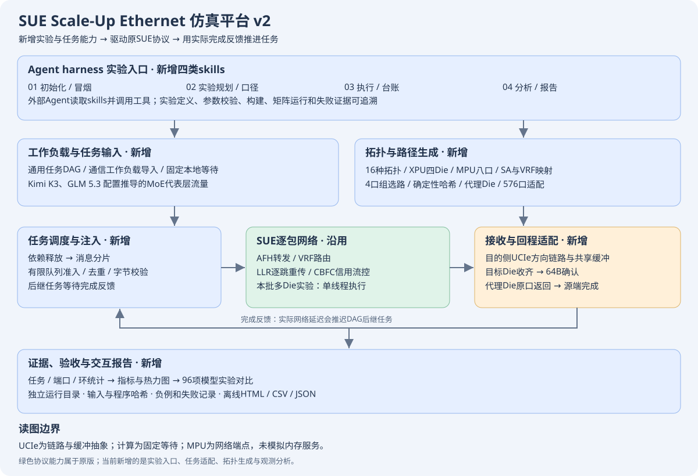

## 相对最初版的新增特性

当前扩展版本统一命名为 **SUE Scale-Up Ethernet 仿真平台 v2**。本节以最初下载的项目为起点，汇总实验编排、AI通信负载以及多Die拓扑适配的全部增量；后面的实验结果使用这一版本生成。

原版已经具备SUE AFH转发、LLR逐跳重传、CBFC信用流控、PFC对比、VRF分表、多线程框架，以及4 Die×8口、8张卡单交换机的专用测试和AXI读写事务示例。**这些协议和基础能力沿用原实现。v2新增的是将它们组织成可配置的任务实验平台，并补充大规模拓扑、组选路、目的侧Die转交和结果审计。**

### 新增能力架构图

蓝色为新增实验与任务能力，绿色为沿用的SUE协议，橙色为新增的端点与UCIe抽象。箭头表示配置、执行和完成反馈的关系。

### 新增能力总览

| 能力 | 最初版的基础 | v2增加的内容 | 用来回答的问题 |
|---|---|---|---|
| Agent harness 实验入口 | 配置文件、C++示例及各自的运行脚本 | 新增初始化、实验规划、运行、分析四类Agent skills，配套配置校验、构建、案例矩阵、证据与失败台账工具 | 如何由Agent将自然语言需求转成可执行、可复现的实验 |
| 通用任务DAG | 固定通信模式与专用事务驱动 | 任意合法依赖关系、消息分片、接收完成反馈、本地等待、通信工作负载导入 | 后续通信什么时候才能启动，拥塞如何传递到整个任务窗口 |
| 端点注入与完成语义 | 原有网卡队列和交换机背压 | 应用注入前检查有限队列、分片去重与字节校验；拓扑入口等待原口确认 | 数据是已入队、已到达，还是整个通信事务已结束 |
| 多Die拓扑生成 | 特定8卡、4 Die、32口测试 | 16种纯XPU/混合/拆轨拓扑，统一端口表、SA与VRF路由生成 | 拓扑方案是否真的满足容量、隔离与可达性约束 |
| 端口组选路 | 交换机ECMP及直接指定发送设备 | 源Die选择4口组，确定性哈希决定组内口，整条消息固定该口 | 一跳可达能否由选组保证，还是依赖哈希结果 |
| 目的侧UCIe环 | D2D接口设计建议，未实现本方案的环 | 双向四Die环、方向带宽、逐跳延迟、有限共享缓冲与排队 | 跨Die绕行需要多久，会不会成为拥塞点 |
| 接收侧代答与回程 | 专用AXI事务示例 | 静态代理Die、目标Die收齐、64B确认返回代理并从原口回源 | 请求和响应是否遵守同轨、同口的返回约束 |
| MPU接入 | 通用网络端点原语 | 8口MPU身份、混合接线、选组与内存池隔离验证 | 哪些Die能访问哪些MPU，错误组及跨池路径是否被拒绝 |
| 576口交换机 | 设备容器可增长，但端口VRF表只覆盖256口 | 将端口到VRF配置缓存扩到1024项，覆盖576口档 | 大端口交换机后半段的端口是否仍正确隔离 |
| 576卡寻址 | 10位查表键，专用测试使用chip×4+die | pure-rail中以chip查表、MAC低位保留完整Die身份 | 超过256张四Die卡后是否出现地址截断或别名 |
| 模型工作负载 | 网络及事务测试程序 | Kimi K3、GLM 5.3冻结配置驱动的MoE代表层生成器 | 两种通信模式在不同拓扑上的消息量、路径和时延差异 |
| 可观测性与报告 | 协议计数器、测试日志和专用分析 | 任务/端口/环统计、原始CSV、十类交互图、筛选与下载 | 能否从实际数据解释排队、尾时延和路径变化 |
| 可复现验证 | 原有协议与场景测试 | 输入/二进制/库哈希、独立运行目录、负例留存、25项验收和96项模型实验 | 一次结果能否追溯输入与实现，失败是否被如实保留 |

### Agent harness：让Agent组织实验的入口与工具

新增四类入口：`sue-welcome`负责初始化和冒烟，`sue-plan-experiment`负责实验设计与比较口径，`sue-run-experiment`负责执行与证据留存，`sue-analyze-results`负责结果分析和报告。它们配合通用任务入口 `harness/sue_harness.py` 与多Die拓扑入口 `harness/v2/run.py`，提供配置生成、输入校验、构建、批量矩阵、指标分析和失败台账能力。

这里的Agent harness是供外部Agent读取skills并调用确定性工具的实验工作流；四类skills是能力分工，不代表运行了四个自主Agent，后端也没有内置大模型推理服务。自然语言需求最终落为可检查的配置和命令，执行结果保留原始证据。

### 1. 从固定测试流量扩展到通用任务DAG

v2把通信和本地等待表示为任务。每个任务记录源、目的、字节数、等待时间、VC、依赖任务和标签；多Die入口进一步记录源/目的chip、Die及端口组。执行前检查端点合法性、重复依赖、依赖环和本地等待语义。

例如，“dispatch完成 → 专家计算等待 → combine → 下一步dispatch”可以直接作为依赖图执行。一个任务也可以等待多个前驱，实现fan-in。网络变慢会推迟任务完成，从而推迟真正依赖它的任务；无需预先把所有消息的开始时间写死。

同时新增通信工作负载导入：将支持的一向消息操作转换为任务、保留字节与阶段依赖。它保留的是通信需求，不会自动还原原系统的所有传输事务、计算行为或物理拓扑。

**与真实情况的对应：** AI通信通常由前序算子或通信结果触发，DAG表达这种因果关系。当前计算仍用固定等待近似；多个等待可以并发，不占用GPU执行单元，也不模拟专家、HBM或计算队列。依赖完成通知是固定延迟的调度事件，不是额外网络报文。

### 2. 消息分片、有限注入和明确的完成时刻

应用消息按有效载荷上限分片，末片保留真实长度。端点在发送前检查对应VC的出口队列；队列满时保留进度、稍后重试。新增的是应用层与有限发送队列的衔接，原来的CBFC和交换机背压机制继续工作。

接收侧按任务和分片去重，检查完整源目的地址、有效字节数和接收端身份。多Die入口区分两个时间：`data_end_ps`表示目标Die收齐请求，`end_ps`表示确认已经回到源端原口；后续DAG依赖后者。通用单口入口保留其“目的端收齐即完成”的语义，两个入口的时间不能不加说明地混用。

**与真实情况的对应：** 应用入队、网络送达和事务结束是不同阶段。该实现能够表现源端排队及等待远端完成的影响。任务/分片标签仍是仿真元数据，不额外占线上字节；它不是完整传输层、NCCL channel调度或内存一致性实现。

### 3. 16种拓扑成为可执行配置

在原有多端口和VRF基础上，v2新增以下完整的映射族：

| 家族 | 已适配档位 | 主要差异 |
|---|---|---|
| 完整轨纯XPU | 8、16、32、64卡 | 单台多VRF到一轨一台交换机 |
| 拆轨纯XPU | 128奇偶分面、128分法轮转、256卡 | 同轨按Die分区，部分跨Die需要目的侧转交 |
| XPU＋MPU | 6+8、8+8、32+32、64+64主方案、64+64内存池备选 | MPU接入位置、可用端口组和跨池可达性不同 |
| 576口交换机 | 18卡、16+8、144卡、576卡 | 大端口规模及大地址规模适配 |

生成器逐端口记录chip、Die、口号、交换机、VRF和面板物理端口号。执行前验证端口唯一性与守恒、容量边界、每SA每域至多一口、R1隔离和R2跨卡同Die同口号可达。按这些映射安装静态VRF路由，不让通用BFS通过多端口主机寻找跨平面捷径；所有方案都没有ISL。

**与真实情况的对应：** 接线位置决定可用路径和资源共享，不能用一条聚合大带宽链路替代。这里创建了每条实际规划的200G链路，但仍没有验证OSFP分支、lane顺序、SerDes或Gearbox能否实现该接法；软件可连接不等于实物可布线。

### 4. 源端4口组选路及哈希约束

组0为口0–3，组1为口4–7。软件只能给出组号，后端用种子、任务ID及源目的chip/Die进行确定性哈希，选择组内一个口。消息的全部分片固定在该口；没有通过逐包喷洒或指定某个好口绕开组约束。

自动模式只在整个组均可到达时选择该组。64+64主方案中，偶Die到MPU使用组0，奇Die使用组1；轮转方案中，组内不同口可能得到不同的直接/绕行路径。强制错误组或跨内存池路径会被记录为不可达。

**与真实情况的对应：** 这表达了“软件能选组，但不能选具体口”的控制边界。哈希函数和流标识是当前仿真假设，尚未校准到具体芯片；当前也未实现链路故障后的自动重选。不可达任务在发送前拒绝，不注入数据帧，因此负例检查的是路径约束，而不是实际交换机丢包率。

### 5. 有带宽、缓冲和排队的目的侧UCIe环

每张XPU的四个Die连接成 `0↔1↔2↔3↔0` 双向环，共8条独立方向链路。跨Die请求先经过一台SUE交换机，到达目的卡代理Die后再进入环；源侧不会先换Die再上网。环上使用最短路，对角等长时取顺时针。

环转交逐包计算序列化时间和每跳延迟。每卡设共享在途包池，包在到达目标Die前一直占用该池；后续包会与已在途包竞争方向链路。池满时，端点暂不退还SUE接收信用，形成从Die内部向外部网络传递的背压。当前矩阵采用每方向400G、每跳20ns、每卡64KiB缓冲。

**与真实情况的对应：** 跨Die搬运会消耗带宽、占用缓冲并产生动态排队，因而不能只加固定等待。当前是包级互连抽象，尚未实现UCIe PHY、flit格式、真实信用协议或每链路独立缓冲。这些速率和时延是明确的实验参数，不是实测值。验收中将环速率从400G降到100G，检查窗口变长，并验证缓冲峰值不越界。

### 6. 接收侧代理、代答及原口响应

当目标Die在当前转发域内没有直连口时，选择目的卡中同域且离它最近的Die作为代理，同距取最小编号。请求送达代理后经环转交；目标Die收齐消息后生成64B确认，经环返回代理，再从请求进入的同一端口发出，最后到达源端原口。

后端检查实际代理Die、轨号、源目的身份和回程口。报告中的0/1/2次UCIe分类统计请求方向；响应的环流量另计入环链路字节，不从请求路径图中推算。

**与真实情况的对应：** 这实现了本方案要求的原轨、原口返回约束。原版已有AXI读写示例；本次新增的是与多Die拆轨、代理及环转交结合的确认机制。64B确认只表示通信收齐，不表示数据已经写入内存，也不是完整AXI五通道、原子操作或一致性协议。

### 7. MPU的身份、连通性及当前用途

MPU建模为独立chip、Die固定为0、带8个200G端口的通信端点。其网络端口使用真实SUE队列、LLR和CBFC，按混合方案接入相应交换机与VRF。涉及MPU的任务必须直接可达，不通过UCIe兜底。

新增验证覆盖XPU0各Die与每片可达MPU的双向消息、MPU间测试消息、64+64主方案的正确/错误组，以及备选方案的同池可达和跨池拒绝。接收端收齐后原口返回64B确认。

**本报告的Kimi/GLM主实验没有使用MPU存放权重、KV cache、激活或优化器状态，也没有加入MPU offload流量。** MPU的节点、链路和协议控制活动存在，但模型的数据通信全部在XPU之间。当前没有MPU内存容量、服务带宽、读写时延、控制器排队或地址空间模型，因此不能用这些实验评价MPU带来的显存扩容或模型加速。

### 8. 576口配置和576卡寻址适配

原交换机端口容器可以增长，但原版入口端口→VRF缓存仅256项。逐包验证发现，第257口之后会失去正确映射；v2将这张配置缓存扩为1024项，覆盖576口方案。该修改不改变原有端口的映射语义，也没有修改LLR、CBFC或AFH转发算法。

原来的 `chip×4+die` 编码在256张四Die卡时已用满1024个查表键。576卡pure-rail中，每个域只有一种Die，因此v2以chip作为10位查表键，并在MAC低位保留完整chip/Die身份，收发均核对完整地址。不同Die由物理转发域区分，不扩大SUE报头。

**与真实情况的对应：** 域内路由键与全局端点身份需要同时正确，避免截断后把不同卡误认成同一目的。该编码适用于这里的pure-rail域结构，不是任意2304个SA同域寻址方案。576卡已作为软件逻辑规模运行，真实芯片的chip-id上限仍需单独解决。

### 9. Kimi K3与GLM 5.3的模型通信生成器

新增生成器读取冻结的两份模型配置，按专家数、top-k、通信宽度及指定精度推导记录大小，再生成专家选择、专家放置、dispatch/combine消息及阶段依赖。不同拓扑复用同一随机种子和token数，按卡数重新映射端点；本地命中不产生外部网络消息。

当前覆盖prefill代表层、4步decode、训练代表层前向与反向。decode的专家集合以0.75概率沿用前一步；BF16通信和每记录8B元数据是显式假设。输入保留每条token→expert路由以及阶段标签，能够检查记录数、字节守恒和依赖关系。

**与真实情况的对应：** MoE路由决定稀疏通信矩阵，消息到达会影响后续计算/通信启动。这里使用的是配置推导＋合成路由，不是线上trace；没有完整注意力、TP/PP/DP、优化器通信、共享专家计算、动态batching或真实GPU执行。因此输出是代表层通信窗口，不是完整模型TTFT、TPOT或训练step时间。

### 10. 实验编排、证据、指标与交互报告

v2新增输入校验、自动构建/运行、独立运行目录、命令及输入快照、SHA-256、超时与失败状态。重复运行保留前次记录，错误组和跨池测试保持failed状态，由验收程序确认它们按预期拒绝。原有协议测试继续作为基础，本次新增25项验收记录、通用入口11项回归，以及96项模型矩阵实验。

新增三类可关联的统计：任务记录消息到达、确认返回和实际选路；端口记录面板身份、发送占用、控制/重传及信用检查；环记录方向字节、排队和共享池峰值。报告把这些数据做成完成窗口、路径构成、时延CDF、Die通信矩阵、交换机最忙出口和任务时间线，并提供模型/窗口/拓扑筛选、CSV导出及每图口径说明。

**与真实情况的对应：** 将逻辑任务与物理路径关联，才能解释“为什么慢”。信用检查失败次数不是阻塞时长，跨链路wire字节不是应用有效载荷，最忙出口占用率不是交换机平均利用率；本报告分别标注，避免把这些指标混用。HTML已做96个视图的DOM逻辑检查，未声称完成真实浏览器的像素验收。

### 功能范围与验证结论

| 入口 | 已接入的能力 | 当前边界 |
|---|---|---|
| 通用任务入口 | 单交换机/leaf-spine、DAG、消息导入、参数扫描、单线程/MTP、CBFC/PFC/OFF | 单口host模型，不能直接承载本文全部多Die拓扑 |
| 多Die拓扑入口（本报告使用） | 16种拓扑、MPU接入、组选路、环转交、原口确认、模型窗口与逐路径统计 | 当前为单线程、200G外链、LLR＋CBFC；尚未接入MTP及PFC/OFF |

**已验证：** 16种拓扑均通过逐包功能测试；96个合法模型实验全部完成；主动错误注入触发LLR恢复；环限速和缓冲边界有效；错误MPU组与跨池路径按预期拒绝。

**仍需校准或扩展：** GPU/专家/HBM排队、MPU内存服务、真实UCIe协议、实际哈希与lane映射、故障口重选、完整模型工作负载及多种子统计。这些内容没有因为版本更名或拓扑跑通而被视为已实现。

---

### 报告可视化的补充

参考已有实验报告的呈现方式，本报告增加卡间请求量矩阵、源卡任务并发热力图、交换机端口组发送占用热力图和专家分配负载图。共十类数据图，另有新增能力架构图。图表均从已有任务、端口统计及专家路由输入重新聚合，未改变实验结果。

当前仍未采集端口带宽、交换机队列深度随时间的完整序列，所以端口热力图展示整段实验的平均发送占用；任务并发图展示每个时间桶内的平均未完成网络任务数，不能当作瞬时吞吐、GPU利用率或队列长度。专家分配图是输入路由次数，也不等于计算负载实测。
